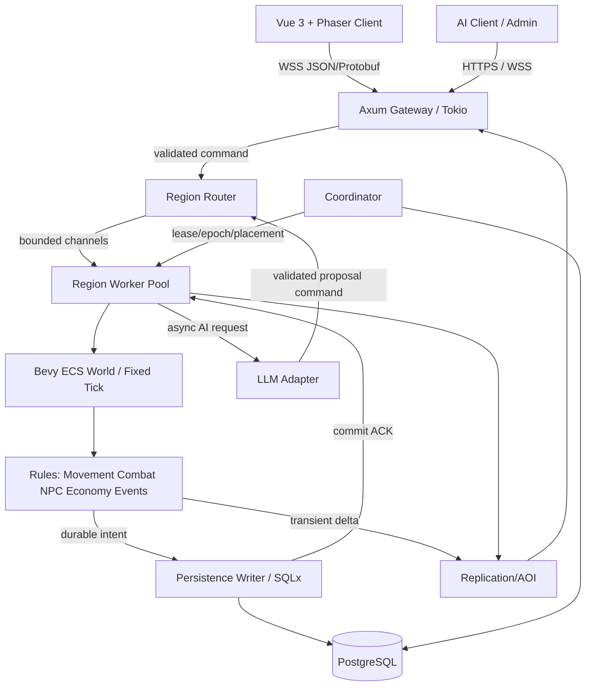
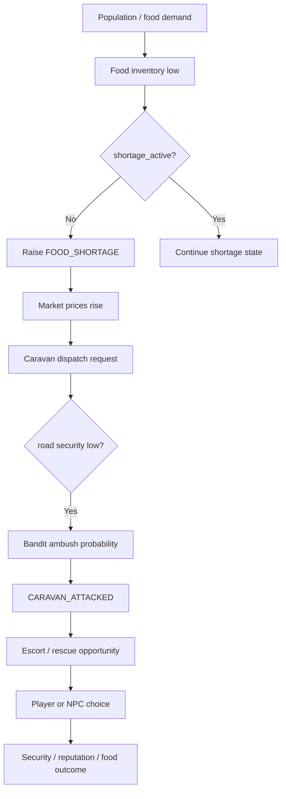
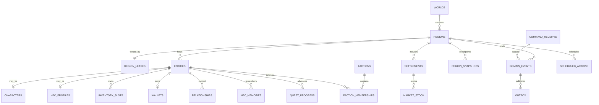
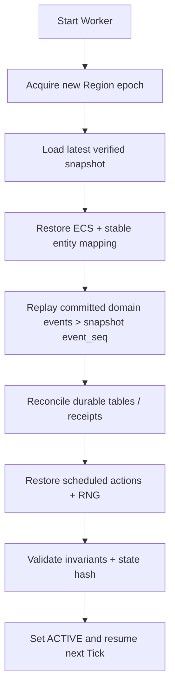
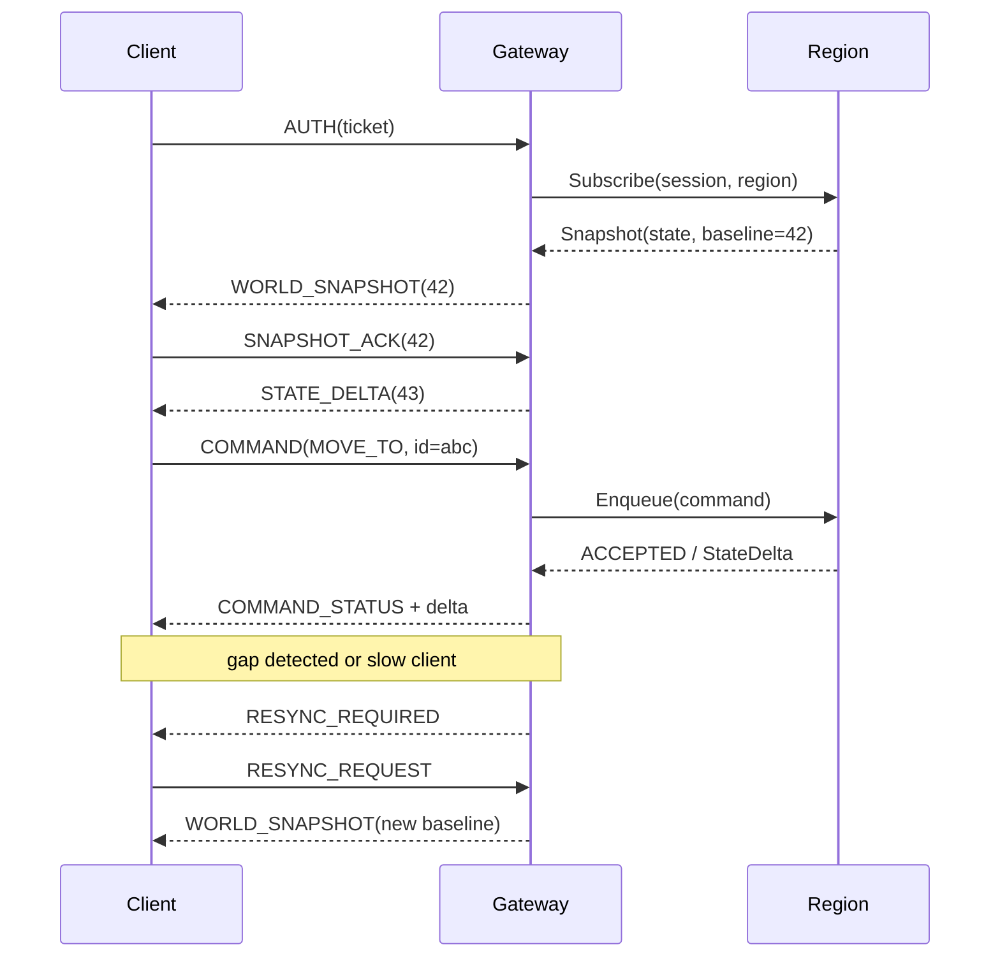
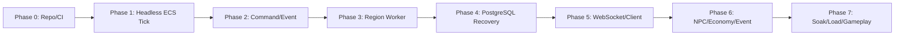

# RPG World Simulation Engine — Complete Design

---

> Generated from the English README/docs and shared schemas. Do not edit directly.

---

<!-- source: README.en.md -->

# RPG World Simulation Engine (RPG-WSE)

[한국어](README.md) | **English**

> A Rust-based real-time, persistent RPG simulation engine. This is a prototype under development: design goals are distinct from implemented and integrated features.
> Stack: **Rust + Bevy ECS + Tokio + Axum + PostgreSQL + Vue 3/Phaser**.
> Target: a new real-time, persistent medieval fantasy RPG simulation. Compatibility with previous repositories is not assumed.

New contributors should read **Quick start → Repository layout → Validation → Contributing** below. Browse the [English documentation index](docs/en/README.md) or [Korean documentation index](docs/README.md).

## 0. Reading list

1. [Vision and scope](docs/en/00-vision-scope.md) — goals, MVP, non-goals, terminology.
2. [Requirements](docs/en/01-requirements.md) — functional/nonfunctional requirements and IDs.
3. [Architecture](docs/en/02-hld-architecture.md) — architecture and responsibilities.
4. [Core Tick](docs/en/03-core-tick.md) — simulation core, fixed ticks, determinism.
5. [Region/ECS](docs/en/04-region-ecs.md) — Workers, ownership, transfers.
6. [Commands/events](docs/en/05-command-event.md) — validation, ordering, deduplication.
7. [NPC AI](docs/en/06-npc-ai.md) — Utility AI, GOAP, memory, LLM boundary.
8. [World systems](docs/en/07-world-systems.md) — movement, combat, economy, factions, environment, dynamic events.
9. [Data/ERD](docs/en/08-data-erd.md) — persistent/transient data ownership.
10. [Persistence/recovery](docs/en/09-persistence-recovery.md) — transactions, outbox, snapshots, recovery.
11. [Network replication](docs/en/10-network-replication.md) — WebSocket, AOI, snapshots/deltas.
12. [Protocols](docs/en/11-protocols.md) — messages, errors, operations APIs.
13. [Testing/observability](docs/en/12-test-observability.md) — tests, benchmarks, metrics.
14. [Implementation backlog](docs/en/13-implementation-backlog.md) — dependencies and acceptance criteria.
15. [Operations/security](docs/en/14-operations-security.md) — deployment, security, disaster recovery.
16. [ADRs](docs/en/15-adrs.md) — decisions and open questions.
17. [Prologue/gameplay](docs/en/16-prologue-gameplay.md) — player experience and shared-world entry.
18. [Developer onboarding](docs/en/17-developer-onboarding.md) — contributor workflow.
19. [End-to-end example](docs/en/18-end-to-end-example.md) — purchases and economic events.
20. [Initial SQL](schemas/0001_initial.sql) — draft PostgreSQL schema.
21. [Example configuration](schemas/config.example.toml) — server settings.

## 1. Suggested reading paths

- **Planning/design:** 00 → 01 → 02 → 15 → 16.
- **Engine:** 03 → 04 → 05 → 06 → 07.
- **Data/server:** 08 → 09 → 10 → 11 → SQL.
- **QA/operations:** 12 → 13 → 14.
- **Onboarding:** this README, ADRs, relevant module documentation, then the ticket's Definition of Done.

## 2. Execution goals and priorities

**First Vertical Slice:** 64×64 frontier settlement, one player, 10 NPCs, two monster types, fixed 10Hz Tick, movement/dialogue/basic combat, food production/consumption, one dynamic event involving a merchant-caravan raid, and restart recovery. Then validate 10 concurrent players and 1,000 NPCs.

**MVP quality:** reproducible 10,000-Tick headless execution; matching Command/Event order; no duplicate durable transactions; two clients observing the same state; Tick p95 ≤30ms as an **initial target**, not a guarantee before measurement.

## 3. Implementation invariants

- Exactly **one active writer** per `region_id`; fence durable writes using `ownership_epoch`.
- Network/LLM/DB work **never blocks simulation Tick**.
- Submit all external actions as **Commands**; only Region Worker/Global Owner mutates world state.
- **Finalize durable assets, inventory, and ownership only after DB Commit/ACK**.
- Explicitly allow **checkpoint-level recovery** for transient positions/animations.
- Deterministic replay requires **engine version + initial state + RNG rules + assigned Tick/ordered inputs + recorded external results**.
- NPC LLM output is a non-authoritative proposal validated by game rules.

## 4. Documentation conventions

Use `REQ-*`, `ADR-*`, `TASK-*`, and `TEST-*` for requirements, decisions, work, and tests. **[Confirmed]** means baseline; **[Assumption]** means provisional; **[Later]** requires a separate decision. Code blocks describe contracts/examples, not a complete server or guaranteed build. Messages carry `schema_version`. In conflicts, prioritize [ADRs](docs/en/15-adrs.md) and [persistence atomicity rules](docs/en/09-persistence-recovery.md), and record the change.

Korean sources remain at `README.md` and `docs/NN-*.md`; English counterparts are `README.en.md` and `docs/en/NN-*.md`. Preserve IDs, commands, configuration values, and acceptance criteria across languages. See [maintenance instructions](docs/en/README.md).

## 5. Current implementation and limitations

This describes current source entry points/modules. Existing code does not establish integration verification or production readiness.

| Area | Current state |
|---|---|
| Headless Runner | Executes simulation from seed/Tick count; outputs JSON state hash, event count, economy summary |
| Server | Configuration validation, HTTP health, WebSocket ticket/gateway routes |
| Domain/simulation | ECS, Command/Event, movement/combat/NPC/economy/prologue code and tests |
| Persistence | PostgreSQL transaction/snapshot/recovery modules and integration tests; default server entry point does not initialize DB/full simulation |
| Web client | Vue 3 + TypeScript + Phaser UI/networking; local connection needs API/WS proxy configuration |
| Readiness | `/health/ready` currently always returns **503**; not a full-game readiness signal |

The default gateway uses `GatewayState::default()` without a simulation-command channel. Starting server and UI does not produce a fully integrated game with movement/combat/persistent storage. Default prologue file storage: `.data/prologue`.

[Development plan](docs/en/19-nmain-development-plan.md), [status](docs/en/20-development-status.md), and [M0 ADR](docs/en/21-m0-bootstrap-decisions.md) provide background. Some statements reflect historical M0/nmain policy; compare with current code/PR target. Historical `scripts/verify-m0.sh`, `scripts/sync-design-docs.py`, and `.github/workflows/wse-m0.yml` are absent. Use the individual checks below; current documentation generation uses `scripts/sync-design-docs.mjs`.

## 6. Quick start

### Prerequisites

| Tool | Purpose/baseline |
|---|---|
| Git | Clone and change management |
| Rust/Cargo | **1.90.0**, pinned in rust-toolchain.toml, with rustfmt/clippy |
| Native build tools | Visual Studio Build Tools C++ tools for Windows MSVC; platform build tools for Linux/macOS |
| Node.js/npm | Web development; exact Node version is not pinned yet, so record yours in the PR |
| Docker + Compose v2 | DB integration tests; Compose pins PostgreSQL 16.11 |
| Python 3 + websockets | Only for adapting/running existing browser E2E |

Fork and clone your Fork. Replace `<YOUR_FORK_CLONE_URL>` with the actual URL. Run in a terminal where rustup is available after Rust installation.

```sh
git clone <YOUR_FORK_CLONE_URL> RPG_WSE
cd RPG_WSE
rustup toolchain install 1.90.0 --profile minimal --component rustfmt --component clippy
cargo build --workspace --locked
```

Run all Rust commands from the **repository root**; default configuration paths are relative to the working directory.

### Server

```sh
cargo run --locked -p game-server -- --check-config
cargo run --locked -p game-server
```

Check from another terminal. Use `curl.exe` instead of `curl` in Windows PowerShell.

```sh
curl -i http://127.0.0.1:18080/health/live
curl -i http://127.0.0.1:18080/health/ready
```

Expect live **200**, ready **503**. `--check-config` validates configuration and exits; it does not verify DB connectivity/gameplay. Stop with Ctrl+C.

### Headless simulation

No DB/web client required.

```sh
cargo run --locked -p simulation-runner -- --seed 42 --ticks 10000
cargo run --locked -p simulation-runner -- --seed 42 --ticks 10000 --check
```

The first executes ticks, returning `status: completed`, `executed_ticks`, `final_state_hash`, `economy`, etc. The second only validates arguments with `executed_ticks=0`. Compare runs with identical version/initial state/seed/inputs. One final-state hash does not prove determinism of all economic processing/external systems.

### Web client

Use another terminal and the package/lock files in `apps/web-client`, not the root.

```sh
cd apps/web-client
npm ci
npm run dev -- --host 127.0.0.1
```

Open `http://127.0.0.1:3000`; if occupied, use the actual URL printed by Vite.

The client requests `/api/v1/ws-tickets` and `/ws` on the page's origin, but Vite currently has no proxy. To develop the connection, add this `proxy` inside the existing `server` object in [vite.config.ts](apps/web-client/vite.config.ts). Match target ports if changing the server listener.

```ts
proxy: {
  '/api': { target: 'http://127.0.0.1:18080', changeOrigin: true },
  '/ws': { target: 'ws://127.0.0.1:18080', ws: true, changeOrigin: true },
},
```

Restart Vite. This connects transport routes; the game-loop integration limits above still apply. Initial UI gold/inventory includes sample values.

## 7. Repository layout

| Path | Responsibility |
|---|---|
| `apps/game-server` | Server entry point, TOML/environment loader |
| `apps/simulation-runner` | Headless simulation CLI |
| `apps/web-client` | Vue/Phaser UI, network client, Vitest tests |
| `crates/game-domain` | IDs, Command/Event, rule contracts |
| `crates/ecs-components` | ECS components and Region world |
| `crates/simulation-core` | Tick execution, determinism, Worker foundation |
| `crates/simulation-systems` | Movement/combat/NPC/economy/prologue |
| `crates/persistence` | DB transactions, leases, snapshots, recovery, integration tests |
| `crates/networking` | Axum gateway, sessions, tickets, AOI, replication |
| `crates/shared-protocol` | Server/client wire protocol |
| `schemas` | Initial SQL and example server config |
| `deploy` | Development PostgreSQL Compose and environment example |
| `docs` / `docs/en` | Korean / English requirements, design, ADRs, backlog |
| `tests` | Browser E2E scripts |

Root `docker-compose.yml` is a reference for the old Go game. It points to absent `src/` paths; do not use it to start the new Rust engine.

## 8. Configuration

Server reads [schemas/config.example.toml](schemas/config.example.toml), then supported environment overrides. Select another file with `cargo run --locked -p game-server -- --config <CONFIG_PATH>`. Valid configuration does not prove all runtime modules consume it.

| Variable | Default | Meaning |
|---|---|---|
| `WSE_HTTP_LISTEN` | `127.0.0.1:18080` | HTTP/WS listener |
| `WSE_WS_AUTH_TIMEOUT_SEC` | `5` | Configured WS authentication timeout |
| `WSE_TICK_RATE_HZ` | `10` | Tick frequency |
| `WSE_GAME_TIME_SCALE` | `10` | Game-time multiplier |
| `WSE_REGION_CMD_CAP` | `4096` | Region command queue capacity |
| `WSE_DURABLE_CAP` | `512` | Durable queue capacity |
| `WSE_SNAPSHOT_INTERVAL_SEC` | `300` | Snapshot interval |
| `WSE_REGION_LEASE_SEC` | `15` | Region lease duration |
| `WSE_LEASE_RENEW_SEC` | `5` | Lease renewal interval |
| `RUST_LOG` | `info` | tracing filter |
| `PROLOGUE_DATA_DIR` | `.data/prologue` | Gateway prologue file storage |
| `DATABASE_URL` | Set explicitly | PostgreSQL integration-test connection string |

Example port override:

```sh
# Bash / zsh
WSE_HTTP_LISTEN=127.0.0.1:19080 cargo run --locked -p game-server
```

```powershell
# PowerShell: applies to the current terminal
$env:WSE_HTTP_LISTEN = '127.0.0.1:19080'
cargo run --locked -p game-server
Remove-Item Env:WSE_HTTP_LISTEN
```

`deploy/.env` is for Compose; Rust does not automatically load it. Tick frequency must divide 1000ms and cannot be lower than delta frequency. Renewal interval must be shorter than lease duration.

## 9. Development PostgreSQL

Optional for persistence work. Use a **dedicated development DB** because tests write data.

```sh
# Bash / zsh: copy only on initial setup
cp deploy/.env.example deploy/.env
```

```powershell
# PowerShell: copy only on initial setup
Copy-Item deploy/.env.example deploy/.env
```

Set your development `WSE_POSTGRES_PASSWORD` in `deploy/.env`, then:

```sh
docker compose --env-file deploy/.env -f deploy/compose.dev.yml up -d --wait
docker compose --env-file deploy/.env -f deploy/compose.dev.yml ps
```

Defaults: `127.0.0.1:55432`, user/database `wse_dev`. Set the test terminal's connection string, replacing the password placeholder and percent-encoding URI special characters.

```sh
export DATABASE_URL='postgres://wse_dev:<YOUR_DEV_PASSWORD>@127.0.0.1:55432/wse_dev'
```

```powershell
$env:DATABASE_URL = 'postgres://wse_dev:<YOUR_DEV_PASSWORD>@127.0.0.1:55432/wse_dev'
```

Compose does not automatically apply SQL. Persistence tests connect and call `apply_migration`; do not treat this as an existing-database upgrade procedure.

```sh
cargo test --locked -p persistence --test durable_transactions -- --nocapture
cargo test --locked -p persistence --test snapshot_recovery -- --nocapture
# Stop, retaining volume data
docker compose --env-file deploy/.env -f deploy/compose.dev.yml down
```

**Tests currently skip on DB connection failure and may appear successful.** Check for `Skipping PostgreSQL integration test` output and explicitly report actual DB coverage in PRs. Changing the environment password does not change an existing PostgreSQL volume's password.

## 10. Validate changes

From the repository root for Rust:

```sh
cargo fmt --all -- --check
cargo clippy --workspace --all-targets --locked -- -D warnings
cargo test --workspace --locked
cargo build --workspace --locked
```

From `apps/web-client` for frontend:

```sh
npm ci
npm test
npm run typecheck
npm run build
```

Narrow initial checks with commands such as `cargo test --locked -p simulation-core`. Report DB skips, browser checks not run, and failures separately. These are verification procedures, not a guarantee the current checkout passes.

[Browser E2E](tests/e2e_two_clients_prologue.py) resolves repository paths from the script and finds Chrome through `CHROME_BIN` or PATH. It uses CDP port 9222 and preview port 4173; adapt browser options/API/WS routing to your environment. Normal Rust/Vitest runs do not require Python.

### Troubleshooting

| Symptom | Check |
|---|---|
| Configuration file not found | Run at repository root; check `--config` path |
| Ready returns 503 | Expected currently; starting DB alone does not make it 200 |
| Server bind failure | Check port 18080; override `WSE_HTTP_LISTEN` |
| UI loads, ticket returns 404 | Vite `/api` proxy and Rust server |
| WS connection failure | `/ws` proxy `ws: true`, target port, browser Network/WS |
| DB tests succeed suspiciously quickly | Use `--nocapture`; check skips and `DATABASE_URL` |
| PowerShell blocks npm script | Invoke `npm.cmd ci`, `npm.cmd test` directly |
| `--locked` failure | Confirm intentional dependency changes and update corresponding lock file |

## 11. Contributing

Contribute bug fixes, tests, documentation, engine, or client work. Good first tasks include reproducing setup, improving DB-test skip behavior, configuring the development proxy, and improving E2E portability. Discuss large architectural changes in an Issue first.

1. Check existing Issues/PRs and the [backlog](docs/en/13-implementation-backlog.md).
2. Branch from the current default or maintainer-specified branch; do not assume historical `nmain` exists.
3. Keep changes focused on one problem with relevant tests/docs.
4. Run checks, open a PR from your Fork, and link relevant `REQ-*`, `TASK-*`, `TEST-*` IDs.

```sh
git switch -c fix/describe-the-change
# After editing/testing, stage only relevant files
git add <CHANGED_FILES>
git commit -m "Describe the change"
git push -u origin fix/describe-the-change
```

Include:

- **Problem/result:** what changes under which conditions.
- **Contracts:** API/DB/Command/Event/schema_version effects and ADR changes.
- **Validation:** commands/results, OS/tool versions, actual PostgreSQL coverage.
- **Limits:** unrun tests, known issues, compatibility/recovery effects.
- **UI:** before/after screenshots and browser checks.

Follow rustfmt/clippy. Update Cargo.lock/web package-lock.json with dependency changes; avoid unrelated lock churn. Check both Rust and TypeScript for protocol changes. Record architecture rationale/impact in [ADRs](docs/en/15-adrs.md) and preserve single-writer/nonblocking-Tick/Commit-ACK invariants.

Bug Issues need reproduction, expected/actual results, commit, OS/tool versions, and sanitized logs; determinism bugs also need seed/Ticks/inputs. Never publish passwords, tickets, real account data, or private connection strings. Use private vulnerability reporting when the repository offers it.

## 12. License

Root [LICENSE](LICENSE) is **Apache License 2.0**. Dependencies/assets retain their respective licenses. Record provenance, license, and redistribution terms when adding assets. Asset notes in the [client README](apps/web-client/README.md) do not replace the project license.

---

<!-- source: docs/en/00-vision-scope.md -->

# 00. Vision, Game Scope, and Terminology

[한국어](docs/00-vision-scope.md) | **English**

## 1. Product vision

> A real-time medieval fantasy RPG where ecosystems, economies, NPC relationships, and factions evolve even while players are offline, and player choices become part of the world's permanent history.

### Game identity

- Genre: top-down/isometric 2D, sandbox, persistent world simulation.
- Core loop: **Explore → discover information/events → choose → affect the simulation → observe consequences/reputation → make another choice**.
- The appeal extends beyond predefined quests: players see the world change through player and NPC actions.
- Humans and bots/AI agents use the same server Command interface. Bot permissions and command rates have separate limits.

## 2. Example world: a frontier settlement

The initial region has 64×64 tiles and 20 residents (10 initially active detailed NPCs): 3 guards, 2 merchants, 3 farmers, 1 blacksmith, and 1 village leader; plus 5 bandits as simulation/combat participants, a forest, mine, trade route, and warehouse. These are content-design **assumptions**, not fixed values before profiling.

```text
Population grows → food consumption rises → food stocks fall
  → prices rise → more merchant caravans → more targets for bandits
  → raid/escort events → player intervention → economic/security/relationship changes
```

## 3. Initial MVP scope (keep it small)

| Included | Acceptance criterion |
|---|---|
| Single-region headless simulator | Run 10,000 ticks without a GUI and reproduce results |
| Player/NPC entities and components | Represent IDs, positions, health, needs, and inventory |
| Tile movement and pathfinding | Avoid walls/obstacles and report arrival/failure |
| Minimal combat | Melee attacks, damage, death, and loot through committed transactions |
| Basic NPC life | Farmers produce, merchants trade, guards patrol, bandits raid |
| One dynamic event | Food shortage/caravan raid occurs when conditions are met |
| Two-player shared-world observation | Server-authoritative synchronization of positions and events |
| Persistence | Atomic transaction finalization and restart recovery |
| Operational instrumentation | Tick, queue, region, and persistence metrics |

## 4. Non-goals (outside the MVP)

- Full MMO-scale distributed sharding, instant global player trading, or concurrent LLM conversations for thousands of NPCs.
- Ranked real-time PvP, complex physics, continental map generation, or a complete real-time diplomatic/political system.
- Full event sourcing with exact replay of every small movement.
- Advanced combat prediction/rollback netcode; start with interpolation and an authoritative server.

## 5. Key terms

| Term | Meaning |
|---|---|
| World | The entire persistent game, composed of Regions |
| Region | An area with independent ECS state, authority, and simulation |
| Region Worker | A computation owner executing ticks for one or more Regions |
| World Coordinator | Coordinates Region ownership, placement, and global work |
| Game Entity ID | A UUID stable across networking and DB storage; distinct from an ECS `Entity` |
| Tick | A fixed logical time step, initially 100ms |
| Command | An input expressing intent, without guaranteed success |
| Domain Event | A business fact that actually occurred under the rules |
| Delta | A message describing changes to current client-visible state |
| Durable | Assets/ownership and other state finalized by DB Commit |
| Transient | Coordinates/paths and other state allowing checkpoint-bounded loss |
| Outbox | Follow-up publication work recorded inside a DB transaction |
| Epoch/Fencing | A Region ownership generation that blocks stale Worker writes |

## 6. Validating player experience

Each event outcome must appear in at least one UI channel: **rumors, regional news, economy/security indicators, or NPC dialogue**. A choice with no feedback is a bug. Each stage has `timeout`, `fallback`, `reason_code`, and `recovery_hint` to keep the event loop moving. See [16](docs/en/16-prologue-gameplay.md) for the detailed flow.

---

<!-- source: docs/en/01-requirements.md -->

# 01. Software Requirements Specification (SRS)

[한국어](docs/01-requirements.md) | **English**

## 1. Functional requirements

| ID | Priority | Requirement | Acceptance criterion |
|---|---|---|---|
| REQ-F-001 | P0 | Headless execution without clients | Support `run --seed X --ticks 10000` |
| REQ-F-002 | P0 | Region ECS/stable IDs | Restore the same Game Entity UUID after restart |
| REQ-F-003 | P0 | Fixed 10Hz ticks and separate time scale | Control Tick/WorldTime independently |
| REQ-F-004 | P0 | Command validation/idempotency | Repeated purchase Command commits once |
| REQ-F-005 | P0 | Region Single Writer | Two Workers cannot commit concurrently in the same Epoch |
| REQ-F-006 | P0 | Autonomous NPC behavior over game time | NPC states/tasks change without input |
| REQ-F-007 | P0 | Movement/collision/pathfinding | Record failure/repath reasons for unreachable destinations |
| REQ-F-008 | P0 | Basic combat/damage/death | Validate HP, collision, range, and cooldown |
| REQ-F-009 | P0 | Event rules/follow-up events | Trace causality through event IDs |
| REQ-F-010 | P0 | Persistent state/restart recovery | Committed assets survive restart |
| REQ-F-011 | P0 | WS client state synchronization | Two clients agree on the latest Snapshot |
| REQ-F-012 | P1 | Active/Background Regions | Aggregate NPC simulation in idle areas |
| REQ-F-013 | P1 | Food production/consumption and market pricing | Stock shortages affect prices/events |
| REQ-F-014 | P1 | NPC relationships/memory/goals | Structured memories influence decisions |
| REQ-F-015 | P1 | Death/economic effects in the world | Consistently update world history/reputation/stock |
| REQ-F-016 | P1 | Private prologue → shared world | Transfer once without duplicate characters/items |
| REQ-F-017 | P1 | Operations tools | Region pause/resume, health, diagnostics |
| REQ-F-018 | P2 | LLM dialogue/action proposals | No world mutation before rule validation |
| REQ-F-019 | P2 | Multi-server Region transfer | Safe authority handoff through Epochs |

## 2. Nonfunctional requirements

| ID | Requirement | Initial target / verification |
|---|---|---|
| REQ-N-001 | Reproducibility | Same engine/rules version, seed, and input log produce identical event/state hashes |
| REQ-N-002 | Tick performance | 10Hz; Active Region p95 ≤30ms, p99 ≤50ms (**targets**) |
| REQ-N-003 | Load | Measure 1,000 NPCs/Region; 10,000 NPCs are a distribution/aggregation experiment |
| REQ-N-004 | Fault tolerance | No duplicate transaction when retrying after Commit with lost ACK |
| REQ-N-005 | Bounded memory | Bounded channels and explicit backlog response/drop policies |
| REQ-N-006 | Security | Server authority, Actor ownership, WSS/TLS, operations API RBAC |
| REQ-N-007 | Observability | Tick, queue, error, DB, recovery, event, and Region-state metrics |
| REQ-N-008 | Evolvability | JSON/Protobuf/DB schema_version and migration policy |
| REQ-N-009 | Data retention | No loss of durable events; positions recover to the latest successful checkpoint |

## 3. Assumptions and constraints

- Start with one Region on one server. Phase 1 does not require distributed consensus/Kafka.
- The **server validates all** game-state changes; clients render.
- Rust server; Vue 3 + Phaser UI; LLM through a separate asynchronous adapter.
- **PostgreSQL 16+ assumed**. 3D/elevation/continuous physics are outside the MVP.
- In-memory ECS owns Region components; the asset DB is the final authority for committed property.

## 4. Shared Definition of Done

1. Reflect RFC/ADR changes in documentation.
2. Version code, migrations, and message schemas.
3. Automate success, failure, duplicate, and restart-path tests.
4. Pass `cargo fmt --check`, `cargo clippy -- -D warnings`, and `cargo test`.
5. Make key metrics available in Grafana/Prometheus.
6. Log applicable IDs: `world_id`, `region_id`, `tick`, `command_id`, `trace_id`.
7. Record unmet performance targets with actual measurements and follow-up tasks; do not claim completion falsely.

---

<!-- source: docs/en/02-hld-architecture.md -->

# 02. Overall Architecture (HLD)

[한국어](docs/02-hld-architecture.md) | **English**

## 1. Context and external systems



## 2. Component responsibilities and boundaries

| Component | Ownership/responsibility | Prohibited |
|---|---|---|
| Axum Gateway | Authentication, sessions, rate limits, protocol, message ingress | Direct ECS writes or arbitrary DB-state changes |
| Command Router | Region mapping, input queues, admission | Arbitrarily finalizing player-action outcomes |
| Coordinator | Region ownership, placement/failover, GlobalWorker communication | Direct mutation of individual ECS entities |
| Region Worker | Its Region's ECS/ticks, rules, temporary state | `await` or synchronous DB work inside a Tick |
| Persistence Writer | Durable transactions, receipts, outbox, snapshots | Independently interpreting game rules |
| Replicator | Subscriptions, AOI, baseline/delta, isolation of slow clients | Redefining Domain Events |
| LLM Adapter | Dialogue and non-authoritative proposals | Direct gold/health/stock writes |
| Global Worker | Sole writer for factions/global time/inter-region requests | Direct writes to data owned by another Region |

## 3. Data and command flow

```
Player input ─> Gateway ─> Region command queue ─> Tick / ECS
                                               │
        ┌──────── transient state delta ◀───────┤
        │                                      durable intent
        ▼                                             │
Client state channel                    DB transaction + outbox
                                                      │
                                          commit ACK / receipt
                                                      │
                                                      ▼
                                             Region finalized state
                                                      │
                                                      ▼
                                            confirmed client result
```

**Core guarantee:** durable success is reported only after DB Commit. Reserve affected currency/items while persistence is pending. The Tick continues processing other entities.

## 4. Concurrency and consistency

- **One Worker owns** each Region. Initially, use a single-threaded Bevy Schedule with explicit System ordering.
- Route global data to a GlobalWorker or DB-owned domain; Regions receive versioned read-only Snapshots.
- Region transfer: `prepare source → durable transfer/lease fence → target spawn → source cleanup`. The MVP supports this **within one process and one DB only**; complex remote Sagas are P2.
- Cross-region asset trading is excluded from the MVP. Add a Global Transaction Owner or explicit Saga if needed.

## 5. Failure domains

| Failure | Isolation/recovery |
|---|---|
| WS disconnect | Expire the session; keep the Region simulation running |
| Command overload | Limit ingress; return `SERVER_BUSY`; never lose durable intents |
| Region Worker panic | Isolate that Region; fence the lease and recover from snapshot |
| PostgreSQL outage | Stop new durable actions; define allowed transient work; alert |
| AI service delay | Utility AI/template-dialogue fallback; never block Tick |
| Gateway outage | Reconnect and snapshot resync; server world continues |
| Coordinator outage | Continue during existing leases; wait/restrict reassignment |

## 6. Purchase sequence

```mermaid
sequenceDiagram
    participant C as Client
    participant G as Gateway
    participant R as Region Worker
    participant D as DB Writer
    participant P as PostgreSQL
    C->>G: command BUY_ITEM (command_id)
    G->>R: validated envelope
    R->>R: rule validate, reserve stock/gold
    R-->>C: ACCEPTED / PENDING
    R->>D: durable intent + expected versions + epoch
    D->>P: BEGIN; fence, receipt, balances, event, outbox
    alt commit success
        P-->>D: COMMIT
        D-->>R: committed ACK
        R->>R: finalize reserved state
        R-->>C: SUCCEEDED + state delta
    else error / unknown ACK
        P-->>D: error / timeout
        D-->>R: receipt lookup or retry
        R-->>C: PENDING / FAILED after resolution
    end
```

## 7. Deployment forms

- **Phase 1:** one `game-server` executable with Tokio runtime, dedicated Region threads, and SQLx writer. No Redis/broker required.
- **Phase 2:** Region Worker Pool and background mode on one machine.
- **Phase 3:** separate Gateway/Region Worker networking, Postgres fencing/router reassignment; optional Redis/message broker, never the queue's source of truth.

## 8. Technology baseline

- Rust edition 2024, pinned Bevy ECS, Tokio, Axum, SQLx, Serde, UUID, tracing, and a Prometheus instrumentation library.
- Pin `Cargo.lock` for every release. Verify changed APIs in CI and update [ADRs](docs/en/15-adrs.md) alongside lock versions.

---

<!-- source: docs/en/03-core-tick.md -->

# 03. Simulation Core and Fixed Tick (LLD)

[한국어](docs/03-core-tick.md) | **English**

## 1. Execution contract

- `tick_rate_hz = 10`, `fixed_delta_ms = 100` (**[Assumption]**). Configure game-time scale (`game_seconds_per_real_second=10`) separately.
- Mutations at `tick = n` follow an **explicitly defined order**.
- Do not use `Instant::elapsed()`/wall-clock time directly in simulation calculations; use it only for timeouts/operations monitoring.
- `WorldState` is a logical concept: each Region has one `bevy_ecs::World`; GlobalWorker owns global state.
- Results must not depend on incidental hash-map iteration. Sort stable UUIDs or use inputs whose order is intentionally recorded.

## 2. Tick phases

| Order | Phase | Input | Output/invariant |
|---|---|---|---|
| 0 | Admission | Gateway Commands | Assign Tick/RegionSeq; reject overflow/duplicates |
| 1 | Command Validation | Ready queue | Pending action / Rejected |
| 2 | Perception | Spatial index | Visible surroundings / danger signals |
| 3 | Navigation & Movement | Targets/speeds/tile map | Position/collision results |
| 4 | Combat | Attack input/range/HP | Damage/death/reward intents |
| 5 | NPC Decisions | Scheduled NPCs | Commands for the next Tick |
| 6 | World/Economy | Resource / Settlement | Production/consumption/prices/environment |
| 7 | Event Rules | State changes/events | Deterministically scheduled follow-up commands |
| 8 | Finalize | Transient changes, staged durable work | Deltas, durable requests, traces |
| 9 | Output | Event/Delta queues | Bounded enqueue to Replicator/Writer |

Process durable transaction ACKs with priority **before phase 0** of each Tick, preserving original durable-intent order. If ACKs can reorder, serialize in-flight work per actor/item.

## 3. Core Rust interfaces (design contracts)

```rust
pub struct TickContext {
    pub tick: u64,
    pub fixed_delta_ms: u32,
    pub game_time_ms: u64,
    pub seed: [u8; 32],
}

pub struct RegionRuntime {
    pub world: bevy_ecs::world::World,
    pub schedule: bevy_ecs::schedule::Schedule,
    pub metadata: RegionMetadata,
    // command inbox, pending transactions, outbox buffers,
    // stable_id <-> ECS Entity index, metrics
}

pub struct TickOutcome {
    pub tick: u64,
    pub transient_deltas: Vec<StateChange>,
    pub durable_intents: Vec<DurableIntent>,
    pub generated_commands: Vec<CommandEnvelope>,
}

pub trait HeadlessEngine {
    fn enqueue(&mut self, command: CommandEnvelope) -> Result<(), EngineError>;
    fn step(&mut self) -> Result<TickOutcome, EngineError>;
    fn snapshot_committed(&self) -> Result<RegionCheckpoint, EngineError>;
}
```

`TickOutcome` may contain durable intents **not yet committed in the DB**. Replicator uses transient deltas immediately; durable results are emitted separately after `PersistenceAck`.

## 4. Bevy Schedule rules

```rust
#[derive(SystemSet, Debug, Clone, Copy, PartialEq, Eq, Hash)]
pub enum SimPhase {
    Perception, Movement, Combat, NpcDecisions, World, EventRules,
}
// schedule.configure_sets((...phase...).chain());
// schedule.set_executor(SingleThreadedExecutor::default());
```

- Systems use component queries/resources only; no IO.
- Compute each System from input state and TickContext only. Explicitly define deferred `Commands` application points.
- New NPC decisions become **next-Tick** commands. Necessary same-Tick reactions, such as damage or interrupted movement, occur only in Combat/Movement phases.
- Start with a single-thread executor; golden replay must pass before later parallelization.

## 5. Staggered NPC scheduling

- With `decision_interval_ticks=10`, normal decisions run only when `hash(stable_id) % 10 == tick % 10`.
- A separate urgent queue handles melee/damage interrupts every Tick.
- Run long-term GOAP planning every 100 Ticks or when a goal is invalidated.
- Budgets: `max_npc_evaluations_per_tick`, `max_path_expansions_per_tick`. Defer lower-priority excess work and use aging to prevent starvation.

## 6. RNG and determinism

- Pin the RNG algorithm to the engine version (for example a fixed ChaCha8 version), or build a stable hashed stream from `(world_seed, region_uuid, tick, system_id, actor_uuid, counter)`.
- No branching dependent on `HashMap` order, OS thread scheduling, or floating-point roundoff.
- Prefer integer/fixed-point coordinates, currency, and damage (`i64` millitiles, integer gold).
- Convert asynchronous LLM results into **external Commands**, logging their application Tick and payload.
- Validate output hashes using `initial snapshot + engine/rules version + ordered input log + RNG state`.

## 7. Tick scheduler pseudocode

```rust
let step = Duration::from_millis(100);
let mut deadline = Instant::now();
while running {
    drain_priority_acks_and_controls();
    collect_commands_with_admission_limit();
    let out = engine.step()?; // never await
    try_enqueue_transient(out.transient_deltas); // coalesce if full
    enqueue_or_reject_durable_safely(out.durable_intents)?;
    emit_metrics();
    deadline += step;
    if Instant::now() < deadline { sleep_until(deadline); }
    else {
        record_overrun();
        // Policy: never skip intermediate state; defer low-priority work.
        // On sustained overruns, restrict admission / enter degraded mode.
    }
}
```

**Guarantee boundary:** reproducing logical Tick results for the same inputs is a goal; actual reception times/network latency are not reproducible. Log `assigned_tick` in live mode.

## 8. Tick failure policy

| Category | Handling |
|---|---|
| Command validation failure | `REJECTED`; continue Tick |
| Data invariant violation during calculation | Region `PAUSED`; preserve evidence snapshot/log; alert operators |
| DB Writer disconnect | Block new durable intents; continue limited transient work |
| Five consecutive Tick overruns | `DEGRADED`; reduce low-priority AI work |
| Thread panic | Recover after safe lease release/expiry |

## 9. Tests

- TEST-TICK-001: headless 10,000-Tick runs with identical seed/inputs have identical state hashes.
- TEST-TICK-002: each NPC executes exactly its scheduled number of decisions.
- TEST-TICK-003: differing arrival orders reproduce according to logged sorting/assignment order.
- TEST-TICK-004: overruns do not skip Tick numbers.
- TEST-TICK-005: a 10-second asynchronous LLM delay does not increase Tick execution time.

---

<!-- source: docs/en/04-region-ecs.md -->

# 04. Region Worker, ECS, and Ownership (LLD)

[한국어](docs/04-region-ecs.md) | **English**

## 1. Region ownership model

- Each Region has exactly **one Active Owner**.
- PostgreSQL stores `region_leases(region_id, owner_id, ownership_epoch, lease_expires_at)`.
- Every **durable DB write transaction** locks the lease row and checks `epoch = expected_epoch` and `lease_expires_at > clock_timestamp()` before proceeding.
- Assigning a new Epoch rejects old Worker commits even if that Worker remains alive after GC/scheduling delays.
- Gateway routing caches include the epoch; refresh and reroute commands on mismatch.

## 2. ECS World structure

```
RegionRuntime
  ├── RegionMetadata { region_id, epoch, status, tick }
  ├── bevy_ecs::World
  │   ├── Entity(opaque Bevy handle) -> StableEntityId(UUID)
  │   ├── Position, Velocity, Navigation, Collider
  │   ├── Health, CombatState, InventoryProjection
  │   ├── Needs, Personality, AIState, MemoryRef
  │   └── Resources: Clock, MapGrid, SpatialIndex, Rng
  ├── Schedule (ordered systems)
  ├── stable_entity_index: UUID -> Bevy Entity
  ├── command_queue / priority_ack_queue
  ├── pending_durable: command_id -> reservations
  └── changed_entity_set / tick_metrics
```

A Bevy `Entity` can change after Region restart; never persist it directly in network messages, DB records, or logs. Use `StableEntityId(Uuid)` and rebuild the index on recovery.

## 3. Required components

| Component | Example fields | Validation |
|---|---|---|
| StableId | UUID | Unique within Region |
| Position | `x_millitile:i64, y_millitile:i64` | Valid terrain/region coordinates |
| Velocity | `dx,dy:i32` | Movement speed/ability cap |
| Navigation | target, path, path_version, state | Valid path/state machine |
| Health | current,max:i32 | 0 ≤ current ≤ max |
| Needs | hunger,fatigue,safety:u16 | Clamp to 0..1000 |
| Personality | courage,greed,loyalty:i16 | -1000..1000 |
| AIState | goal,action,next_decision_tick | Valid plan/cooldown |
| InventoryProjection | committed_version, slots | Apply only DB-committed results |
| FactionMembership | faction_uuid,standing | Validate GlobalWorker version |

## 4. Region Worker thread

```rust
struct RegionHandle {
    id: uuid::Uuid,
    epoch: u64,
    cmd_tx: tokio::sync::mpsc::Sender<RegionMessage>,
}

enum RegionMessage {
    Command(CommandEnvelope),
    PersistenceAck(PersistenceAck),
    GlobalStateUpdate(GlobalProjection),
    SetSimulationMode(SimulationMode),
    Shutdown,
}
```

Tokio networking uses `Sender::try_send`/`send` as appropriate. Dedicated Region OS threads collect bounded inputs with `Receiver::try_recv` before each Tick. Successful `try_send` means **queued**, not executed successfully or committed to the DB.

### Queue policies

| Queue | Provisional cap (assumption) | When full |
|---|---:|---|
| Player Command / Region | 4096 | Return `SERVER_BUSY`; per-session rate limit |
| Persistence Ack | 1024 | Guaranteed priority/separate path; stop safely |
| Transient Delta | 2048 | Coalesce positions/drop old deltas, then snapshot |
| Durable Intent | 512 | Reject new durable commands; retain in-flight reservations |
| Control | 64 | Priority service; health fault if unavailable |

## 5. Region lifecycle

`LOADING → ACTIVE/BACKGROUND → PAUSED/MIGRATING → STOPPED`. Track `health = HEALTHY/DEGRADED/FAILED` separately; do not mix lifecycle and health.

- LOADING: acquire Epoch → validate Snapshot/event/durable Projection consistency → rebuild spatial index.
- ACTIVE: player-present region with detailed movement/combat/AI.
- BACKGROUND: omit some individual real-time NPC movement and aggregate production/consumption; preserve important NPC states.
- MIGRATING: stop new Command admission, drain/finalize durable work, checkpoint safely, hand over Epoch, load target Worker, then change routing.
- PAUSED: administrative/abnormal state; explicitly reject or queue external inputs.

## 6. Inter-region movement (single-server MVP)

```mermaid
sequenceDiagram
  participant S as Source Region
  participant C as Transfer Coordinator
  participant D as Durable Store
  participant T as Target Region
  S->>C: TransferRequest(entity, source_epoch)
  C->>S: Mark TRANSFERRING; stop local commands
  C->>D: transfer record unique transfer_id / fence epochs
  D-->>C: committed transfer intent
  C->>T: spawn frozen entity snapshot
  T-->>C: target ready
  C->>D: commit new region_id/location
  D-->>C: committed
  C->>S: despawn source
  C->>T: activate entity
```

Restart failed transfers using the `transfer_id` receipt. Target creation is an idempotent upsert; source and target must never be active simultaneously. Initially support only `Player` transfers; arbitrary NPC transfers follow later.

## 7. Global-state principles

- A separate GlobalWorker is the single writer for Kingdom/Faction/World Clock/macroeconomic state.
- Regions use read-only Snapshots containing `global_projection_version`.
- Send global commands to GlobalWorker and apply resulting Events asynchronously to Regions.
- Multi-region transactions requiring consistency are outside the MVP. Eventually consistent events still require versioning and deduplication.

## 8. Tests

- TEST-REGION-001: only one of two Workers with the same Region Epoch can commit.
- TEST-REGION-002: recover with a new Epoch after Worker panic; reject stale writes.
- TEST-REGION-003: no cross-mutation of ECS state between two concurrent Regions.
- TEST-REGION-004: NPC/stock-total invariants survive BACKGROUND↔ACTIVE transitions.
- TEST-REGION-005: termination at any transfer stage creates zero duplicate characters.

---

<!-- source: docs/en/05-command-event.md -->

# 05. Command/Event Pipeline and Execution Rules (LLD)

[한국어](docs/05-command-event.md) | **English**

## 1. Invariants and responsibilities

- Command = intent; Event = an occurred fact; Delta = client-visible current-state change. Do not conflate them.
- `CommandEnvelope` includes `command_id(UUID)`, `actor_id(UUID)`, `region_id(UUID)`, `session_id(UUID)`, `client_seq`, `assigned_tick`, `ingress_seq`, `ownership_epoch`, `schema_version`, and `payload`.
- `ingress_seq` is a Region-local monotonically increasing number assigned by the Worker when admitting queued input. This is the authoritative replay order.
- Do not trust client `target_tick`; the Region assigns `assigned_tick` at admission.
- NPC/LLM/operations commands use the same Pipeline with different origins and permission scopes.

## 2. Command processing contract

```rust
pub enum CommandPayload {
    MoveTo { x: i64, y: i64 },
    Attack { target_id: uuid::Uuid },
    Interact { target_id: uuid::Uuid },
    BuyItem { shop_id: uuid::Uuid, sku: String, quantity: i32 },
    NpcAction { action_id: String, target_id: Option<uuid::Uuid> },
}

pub enum CommandStatus {
    Received, Accepted, Rejected,
    PendingCommit, Succeeded, Failed,
}
```

`Received` means received by Gateway; `Accepted` means Region-validated/queued; `PendingCommit` means a durable intent is not yet DB-finalized; `Succeeded` means successful execution. Even simple movement is rejected if tile, speed, or state validation fails.

### Validation order

1. Check WSS authentication, session TTL, and Actor ownership.
2. Validate protocol_version, payload size, and rate limits.
3. Check region_id/epoch in the Router.
4. In the Region Tick, validate actor state, distance, resources, cooldowns, and world rules.
5. Apply transient effects or create durable reservations.
6. Record events/responses and return the result to the Session.

## 3. Deterministic ordering and deduplication

- Default order: `(assigned_tick, ingress_seq)`; monotonically increasing `ingress_seq` makes it unique.
- Replay input logs include **validation results and application order**.
- Durable commands store a DB receipt with `UNIQUE(command_id)`. Same ID with different payload returns `IDEMPOTENCY_CONFLICT`.
- Transient deduplication uses a session/sequence LRU window. Replayed movement after restart may be discarded after snapshot resync.
- Retain receipts for at least the operational policy period; retain purchase/ownership receipts indefinitely or under long-term audit policy.

## 4. Event structure

```json
{
  "event_id": "4c69723e-d891-4ea0-ac73-680c1d48f980",
  "event_type": "CARAVAN_DAMAGED",
  "schema_version": 1,
  "world_id": "<uuid>",
  "region_id": "<uuid>",
  "region_event_seq": 142,
  "tick": 992,
  "causation_command_id": "<uuid-or-null>",
  "correlation_id": "<uuid>",
  "source_entity_id": "<uuid>",
  "payload": {"caravan_id":"<uuid>", "hp_lost":12}
}
```

- Durable `region_event_seq` increases monotonically in DB Commit order.
- Transient events may use `tick_seq` and do not consume durable event sequence numbers.
- Use `causation_command_id` and `correlation_id` to trace event chains.

## 5. Event rule format

```yaml
rule_id: caravan_attack_causes_shortage_v1
priority: 100
scope: region
trigger: CARAVAN_DAMAGED
conditions:
  - expr: "settlement.food_stock < settlement.min_food_stock"
  - expr: "settlement.shortage_active == false"
commands:
  - type: RAISE_SETTLEMENT_CONDITION
    params: {condition: FOOD_SHORTAGE}
cooldown_game_seconds: 3600
max_occurrences_per_region_day: 1
```

**Important:** do not execute expressions using arbitrary string `eval`. Use enums/ASTs or a validated DSL parser with allowed fields/operators. Event definitions propose rule Commands; they cannot directly run arbitrary SQL or mutate the world.

## 6. Event-chain limits

- Normally schedule follow-up commands for `tick+1` or later.
- Enforce `max_events_per_tick`, `max_causation_depth`, per-rule cooldowns, and `event_id` deduplication.
- On infinite chains/invariant violations, emit `RULE_CYCLE_DETECTED`, disable only the offending rule, and alert operations.
- Historical Event Replay must not reissue side effects such as LLM calls, email, or external Webhooks. Outbox publishers implement their own idempotency.

## 7. Transaction finalization and failure modes

`Validate → Reserve → DurableIntent → DB Transaction → ACK → Commit ECS projection → SUCCEEDED`.

- Reserved currency/items cannot be reused while Pending.
- DB Timeout does not imply failure. Look up the Receipt; keep unresolved outcomes `UNKNOWN/PENDING`. Never arbitrarily refund or re-execute.
- Receipt of a request alone does not justify a success response.
- Write event log, state tables, Outbox, and Receipt in **one DB transaction**.

## 8. Tests

- TEST-CMD-001: repeat one purchase Command 100 times; deduct currency once.
- TEST-CMD-002: same command_id, different payload → `IDEMPOTENCY_CONFLICT`.
- TEST-EVENT-001: one shortage-condition activation produces one FOOD_SHORTAGE.
- TEST-EVENT-002: cyclic rules stop at the depth limit with traceable causality.
- TEST-EVENT-003: resolve success/failure by receipt lookup after ACK loss.
- TEST-EVENT-004: zero external Webhook/LLM reissues during Replay.

---

<!-- source: docs/en/06-npc-ai.md -->

# 06. NPC Decision Engine — Utility AI + GOAP (LLD)

[한국어](docs/06-npc-ai.md) | **English**

## 1. Design goals

NPCs act according to goals and needs even without players. Separate **Perception → Urgent Reaction → Utility Goal Selection → GOAP Planning → Action Execution**, rather than replanning every NPC every Tick. NPC AI never directly mutates durable state; it submits an `NPC_ACTION` Command for the next Tick.

## 2. NPC data model

| Component | Fields | Storage/update |
|---|---|---|
| Identity | stable_id, profession, home_region, faction_id | Persistent DB |
| Needs | hunger, fatigue, safety, wealth_pressure (0..1000) | ECS/checkpoint |
| Personality | courage, greed, loyalty, curiosity (-1000..1000) | Persistent DB |
| Relationship | target_id, trust, affinity, fear, debt | DB for important changes |
| Memory | kind, target, severity, happened_tick, ttl, immutable refs | Important memories in DB; short-term in ECS |
| Goals | survive, eat, earn, defend, revenge | AI state/checkpoint |
| Plan | GOAP action list, current_index, precondition_hash | ECS/checkpoint |
| AI Schedule | next_decision_tick, last_replan_tick | ECS/checkpoint |

## 3. Perception: use only known facts

- Query entities within `vision_range_tiles` through a spatial hash/grid.
- Generate **observed Facts** such as `VisibleEntity`, `Threat`, `AvailableFood`, `NearbyWork`, `FactionAlert`, and `KnownRoute`.
- Do not read another Region's internal state as if by telepathy. Use communicated facts: rumors, messengers, or world notices.
- Terrain/fog/occlusion is P1; the MVP uses radius and simple obstacle checks.

## 4. Urgent reactions and normal decisions

**Urgent reactions:** damage, attacks, stun, fire. Enqueue each Tick or on an event; evaluate `DODGE`, `FLEE`, `CALL_GUARD`, and `COUNTERATTACK`. Apply cooldown after processing.

**Normal decisions:** initially once per second, staggered by a stable NPC UUID hash. Retain valid ongoing actions when there is no emergency; avoid changing goals every evaluation (hysteresis).

## 5. Utility scoring

Each goal `g` produces a utility in 0–1000 from input facts.

\[
 U(g)=\operatorname{clamp}_{[0,1000]}(\sum_i w_{g,i}\,c_i(facts, needs) + p_g(personality) + q_g(context) - k_g(cooldown))
\]

- Normalize `c_i` to integers in 0–1000; use fixed-point `w` (for example per-mille) and 64-bit intermediate dot products.
- Store all weights/curves in versioned data files.
- Retain the current goal if the score difference is at most `switch_margin=100` to prevent oscillation.
- Break ties by `(goal_priority, stable_goal_id)`.

**Example NPC:** `hunger=850`, `fatigue=400`, `threat=700`, `food_available=true`.

| Candidate | Inputs/context | Example utility | Result |
|---|---|---:|---|
| EAT | High hunger, accessible food | 830 | Candidate |
| REST | Moderate fatigue, accessible home | 410 | Candidate |
| FLEE | High threat, low courage | 930 | **Selected** |
| WORK | Workplace available but dangerous | 180 | Candidate |

Values are examples and belong in external balance data. Selecting `FLEE` passes the `Safe=true` goal to GOAP.

## 6. GOAP planner

### Example World Facts

```rust
struct Facts {
    has_food: bool,
    near_home: bool,
    is_safe: bool,
    has_gold: bool,
    shop_open: bool,
}

struct GoapAction {
    id: &'static str,
    preconditions: Vec<FactPredicate>,
    effects: Vec<FactEffect>,
    cost_milli: u32,
    max_duration_ticks: u32,
}
```

### Basic actions

| Action | Precondition | Effect | Example cost |
|---|---|---|---:|
| MOVE_TO_MARKET | route_available, not_threatened | at_market=true | path_length×10 |
| BUY_FOOD | at_market, has_gold, stock>0 | has_food=true | price + queue |
| EAT_FOOD | has_food, not_in_combat | hunger_reduced=true | 200 |
| FLEE_TO_GUARD | threat_present, route_available | is_safe=true | Route risk |
| REST_AT_HOME | near_home, safe | fatigue_reduced=true | 500 |
| WORK_FIELD | season_ok, safe, tools_ok | earned_food=true | 700 |

### Search algorithm

1. Select Goal Facts with Utility AI.
2. Load current NPC Facts and the Action Catalog.
3. Expand feasible precondition/effect nodes using A* or Dijkstra.
4. Limit `max_expansions=128`, `max_plan_length=12`, and `max_plan_ms`. Wall-clock time is only for budgets/operations, never result ordering.
5. Action cost is an integer-weighted sum of `duration + risk + resource + social_cost`.
6. Break ties by stable action ID. On search failure use `fallback = REST/WAIT/FLEE`.
7. Submit execution as a next-Tick command; the server revalidates actual costs/stock.

### Replanning triggers

- Goal reached, combat/threat changed, action failed, required materials exhausted, path blocked, or plan expired.
- After three consecutive failures: exponential cooldown, plan diagnostics, and safe Idle.

## 7. GOAP execution state machine

`IDLE → EVALUATING → PLANNING → EXECUTING → (SUCCESS | FAILED | INTERRUPTED) → EVALUATING`.

Each Action records `action_id`, `entity_id`, `plan_version`, `started_tick`, `timeout_tick`, `target_id`, and `status`. Safely cancel on timeout or stale `plan_version`. Repeated action failures emit an `NPC_STUCK` diagnostic event.

## 8. NPC memory and relationships

- Short-term: observed entities, recent dialogue, current threats; expire by game-time TTL.
- Long-term: important rescues, betrayals, murders, rewards; persist in DB.
- Store trust/affinity/fear as integers keyed by `(subject_id, target_id)`.
- Submit follow-up updates as `RelationshipChangeCommand`; update ECS projection after DB Commit.
- Give important memories unique `source_event_id` references to prevent learning the same event twice.

## 9. LLM boundary

```
Dialogue request (async) -> NPC facts + policy-approved memory
  -> LLM proposal (text, optional suggested_action)
  -> schema parse / content policy / rule validation
  -> dialogue broadcast or Command queued in future Tick
```

- LLMs cannot modify actual NPC asset/item/location databases.
- Revalidate proposed actions for permission, feasibility, resources, relationships, and distance.
- On timeout, fall back to template dialogue/Utility decisions. Check response idempotency key and requested world revision.
- Do not store personal data/raw conversations unchanged as long-term memory; retain only purpose-appropriate summaries under retention policy.

## 10. Decision performance

- A target of `1,000 NPCs / one decision per second` averages about 100 NPC evaluations per 10Hz Tick.
- Use a spatial index for Perception; fully replan GOAP only when goals change.
- Instrument `npc_decisions_total`, `goap_expansions_total`, `npc_plan_failures_total`, and `npc_stuck_total`.

## 11. Tests and acceptance

- TEST-AI-001: urgent threats prioritize FLEE over EAT despite high hunger.
- TEST-AI-002: without food, available gold and a shop produce a BUY → EAT plan.
- TEST-AI-003: invalid paths trigger replanning; repeated failures cause Idle and diagnostics.
- TEST-AI-004: identical inputs/seed/facts produce identical goals/plans.
- TEST-AI-005: an LLM proposal to grant a nonexistent item results in zero grants.
- TEST-AI-006: no duplicate important-memory application for a source_event_id.

---

<!-- source: docs/en/07-world-systems.md -->

# 07. World Systems — Movement, Combat, Economy, Factions, Environment, Events (LLD)

[한국어](docs/07-world-systems.md) | **English**

## 1. Shared System execution rules

- World updates access only ECS Resources/Components allowed by `simulation-core`.
- Follow ordering/constraints in [03](docs/en/03-core-tick.md). No direct SQL calls between systems.
- Commit `Transient` state at Tick completion; commit `Durable` state through `DurableIntent` and DB ACK.
- Validate content YAML/JSON with JSON Schema/type checks and pin versions before execution.

## 2. Movement and navigation

### Coordinate rules

- Integer world coordinates in `millitile` (`1 tile = 1000`); no Z axis.
- Tiles combine static terrain, dynamic blocking entities, and risk costs.
- Movement modes: `IDLE, PATH_REQUESTED, FOLLOWING, BLOCKED, ARRIVED, CANCELLED`.

### Movement Command handling

1. Check that the actor exists and can move (`STUNNED`, `DEAD`, etc.).
2. Validate the destination tile and reachability.
3. Run A* with bounded node expansions and Manhattan/Octile heuristics.
4. Handle distance, speed, collision, and any neighboring-cell reservations.
5. Emit `MOVE_ARRIVED` on arrival; persistent blocking produces `MOVE_BLOCKED` with repath/failure reasons.

### Tests

No wall traversal; consistent order when NPCs compete for one cell; no infinite repath loops; repeated auto-move requests do not execute duplicate paths.

## 3. Combat

| Field | Type/rule |
|---|---|
| `attack_range_millitile` | Integer; validate target distance |
| `cooldown_until_tick` | Next allowed attack Tick |
| `base_damage` | Integer fixed-point |
| `armor/mitigation` | Validated damage-reduction rules |
| `health` | 0..max; no underflow |
| `status` | ALIVE/DOWNED/DEAD |
| `loot_intent` | Requires DB finalization before granting actual items |

**Sequence:** `ATTACK command → ownership/range/cooldown → damage calculation → HP update → DIED event → durable loot/ownership intent → DB ACK → item added`.

Damage recovery guarantees depend on policy. In the MVP, player death/item acquisition are durable; ordinary movement and minor monster damage recover from checkpoints. Do not turn `DIED` into a final user-asset change before DB finalization.

## 4. Economy

### Minimal local economy data

- Settlement: `population`, `food_stock`, `food_capacity`, `security_index`, `treasury`.
- Producers: `production_rate`, `input_stock`, `season_modifier`.
- Consumers: population × daily consumption.
- Market: `base_price`, `stock`, `target_stock`, `min/max_price`, `version`.

### Example one-minute aggregation

```
production = active_farms * base_yield * weather_multiplier
consumption = population * food_consumption_per_step
new_stock  = clamp(old_stock + production - consumption, 0, capacity)
scarcity   = clamp((target_stock - new_stock) / target_stock, -1, 1)
price      = clamp(base_price * (1 + scarcity_factor * scarcity), min, max)
```

Use **integer or fixed-point** arithmetic in production with fixed division-rounding rules. Smooth/delay price changes with EMA or steps to prevent oscillation. Record conservation audits for currency totals and resource production/consumption.

### Failure and overload controls

- No negative stock. DB row versions/locks guarantee atomicity when two buyers request the same item.
- Use `shortage_active` plus cooldown to avoid repeatedly triggering the same event.
- Background Regions continue production/consumption while omitting per-Tick NPC-position calculations.

## 5. Factions and politics

- GlobalWorker is the sole writer of global faction influence, territory, alliances, hostility, and wars.
- Regions read versioned faction projections and propose `FactionActionCommand`.
- Example: more trade-route raids → guard request → reduced faction influence → suppression action.
- MVP: trust/hostility between two factions and local security only. Wars/territory conquest are P2.

## 6. Environment, weather, and time

- Manage `WorldClock` and Time Scale independently; initially `game_time_scale = 10`.
- Update regional WeatherState (`CLEAR/RAIN/STORM`) using seeded RNG and a game-time schedule.
- Environmental effects are Modifiers on movement cost, farm output, and NPC safety needs; never directly mutate other systems.

## 7. Emergent event example



Even probabilistic conditions log RNG stream/seed, application Tick, and rule_version. Do not emit false facts such as a successful invasion when damage, goods, or the economy did not actually change.

## 8. Background simulation

- `ACTIVE`: detailed individual movement, combat, vision, and dialogue.
- `BACKGROUND`: preserve important NPC assets/state individually; aggregate some ordinary-resident movement/production.
- Never **double-grant** aggregate production into Entity inventories at transitions. Resources whose `source_of_truth = SETTLEMENT_LEDGER` use that same ledger in both modes.
- Enter Background only with zero players, zero ongoing combats, zero pending durable operations, and an expired recent-activity grace period.

## 9. Module tests

| Test | Input | Result |
|---|---|---|
| TEST-MOV-001 | MOVE_TO through a closed wall | REJECTED / BLOCKED; coordinates unchanged |
| TEST-MOV-002 | Terrain blocks movement in progress | Defined repath/failure; Tick continues |
| TEST-CMB-001 | ATTACK outside range | Zero damage; REJECTED |
| TEST-CMB-002 | Death + reward DB failure | No currency/items granted |
| TEST-ECO-001 | Production < consumption for a day | Stock decreases; prices rise within caps |
| TEST-ECO-002 | Two concurrent purchases, stock of one | One successful Commit |
| TEST-FACTION-001 | Apply an old Global projection | Reject/ignore through version check |
| TEST-BG-001 | 100 mode transitions | Preserve stock and important NPC IDs |

---

<!-- source: docs/en/08-data-erd.md -->

# 08. Persistent Data Model and ERD (LLD)

[한국어](docs/08-data-erd.md) | **English**

## 1. Data ownership

| Domain | Source of truth | Cache/projection | Recovery |
|---|---|---|---|
| Accounts/characters | PostgreSQL | Session/Game Entity | DB |
| Inventory/gold/transactions | PostgreSQL Commit | ECS committed projection | DB + durable event |
| Position/velocity/temporary AI state | Region ECS | Client delta | Latest valid checkpoint |
| Long-term NPC memory/relationships | PostgreSQL | NPC Component | DB + durable event |
| Factions/world time | GlobalWorker + durable log | Region read projection | DB/Global checkpoint |
| Causes of game events | domain_events | UI rumors/news | Event log |

## 2. Logical ERD



This ERD describes conceptual relationships. Physical keys/constraints follow [schemas/0001_initial.sql](schemas/0001_initial.sql); some optional PK/FK relationships may be represented differently there.

## 3. Main tables

| Table | PK/Unique | Key fields | Writer |
|---|---|---|---|
| `worlds` | id UUID | seed, game_time_ms, version | GlobalWorker |
| `regions` | id UUID | world_id, grid, event_seq | Region Registry/Writer |
| `region_leases` | region_id | owner_id, epoch, expires_at | Coordinator |
| `entities` | id UUID | region_id, kind, state_version, persistent_json | Region Writer |
| `characters` | entity_id | account_id, progress | Game Domain |
| `npc_profiles` | entity_id | personality, profession, home | NPC Domain |
| `wallets` | entity_id | gold, version | Economy Writer |
| `inventory_slots` | (owner_id,item_id) | quantity, version | Economy Writer |
| `relationships` | (source_id,target_id) | trust, affinity, fear | Social Writer |
| `npc_memories` | id UUID | source_event_id, data, expires_at | NPC Domain |
| `settlements` | id UUID | region_id, food_stock, security | Economy/World |
| `market_stock` | (settlement_id,sku) | quantity, price, version | Economy Writer |
| `factions` | id UUID | influence, policy, version | GlobalWorker |
| `command_receipts` | command_id UUID | payload_hash, result, status | DB Writer |
| `domain_events` | (region_id,seq) | event_id unique, event_type, payload | DB Writer |
| `outbox` | id UUID | event_id, published_at, retry_count | DB Writer/Publisher |
| `region_snapshots` | id UUID | region_id, tick, event_seq, data, checksum | Checkpointer |
| `scheduled_actions` | id UUID | due_tick, action_type, payload | Region Domain |

## 4. Data contracts

- IDs use DB `UUID` and Rust `uuid::Uuid`; never persist Bevy `Entity`.
- Gold/stock use nonnegative `BIGINT` integers with optimistic version CAS.
- Clearly distinguish integer score ranges for relationships, needs, and security: `-1000..1000` or `0..1000`.
- Event payloads use `JSONB`, with `schema_version` and `rule_version`.
- Snapshot payloads use `BYTEA` or object storage plus checksum; MVP uses PostgreSQL BYTEA.
- As long-term data grows, partition/archive by `(world_id, region_id, event_seq)`.

## 5. Atomic validation of a gold-balance transfer

```sql
-- Inside a transaction after BEGIN and Region lease/epoch validation
UPDATE wallets
   SET gold = gold - $2, version = version + 1
 WHERE entity_id = $1 AND gold >= $2 AND version = $3
RETURNING gold, version;
-- Zero returned rows mean insufficient funds or a version conflict.
```

Debit, credit, stock change, receipt, event, and outbox all belong in one transaction. Audit total gold transferred to prevent duplication/loss.

## 6. Data migration

1. Run `sqlx migrate run` in CI/staging first.
2. Provide `schema_version` and per-event upcasters.
3. Maintain compatibility between old Snapshots and new ECS code for at least one version, or provide snapshot migration.
4. Use Expand/Backfill/Contract for destructive changes.
5. Finalize retention/deletion policies separately after operational/legal review.

## 7. Tests

- TEST-DB-001: DB rejects FK/unique/check violations.
- TEST-DB-002: inventory quantities/gold cannot fall below zero.
- TEST-DB-003: block reinsertion of duplicate event_id/command_id.
- TEST-DB-004: validate Snapshot schema upgrades and detect checksum errors.

---

<!-- source: docs/en/09-persistence-recovery.md -->

# 09. Persistence, Transactions, Snapshots, and Recovery (LLD)

[한국어](docs/09-persistence-recovery.md) | **English**

## 1. Explicit guarantees

| State | Guarantee | Basis |
|---|---|---|
| Assets/ownership/important quests/relationships | Target: **no loss after DB Commit** | Transaction + receipt + outbox |
| Position/movement paths/temporary combat | Restore to **latest valid snapshot** | Periodic checkpoint |
| Exact replay of every intermediate Tick | Not guaranteed in MVP | Not all inputs/state are durably logged |
| Outbox consumption | At-least-once + idempotent consumers | Relay may resend |

DB/disk-disaster guarantees depend on backup/PITR operations. “No loss after Commit” describes transaction atomicity within the single-DB failure scope, not an unconditional guarantee against destruction of an entire data center.

## 2. Durable Intent model

```rust
pub struct DurableIntent {
    pub command_id: uuid::Uuid,
    pub region_id: uuid::Uuid,
    pub ownership_epoch: i64,
    pub actor_id: uuid::Uuid,
    pub payload_hash: [u8; 32],
    pub expected_entity_versions: Vec<(uuid::Uuid, i64)>,
    pub operations: Vec<DurableOperation>,
    pub emitted_events: Vec<DurableDomainEvent>,
}
```

After validation, the Region reserves affected assets. The DB Writer executes the transaction below and ACKs `commit_result`. A pending map per actor/product prevents simultaneous double-use.

## 3. SQL transaction order

```text
BEGIN
 SELECT lease FOR UPDATE
 VERIFY owner/epoch/lease_not_expired
 INSERT command_receipts(command_id,payload_hash,status='PENDING') ON CONFLICT ...
    if exists: compare hash -> return previous result or reject
 SELECT wallet/inventory/market rows FOR UPDATE (stable order)
 VERIFY balances, stock, row versions
 UPDATE wallet/inventory/market
 ALLOCATE region_event_seq (under regions row lock)
 INSERT domain_events (...)
 INSERT outbox (...)
 UPDATE command_receipts SET status='SUCCEEDED', result_json=...
COMMIT
ACK(SUCCEEDED, committed_seq, updated_projections)
```

If a receipt is already `SUCCEEDED`, **return the existing result without re-executing the Command**. Complete PENDING and all related writes in one transaction to prevent partial records. ACK timeout is not failure: determine the outcome by receipt lookup.

## 4. SQLx transaction outline

```rust
async fn persist_intent(
    pool: &sqlx::PgPool,
    intent: DurableIntent,
) -> Result<PersistenceAck, PersistError> {
    let mut tx = pool.begin().await?;
    // 1. SELECT lease FOR UPDATE / verify epoch
    // 2. INSERT command receipt or select existing
    // 3. lock and update wallet, stock, inventory
    // 4. append event, outbox, receipt in same tx
    tx.commit().await?;
    // ACK can be lost; retry by command_id queries DB receipt.
    Ok(PersistenceAck::Committed { /* committed state */ })
}
```

This illustrates a contract/flow, not implemented domain SQL. Verify actual queries, DB versions, and exception-specific responses in integration tests.

## 5. Checkpoint and snapshot boundaries

**Problem:** including uncommitted DB state in a Snapshot can restore nonexistent items after restart.

Policy:

1. Temporarily **stop admission of new durable intents** when checkpointing starts.
2. Drain the separate priority ACK queue until all pending intents Commit/Reject. On timeout, fail the snapshot; continue Tick or safely Pause according to policy.
3. At a Tick boundary, serialize ECS state (Transient + latest committed Durable Projection), RNG state, timers, scheduled actions, and current Tick.
4. Include `last_committed_event_seq`, `ownership_epoch`, schema/engine/rules versions, and SHA-256 checksum.
5. Save to `region_snapshots`, then verify checksum/referential integrity.
6. Resume durable admission.

Long checkpoints affect players. After sufficient testing, consider copy-on-write snapshots or byte-copy strategies. **Full consistency takes priority** in the MVP; assume checkpoints every 5–10 minutes.

## 6. Recovery sequence



- Without a usable Snapshot, rebuild from initial Region configuration and the complete durable projection. Events alone do not guarantee reconstruction of all positions.
- Positions/paths/transient combat after the last checkpoint may be lost. Reconnecting clients receive a full snapshot including `world_revision`.
- **Final committed DB state wins** when latest durable data conflicts with the ECS projection.
- Missing upcasters for old durable events cause recovery failure/alerts; never silently ignore them.

## 7. Epoch/lease fencing

```sql
SELECT ownership_epoch, owner_id, lease_expires_at
  FROM region_leases
 WHERE region_id = $1
 FOR UPDATE;
-- Check expected_epoch/owner match and lease_expires_at > clock_timestamp()
```

- DB rejects every write attempted with a stale Worker Epoch.
- Evaluate leases using **DB time**, accounting for Coordinator failure and system-clock differences.
- Do not start new durable writes if lease renewal fails. Never trust the same Epoch indefinitely until DB connectivity returns.

## 8. Outbox delivery

1. Insert domain event + outbox within the DB transaction.
2. A separate Publisher claims unpublished rows with `FOR UPDATE SKIP LOCKED`.
3. Mark `published_at` after confirmed delivery to the external broker/service.
4. Consumers deduplicate by unique `event_id` because delivery may repeat.
5. Use retries/backoff/dead-letter handling for persistent failures. Preserve the rule that rolled-back domain transactions must not result in published events; publication starts from committed outbox rows.

## 9. Recovery/failure tests

| ID | Injection point | Expected result |
|---|---|---|
| TEST-PER-001 | Crash before BEGIN | No asset changes |
| TEST-PER-002 | Crash after asset UPDATE, before COMMIT | Complete rollback |
| TEST-PER-003 | Lose ACK after COMMIT | Receipt confirms one success |
| TEST-PER-004 | Crash while writing snapshot | Use latest valid snapshot |
| TEST-PER-005 | Crash during replay | Zero duplicate durable application after restart |
| TEST-PER-006 | DB UPDATE with stale epoch | Zero commits or explicit rejection |
| TEST-PER-007 | Outbox redelivery | Zero duplicate consumer effects |

---

<!-- source: docs/en/10-network-replication.md -->

# 10. Multiplayer Synchronization and Network/AOI (LLD)

[한국어](docs/10-network-replication.md) | **English**

## 1. Transport principles

- Server authority: clients send intent Commands only; only the authoritative Region finalizes position/HP/items.
- Use `HTTPS + WSS`; Axum WebSocket Gateway manages connections on Tokio Runtime.
- Start with **versioned JSON**; consider Protobuf after bandwidth/CPU measurements.
- Do not propagate every movement Tick bit-for-bit; send Snapshot+Delta only to AOI subscribers.

## 2. Establishing a connection

1. Obtain an authenticated session through HTTPS login.
2. Request a single-use ticket from `POST /api/v1/ws-tickets`, with a short TTL (example: 30 seconds).
3. Connect to WSS `/ws` and send `AUTH {ticket}` **within 5 seconds**. Never process unauthenticated messages.
4. Gateway validates reuse/expiry and resolves actor_id, region_id, and session_id.
5. Receive an initial snapshot plus `baseline_id/world_revision` from the Region.
6. Client sends `SNAPSHOT_ACK`, then receives deltas.

By default, tickets must not appear in URL queries/logs. Obtain a new ticket on reconnect.

## 3. Area of Interest (AOI)

- Initial cells: 16×16 tiles. Subscribe to the surrounding 3×3 cells plus event/party/interaction targets.
- Worker produces `changed_entity_set`; Replicator selects interested entities per session.
- Cell transitions send `ENTITY_ENTER`/`ENTITY_LEAVE` and full attributes for newly visible entities.
- Do not propagate detailed changes for unobserved NPCs to uninterested subscribers.
- Regional public indicators such as security/food may reach outside AOI via news or separate subscriptions.

## 4. Snapshot/Delta contracts

| Message | When | Required data |
|---|---|---|
| `WORLD_SNAPSHOT` | Initial connect, reconnect, lost baseline | snapshot_id, world_revision, entities, region_tick |
| `STATE_DELTA` | State changes | baseline_id, delta_seq, region_tick, changed, removed |
| `COMMAND_STATUS` | Receipt/rejection/finalization | command_id, status, reason, committed_event_seq |
| `ENTITY_ENTER/LEAVE` | AOI changes | entity_id, state/remove |
| `RESYNC_REQUIRED` | Sequence gaps/slow clients | reason, current_revision |

`world_revision` is a per-Region state version, distinct from durable `region_event_seq`. Transient state_delta also advances revision.

## 5. Message sequence



## 6. Latency, loss, and ordering

- WebSocket ordering alone cannot recover reconnect-time message loss. Use `baseline_id`, `delta_seq`, and `region_tick`.
- On a Delta gap, retransmit from retained buffers when possible; otherwise send a full snapshot.
- Send `COMMAND_STATUS.SUCCEEDED` for durable changes only after DB ACK.
- If bandwidth is excessive, batch position Deltas at 5–10Hz independently of server Tick frequency. Use client interpolation.
- Predicted client movement is an optional P2 feature; initially interpolate authoritative coordinates smoothly.

## 7. Backpressure and security

- Bound per-session outgoing queues; coalesce position deltas to latest values and reset snapshots.
- Disconnect persistently slow connections with `SLOW_CONSUMER` and prompt reconnect.
- Apply Session/Actor/IP rate limits, accounting for shared NAT; finalize limits after load testing.
- Revalidate authority, visibility, and range even when a client sends another Actor ID or an unseen target ID.
- Limit JSON schema, payload size/depth, and reject malicious oversized messages.

## 8. Tests

- TEST-NET-001: two clients observe the same latest NPC coordinates.
- TEST-NET-002: resync after one missing Delta restores agreement.
- TEST-NET-003: no duplicate durable Command execution with 500ms delay/reconnect.
- TEST-NET-004: reject forged Actor IDs.
- TEST-NET-005: do not send out-of-AOI NPC changes to uninterested sessions.
- TEST-NET-006: slow clients do not delay Region ticks.

---

<!-- source: docs/en/11-protocols.md -->

# 11. External API and Protocol Contracts (LLD)

[한국어](docs/11-protocols.md) | **English**

## 1. General envelope

All messages include `protocol_version = 1` and a message ID. UUIDs below are illustrative.

```json
{
  "protocol_version": 1,
  "message_id": "aa4a99d5-610a-4a2b-a123-f1b30361d001",
  "type": "COMMAND",
  "sent_at_ms": 1794200000000,
  "payload": {}
}
```

Client `sent_at_ms` is for display/diagnostics, never simulation-time decisions.

## 2. WebSocket message types

| Direction | type | Payload fields | Handling |
|---|---|---|---|
| C→S | AUTH | ticket | Authenticate session |
| C→S | COMMAND | command_id, client_seq, actor_id, command | Receive input |
| C→S | SNAPSHOT_ACK | snapshot_id, baseline_id | Confirm initialization |
| C→S | RESYNC_REQUEST | last_delta_seq | Full/incremental resync |
| C→S | PING | client_nonce | Measure network |
| S→C | AUTH_OK | session_id, actor_id, region_id | Authentication complete |
| S→C | WORLD_SNAPSHOT | baseline_id, revision, entities, region_tick | Full state |
| S→C | STATE_DELTA | baseline_id, delta_seq, changes, region_tick | Incremental state |
| S→C | COMMAND_STATUS | command_id, status, reason_code | Command result |
| S→C | DOMAIN_NOTICE | event_id, event_type, text | Rumors/notices |
| S→C | RESYNC_REQUIRED | expected_seq | Reset state baseline |
| S→C | ERROR | code, message, trace_id | Error |

### COMMAND example

```json
{
  "protocol_version": 1,
  "message_id": "aa4a99d5-610a-4a2b-a123-f1b30361d002",
  "type": "COMMAND",
  "payload": {
    "command_id": "fcdb3443-2693-4406-8b05-a9c476150f63",
    "client_seq": 17,
    "actor_id": "77bdc378-734a-45d1-ae65-390333b5ce14",
    "command": {"kind":"MOVE_TO", "x_millitile":14000, "y_millitile":12000}
  }
}
```

### Snapshot example

```json
{
  "protocol_version": 1,
  "message_id": "aa4a99d5-610a-4a2b-a123-f1b30361d003",
  "type": "WORLD_SNAPSHOT",
  "payload": {
    "world_id": "f2b8bf9a-4070-421f-b8a2-ae05e18a4041",
    "region_id": "8231eeec-2bf0-4a87-8671-d61016828889",
    "baseline_id": "baseline-42",
    "revision": 4201,
    "region_tick": 123456,
    "entities": [
      {"id":"77bdc378-734a-45d1-ae65-390333b5ce14","kind":"PLAYER", "position":{"x":14000,"y":12000},"hp":100}
    ]
  }
}
```

### Status message

```json
{
  "type": "COMMAND_STATUS", "protocol_version": 1,
  "message_id": "aa4a99d5-610a-4a2b-a123-f1b30361d004",
  "payload": {
    "command_id": "fcdb3443-2693-4406-8b05-a9c476150f63",
    "status": "REJECTED", "reason_code": "PATH_UNREACHABLE",
    "region_tick": 123457
  }
}
```

## 3. HTTP operations/authentication APIs

| Method | Endpoint | Request | Response |
|---|---|---|---|
| POST | `/api/v1/auth/login` | Account authentication | Session token |
| POST | `/api/v1/ws-tickets` | Authenticated Bearer | Single-use 30-second ticket |
| GET | `/api/v1/characters` | Authenticated | Available characters |
| GET | `/api/v1/regions/:id/status` | Admin only | status, epoch, tick, metrics |
| POST | `/api/v1/admin/regions/:id/pause` | Admin reason | operation_id |
| POST | `/api/v1/admin/regions/:id/resume` | Admin reason | operation_id |
| POST | `/api/v1/admin/regions/:id/checkpoint` | Admin reason | operation_id |
| GET | `/health/live` | No auth | Process liveness |
| GET | `/health/ready` | Restricted as needed | DB/Region readiness |
| GET | `/metrics` | Internal only | Prometheus text |

Login/account storage belongs to a separate Identity module. Operations APIs require RBAC, audit records, and confirmation safeguards.

## 4. Standard error codes

| Code | Meaning | Client response |
|---|---|---|
| `UNAUTHENTICATED` | No ticket/session | Log in again |
| `FORBIDDEN_ACTOR` | Forged Actor | Stop request |
| `SCHEMA_UNSUPPORTED` | Protocol mismatch | Update client |
| `RATE_LIMITED` | Excess request rate | Backoff |
| `SERVER_BUSY` | Queue full | Bounded retry |
| `STALE_REGION_EPOCH` | Stale router ownership | Route to current Region owner |
| `PATH_UNREACHABLE` | No path | Change destination |
| `OUT_OF_RANGE` | Outside attack range | Move closer |
| `INSUFFICIENT_FUNDS` | Insufficient gold | Inform user |
| `OUT_OF_STOCK` | Insufficient stock | Inform user |
| `IDEMPOTENCY_CONFLICT` | Same ID, different request | Diagnose before resubmitting with a new ID |
| `PERSISTENCE_PENDING` | Unresolved Commit result | Check receipt and wait |
| `RESYNC_REQUIRED` | Delta gap | Request Snapshot |
| `SLOW_CONSUMER` | Connection cannot keep up | Reconnect |

## 5. Versioning

- New fields default to optional with defaults; define unknown-value handling for enum changes.
- Clients without `protocol_version=1` support receive `SCHEMA_UNSUPPORTED`.
- `domain_event.schema_version` and `network.protocol_version` are independent.
- Validate v1 JSON contracts with automated schema validators and golden fixtures.

## 6. Security and contract checks

- Client `actor_id` must match session mapping.
- Server makes final `region_id` and `assigned_tick` decisions.
- Never echo authentication tokens/passwords in system messages.
- Set maximum message size, JSON depth, and type ranges.
- `COMMAND_STATUS` states: `RECEIVED/ACCEPTED/PENDING_COMMIT/SUCCEEDED/REJECTED/FAILED`. `PERSISTENCE_PENDING` may remain in progress rather than being classified as failure.

---

<!-- source: docs/en/12-test-observability.md -->

# 12. Test Strategy, Benchmarks, and Observability

[한국어](docs/12-test-observability.md) | **English**

## 1. Quality gates

Every TASK must pass applicable stages of `unit → integration → deterministic → recovery → load`. Mark unexecuted tests `NOT RUN`; never present expected performance as measurements.

## 2. Test layers

| Layer | Target | Example tools |
|---|---|---|
| Unit | Damage, AI scoring, pathfinding, utility | Rust `cargo test` |
| Property | Resource conservation, ordering/boundaries, invariants | proptest |
| Deterministic | Snapshot hashes for identical inputs/seed/version | Headless runner |
| Integration | Command→Region→Writer→DB→ACK | Docker Testcontainers or temporary PG |
| Fault | Crash/ACK loss/DB disconnect/lease fencing | Failpoints + process termination |
| Protocol | Schema/codegen/WS state machine | Client/server fixtures |
| Soak | 24–72h simulation | Benchmark runner |
| Load | 1k/5k/10k NPCs; 10/100/500 sessions | k6/custom WS load generator |

## 3. Determinism verification

### Golden test fixture

```yaml
fixture_id: village_food_shortage_v1
engine_version: 0.1.0
rules_version: 1
world_seed: 12345
region_id: 8231eeec-2bf0-4a87-8671-d61016828889
initial_snapshot: fixtures/village_initial.bin
inputs: fixtures/village_inputs.jsonl  # includes assigned_tick + ingress_seq
run_ticks: 10000
expected_state_hash: "<record-after-first-validated-run>"
expected_event_hash: "<record-after-first-validated-run>"
```

Never populate `expected_*` without actual execution/review. Save an approved build's initial results as the golden baseline and record the reason/review for changes.

### Procedure

1. Load the latest snapshot, RNG, and rules version.
2. Inject input logs in `(assigned_tick, ingress_seq)` order.
3. Run 10,000 Ticks.
4. Sort by stable UUID, normalize/serialize state, and calculate SHA-256.
5. Normalize domain events by `(region_event_seq,event_type,payload)` and hash.
6. Compare against baseline; report the first divergence Tick and entity/event IDs.

## 4. Fault-injection matrix

| Location | Fault | Expected behavior |
|---|---|---|
| Gateway | Duplicate/reordered Commands | Preserve receipts/idempotency |
| Queue | Full | Explicit rejection/bandwidth protection; no RAM explosion |
| Worker | Mid-Tick panic | Region isolation + safe recovery |
| DB | Failure before BEGIN | Durable state unchanged |
| DB | Kill after UPDATE, before COMMIT | Rollback |
| DB | ACK loss immediately after COMMIT | Receipt resolves one finalization |
| Lease | Write with old epoch | DB fencing rejects |
| Outbox | Duplicate publication | Consumer idempotency |
| Snapshot | Corrupted checksum | Fall back to previous snapshot |
| LLM | 30s delay/wrong answer | Nonblocking Tick; reject illegal actions |
| Client | Delta gap during reconnect | Full snapshot sync |

## 5. Performance targets (assumptions, unmeasured)

| Metric | Provisional target | Conditions |
|---|---|---|
| Tick frequency | 10Hz | One Active Region |
| `tick_duration_seconds` p95 | ≤30ms | 1k active NPCs, 10% actually acting |
| `tick_duration_seconds` p99 | ≤50ms | Same conditions |
| Overrun (>100ms) | Under 0.1% per minute | 30-minute load run |
| DB durable command result | p95 ≤150ms | Same network, basic transactions |
| WS snapshot resync | p95 ≤2s | 10–100 sessions |
| Region recovery | Assumed ≤30s | 1k NPCs / 10MB snapshot |
| Queue memory | Bounded | Backpressure test |

These **targets may change before approval/measurement** and depend heavily on CPU generation, NPC count, combat ratio, and rule count. Record hardware, release build, seed, active ratio, and OS for comparisons.

## 6. Prometheus metrics

| Metric | Type | Labels |
|---|---|---|
| `wse_tick_duration_seconds` | Histogram | region, mode |
| `wse_tick_overruns_total` | Counter | region |
| `wse_region_entities` | Gauge | region, entity_kind |
| `wse_npc_decisions_total` | Counter | region, goal_kind |
| `wse_goap_expansions_total` | Counter | region |
| `wse_command_queue_depth` | Gauge | region, queue_type |
| `wse_command_rejections_total` | Counter | region, reason |
| `wse_persistence_latency_seconds` | Histogram | operation |
| `wse_snapshot_age_seconds` | Gauge | region |
| `wse_region_epoch_changes_total` | Counter | region |
| `wse_replication_bytes_total` | Counter | region, message_type |
| `wse_client_resync_total` | Counter | reason |

Do not use individual `entity_id/command_id` as Prometheus labels (high cardinality); track them in tracing/logs.

## 7. Structured logging and tracing

Common JSON keys: `timestamp`, `level`, `service`, `world_id`, `region_id`, `tick`, `epoch`, `command_id`, `event_id`, `actor_id`, `trace_id`, `error_code`, `duration_ms`. Never log passwords, tokens, or sensitive dialogue.

Suggested trace: `WS receive → admission → Region assigned tick → rule evaluation → durable intent → SQL commit → ACK → client final response`.

## 8. QA acceptance

- All P0 functional tests PASS.
- Attach reproducible event data (`seed`, `inputs`, `rules`, `first_bad_tick`) to bugs.
- **Zero** duplicate/lost durable transactions or concurrent commits by two Workers.
- Accept performance exceptions only after approval based on measured results and bottleneck analysis.

---

<!-- source: docs/en/13-implementation-backlog.md -->

# 13. Implementation Backlog and Work Instructions

[한국어](docs/13-implementation-backlog.md) | **English**

> Each task includes goals, dependencies, concrete deliverables, and acceptance tests so different contributors can start independently. No duration estimates are provided; plan according to team capability/environment.

## 1. Phase gates



## 2. Tasks

### TASK-001 — Create Rust Workspace/CI

- **Dependencies:** none.
- **Work:** create `apps/game-server`, `apps/simulation-runner`, and `crates/{simulation-core,ecs-components,simulation-systems,game-domain,persistence,networking,shared-protocol}`. Pin Rust edition/version, Cargo.lock, lint/unit-test CI, and basic tracing.
- **Deliverables:** buildable Workspace; `cargo fmt`, `cargo clippy`, `cargo test` workflows.
- **DoD:** empty server/Runner start, CI blocks failures, README explains execution.

### TASK-002 — Entity/Region State and IDs

- **Dependencies:** TASK-001.
- **Work:** per-Region Bevy World; StableId(UUID) ↔ Bevy Entity index; Position/Velocity/Health/Needs; create/delete/query; typed Component registry.
- **DoD:** consistent indexes after creating/deleting 10,000 entities, reload persistent IDs, basic TEST-REGION coverage.

### TASK-003 — Fixed Tick Scheduler/Determinism

- **Dependencies:** TASK-002.
- **Work:** TickContext, SimulationPhase/ordered schedule, separate game/real time, seed/RNG, headless `--ticks --seed`, stable ordering.
- **DoD:** matching hashes over repeated 10,000-Tick replay; TEST-TICK-001~005.

### TASK-004 — Command and Event Contracts

- **Dependencies:** TASK-003.
- **Work:** Envelope/validator/assigned_tick/ingress_seq, Event type/correlation, deduplication, event budgets, error mapping.
- **DoD:** duplicate transient commands execute once in one Region; reproducible order; block Rule cycles.

### TASK-005 — Minimal Movement and Combat

- **Dependencies:** TASK-004.
- **Work:** integer millitile movement, A* budget, collision, health/damage/death/cooldown, no-path diagnostics.
- **DoD:** auto-move/walls/blocking/combat work; TEST-MOV/CMB.

### TASK-006 — Tokio Region Worker/Coordinator

- **Dependencies:** TASK-004.
- **Work:** dedicated threads, bounded channels, lifecycle, Router, Epoch validation hook, Tick lag detection, shutdown drain.
- **DoD:** two independent Regions, no unbounded memory growth under backpressure, tested shutdown/restart.

### TASK-007 — DB Migration and Durable Transactions

- **Dependencies:** TASK-004, TASK-006.
- **Work:** apply `schemas/0001_initial.sql`; SQLx writer; wallet/stock/receipt/event/outbox in one transaction; lease fencing; ACK receipt lookup.
- **DoD:** five DB failpoints; one charge for 100 purchase retries; TEST-PER-001~003/006.

### TASK-008 — Snapshot/Recovery

- **Dependencies:** TASK-007.
- **Work:** snapshot DTO/version/checksum, no-pending barrier, ECS restore, committed replay/reconcile, crash recovery, scheduled actions + RNG.
- **DoD:** recover from termination/corruption during snapshot; data integrity/checksum verified; TEST-PER-004/005.

### TASK-009 — Axum WebSocket and AOI

- **Dependencies:** TASK-006, TASK-007.
- **Work:** ticket AUTH, protocol v1, AOI, snapshot+delta+seq, client reconnect/resync, rate limiting.
- **DoD:** two-client sync, Delta-gap recovery, forged-actor rejection; all TEST-NET cases.

### TASK-010 — NPC Utility AI/GOAP

- **Dependencies:** TASK-002, TASK-003, TASK-005.
- **Work:** Perception, Needs, score curves, GOAP actions/planner, fallback, memory/relationships, budgets, next-Tick actions.
- **DoD:** 10 NPCs live independently and flee threats; staggered decisions for 1k NPCs; TEST-AI.

### TASK-011 — Economy/Factions/Event Rules

- **Dependencies:** TASK-007, TASK-010.
- **Work:** settlement food ledger, market supply/demand, reputation, dynamic rule DSL/AST, shortage→caravan→ambush chain.
- **DoD:** events occur without input; no negative food stock/duplicate rules; TEST-ECO/EVENT.

### TASK-012 — Client Vertical Slice/Prologue

- **Dependencies:** TASK-005, TASK-009, TASK-010.
- **Work:** Vue 3/Phaser tile rendering, WebSocket, NPC interaction, quest guidance, private prologue→shared migration, UI state mapping.
- **DoD:** complete a representative 15-minute experience; auto-move/buttons work; hide prologue button after shared-world entry.

### TASK-013 — Observability/Soak/Fault Injection

- **Dependencies:** TASK-007, TASK-009, TASK-011.
- **Work:** metrics/tracing/dashboard, golden replay, load generator, fault injection, profiling report.
- **DoD:** P0 PASS; share measured p95/p99; attach recovery/deduplication evidence.

### TASK-014 — Operations Safety/Deployment

- **Dependencies:** TASK-008, TASK-009, TASK-013.
- **Work:** TLS/WSS, secrets, backup/PITR restore drill, RBAC, health probes, graceful shutdown, version compatibility.
- **DoD:** reproducible operations Runbook and passing recovery drill; zero exposed service keys.

## 3. Pull request template

```markdown
## TASK ID / Requirements
TASK-___ / REQ-___
## Changes
- [ ] Scope and non-scope
- [ ] Design/ADR changes
- [ ] DB/API schema compatibility
## Test evidence
- [ ] cargo fmt --check
- [ ] cargo clippy -- -D warnings
- [ ] cargo test
- [ ] Applicable deterministic/integration/failpoint tests
## Operational impact
Rollback / Data migration / Metrics
## Open items
Owner / Next-task links
```

## 4. First-release checklist

- [ ] Identical headless replay results with fixed WorldSeed.
- [ ] Complete NPC/player/movement/combat and one dynamic event flow.
- [ ] Two clients synchronize positions/NPC state.
- [ ] Zero duplicate purchases after DB Commit/ACK loss.
- [ ] Assets/long-term memories survive restart; transient coordinates follow recovery policy.
- [ ] Rule trace/fallback work when events stall.
- [ ] Measure and document Region Tick/queue/DB/AI metrics.

---

<!-- source: docs/en/14-operations-security.md -->

# 14. Operations, Security, Deployment, and Incident Response

[한국어](docs/14-operations-security.md) | **English**

## 1. Deployment

**MVP:** Docker Compose or a single server process plus PostgreSQL, with game-server Tokio runtime and Region Worker threads. Introduce Kubernetes only when needed; avoid early distributed complexity across DB, real-time Tick, and services.

**Scale-out:** stateless Gateway Deployment, stateful Region Worker domain with lease fencing, PostgreSQL HA/PITR, optional Redis only for session/token caches. The DB lease remains the source of truth for Region ownership.

## 2. Environment and configuration

| Key | Default (assumed) | Notes |
|---|---|---|
| `WSE_TICK_RATE_HZ` | 10 | Consider deterministic-version impact when changing in production |
| `WSE_GAME_TIME_SCALE` | 10 | Game time / real time |
| `WSE_REGION_CMD_CAP` | 4096 | Bounded channel |
| `WSE_DURABLE_CAP` | 512 | Reject new durable commands when full |
| `WSE_SNAPSHOT_INTERVAL_SEC` | 300 | Checkpoint interval |
| `DATABASE_URL` | Secret | Never store in plaintext config |
| `WSE_REGION_LEASE_SEC` | 15 | DB-clock based |
| `WSE_LEASE_RENEW_SEC` | 5 | Leave failure margin before expiry |
| `WSE_WS_AUTH_TIMEOUT_SEC` | 5 | Ticket authentication after WSS connection |

See [sample configuration](schemas/config.example.toml). Inject production secrets through environment/Secret-management tools.

## 3. Kubernetes considerations

- Readiness is true only when **Gateway and required Regions can process commands**.
- Configure graceful shutdown/terminationGracePeriod so liveness failures do not repeatedly kill Regions during persistence.
- Validate leader/lease fencing **inside DB transactions**; do not trust Kubernetes Lease alone.
- Match CPU requests/limits to active NPC counts; excessive threads cause scheduling delay.
- Prometheus metrics, trace-ID JSON logs, and datastore backups/PITR are required operational components.

## 4. Threat model

| Risk | Mitigation |
|---|---|
| Forged actor_id | Server checks token↔character ownership |
| Duplicate purchases/items | Command receipt + DB transaction |
| Client speed manipulation | Server validation/authoritative positions |
| Excess WebSocket connections | Pre-auth timeout, IP/session rate limits, maximum message size |
| Arbitrary execution through event DSL | Restricted AST/type validation; no OS/SQL calls |
| LLM prompt injection | Proposals only; server action allowlist/validation |
| Stale Worker writes | Epoch fencing/DB lease lock |
| Operations API abuse | Admin RBAC, MFA/audit logs, network restrictions |
| Secret exposure | Secret store, log masking, key rotation |
| Backup exposure | Encryption/access control/retention policy |

## 5. Incident runbooks

### DB connection failure

1. Check `wse_persistence_latency_seconds`, connection health, and Postgres alerts.
2. Stop new durable admission; retain `PENDING_COMMIT` or resolve receipts.
3. After recovery, renew lease/epoch and query receipts.
4. Resolve outstanding transactions using their existing command_id; never duplicate execution.
5. Verify backlog/Outbox and inventory/wallet invariants.

### Region Worker termination/deadlock

1. Mark Region `FAILED/PAUSED`; expose `REGION_UNAVAILABLE` through Gateway.
2. Acquire a new epoch after prior lease expiry or forced fencing.
3. Load the latest valid Snapshot; replay/reconcile durable events.
4. Verify key entity counts/assets/state hash, then activate.
5. Send `RESYNC_REQUIRED` and reconnect clients using full snapshots.

### Stalled events

1. Look up `event_id`, `correlation_id`, `tick`, and `rule_id`.
2. Distinguish unmet conditions, full queues, cooldowns, and rejected commands.
3. Apply retry/timeout/fallback without applying the same Event twice.
4. Save initial state/seed/ordered inputs for reproduction.

## 6. Backup and recovery

- Configure PostgreSQL logical/physical backup and PITR (WAL) for the environment.
- Measure actual RPO/RTO in monthly restore drills; initial RPO/RTO are **undecided**.
- Require a consistency watermark between snapshots and DB event/wallet projections.
- Backups without a restore drill do not establish production readiness.

## 7. Rollback

- Pin code by Git tag/image digest.
- Use Expand/Contract schemas; document event upcasters and downgrade limits.
- Verify whether an older version can read durable events written by a newer release before rolling back. Otherwise prepare snapshot+event conversion or a separate migration.

---

<!-- source: docs/en/15-adrs.md -->

# 15. Architecture Decision Records and Open Questions

[한국어](docs/15-adrs.md) | **English**

## 1. Decision baseline

| ADR | Status | Decision | Rationale/alternative |
|---|---|---|---|
| ADR-001 | Accepted | Rust engine/server, Bevy ECS, Tokio, Axum | ECS/memory management and IO separation; alternative: single Go server |
| ADR-002 | Accepted | ECS World per Region + single writer | Prevent state conflicts; alternative: global ECS lock |
| ADR-003 | Accepted | 10Hz fixed Tick + separate game clock | Easier validation; adjust rate after measurements |
| ADR-004 | Accepted | Initial SingleThreaded ECS schedule | Prioritize deterministic replay; parallel ECS later |
| ADR-005 | Accepted | Separate Command/Event/StateDelta | Distinguish intent, facts, and UI representation |
| ADR-006 | Accepted | No final durable success before DB Commit ACK | Prevent duplicate grants/phantom assets |
| ADR-007 | Accepted | PostgreSQL receipt + event + outbox in one TX | Atomicity/observability |
| ADR-008 | Accepted | Snapshot + durable event/reconciliation | Different recovery guarantees per state category |
| ADR-009 | Accepted | Epoch-based DB fencing | Block stale Region Worker writes |
| ADR-010 | Accepted | Utility AI + GOAP with LLM assistance | Predictable ticks and flexible language |
| ADR-011 | Accepted | MVP JSON WebSocket, Protobuf if needed | Initial development speed |
| ADR-012 | Accepted | Single process first, then Region Worker Pool | Minimize distributed complexity |
| ADR-013 | Accepted | UUID stable entity IDs | Separate from runtime ECS handles |
| ADR-014 | Accepted | Integer/fixed-point action/money/coordinate math | Better reproducibility/consistency |
| ADR-015 | Accepted | Exclude instant cross-region trade from MVP | Defer atomic multi-Region state management |

## 2. Decisions required during implementation

| ID | Topic | Current assumption | Owner/deadline (assigned by project) |
|---|---|---|---|
| OPEN-001 | Performance target/hardware | p95 30ms/1k NPCs | Tech Lead / before benchmark |
| OPEN-002 | Real-time game-time scale | 10x | Game Designer / before content |
| OPEN-003 | HP/death durability | Player death durable | Game/Server / before combat |
| OPEN-004 | Player behavior after logout | No autonomous NPC-like movement | Game Designer / before multiplayer |
| OPEN-005 | Realm/World ownership and region boundaries | One World, one Region | Architect / before transfer |
| OPEN-006 | RNG implementation/version | Fixed algorithm + stable hash | Core Engineer / before Golden Test |
| OPEN-007 | Event/snapshot retention | Long-term durable events | Operations / before production |
| OPEN-008 | Account/authentication method | HTTPS ticket + session | Security/Backend / before public WS |
| OPEN-009 | Region size/AOI cost | Region 64×64, AOI cell 16×16 | Game/Server / load testing |
| OPEN-010 | SQL migrations/DB version | PostgreSQL 16+ | DBA/Backend / before first DB application |
| OPEN-011 | Slow-client disconnect threshold | Assumed 2-second backlog | Backend / WS load testing |
| OPEN-012 | Private prologue → shared world | Idempotent transfer | Game Designer / before prologue MVP |

## 3. Change management

1. Assign a new ADR number and record *problem, options, decision, impact, rollback*.
2. Update deterministic/recovery tests for changes affecting Tick, event schema, persistence, or Region ownership.
3. Major data-boundary changes must include migrations and old-client compatibility policy.
4. Decisions may change based on benchmarks/fault tests, but document why and the consequences.

## 4. ADR template

```markdown
## ADR-XXX: Title
- Status: proposed / accepted / deprecated
- Context: Problem and scope
- Decision: Exact choice and effective point
- Alternatives: Options and why rejected
- Consequences: Performance/complexity/operations impact
- Verification: Required TEST IDs
- Migration/Rollback: Transition procedure
```

---

<!-- source: docs/en/16-prologue-gameplay.md -->

# 16. Player Experience, Prologue, and Shared-World Entry

[한국어](docs/16-prologue-gameplay.md) | **English**

## 1. Purpose

Even in a simulation-centered game, players must understand what to do in the first 15 minutes. The private prologue introduces core features in sequence; the later shared world centers on autonomous events.

## 2. Fifteen-minute prologue (initial assumption)

| Stage | Player action | Learning/validation | Failure/alternative |
|---|---|---|---|
| P0 | Enter settlement, talk to NPC | Movement/interaction | Retry/highlight failed dialogue |
| P1 | Gather resources/help NPC | Ownership/inventory | Storage/recovery when capacity is full |
| P2 | Travel to frontier outpost | Automatic pathfinding | Repath/alternate route if blocked |
| P3 | Rescue Kael/fight goblins | Combat/damage/relationships | Recoverable state after defeat/departure |
| P4 | Collect supplies and migrate | Transactions/resources/events | Automatic prerequisite-event recovery checks |
| P5 | Reach shared settlement | Private→shared world transfer | Requery transfer receipt on timeout |

## 3. Prologue state machine

`NOT_STARTED → IN_PROGRESS → READY_TO_TRANSFER → TRANSFERRING → COMPLETED`. Persist transitions, `completed_at`, `transfer_id`, and `reward_receipts` durably in the DB.

- Every event has `prerequisites`, `completion`, `timeout`, `fallback`, and `diagnostics`.
- Gate only essential learning features; do not force every player choice down one route.
- Define recovery paths so `READY_TO_TRANSFER` does not depend solely on **one prerequisite event**, preventing stalls after Kael's rescue.
- Once the server finalizes `COMPLETED`, **hide the private-prologue start button**. Render from server state, not local UI state alone.
- `transfer_id` retries are idempotent; never duplicate NPCs/items/characters in the shared world.

## 4. UI/game-state contracts

| UI | Server-owned state | Requirement |
|---|---|---|
| Auto-move button | Navigation state | Show received/pathfinding/moving/completed/failed |
| Dialogue choices | Interaction availability | Revalidate distance/permission/dialogue session |
| Supply acquisition | Durable Inventory receipt | Do not finalize acquisition before success ACK |
| Prologue start button | Prologue state | Hide when COMPLETED |
| World news | Confirmed domain events | Never present uncommitted events as final facts |

## 5. Dynamic situations that sustain interest

After the prologue, provide `Food shortage → Caravan ambush → Guard call → Player/NPC intervention`. NPCs create outcomes even without player intervention, changing shops/security/relationships. Make world changes visible through local news, NPC dialogue, and prices.

## 6. Tests and DoD

- TEST-PRO-001: new account starts/completes prologue and enters shared world.
- TEST-PRO-002: continue after disconnect/reconnect at every event stage.
- TEST-PRO-003: retry the same transfer 100 times after READY_TO_TRANSFER; zero duplicate characters/items.
- TEST-PRO-004: hide the prologue button on a new connection after completion.
- TEST-PRO-005: show auto-move failure state/reason within 5 seconds (initial UX target).
- TEST-PRO-006: path/combat failure or NPC death never permanently blocks the required tutorial.

---

<!-- source: docs/en/17-developer-onboarding.md -->

# 17. Developer Onboarding and Getting Started

[한국어](docs/17-developer-onboarding.md) | **English**

## 1. First steps

### Step 1. Understand intent and scope

Read `README → 00-vision-scope → 01-requirements → 02-hld-architecture → 15-adrs`. Then read relevant modules; Tick developers should read 03, 04, 05, and 12.

### Step 2. Prepare the minimum environment

- Rust stable + Cargo, pinned by the team in `rust-toolchain.toml`.
- PostgreSQL 16+ test instance for persistence work.
- `cargo fmt`, `cargo clippy`, `cargo test`.
- Docker/container runtime for integration testing.
- Git, a DB migration tool such as `sqlx-cli`, and Grafana/Prometheus for performance work.

```bash
# Baseline commands after the team prepares the repository
rustc --version
cargo --version
cargo fmt --all -- --check
cargo clippy --workspace --all-targets -- -D warnings
cargo test --workspace
```

**Historical design-stage note:** the original package was a design-document set rather than a Cargo implementation; TASK-001 was to create Cargo.toml/Workspace/code and pin Rust/SQLx versions in the first implementation PR. For the current checkout, use the [root README](README.en.md), which documents the existing Workspace and execution limits.

### Step 3. Choose a first task

- Engine: `TASK-001 → TASK-002 → TASK-003`.
- Domain: `TASK-004 → TASK-005 → TASK-010/011`.
- DB: `TASK-007 → TASK-008`.
- Server/client: `TASK-006 → TASK-009 → TASK-012`.
- QA/operations: `TASK-013 → TASK-014`.

**Parallel-work prerequisite:** review API/event/DB contracts before independently developing dependent modules. Request interface-owner review for shared-contract changes.

## 2. Questions to answer before coding

1. Is the **source of truth** ECS or PostgreSQL?
2. Who is the **sole Writer**?
3. What happens if the same Command repeats 100 times?
4. How does recovery work if the server dies just after DB Commit?
5. Which Tick applies the work, and in what Replay order?
6. Which events/metrics/tests reveal success and failure?

If any answer is unclear, improve the ADR/design before opening an implementation PR.

## 3. Directories and owners

| Directory | Responsibility | Reviewers |
|---|---|---|
| `crates/simulation-core` | Tick, Region, ownership | Core/Architect |
| `crates/ecs-components` | Component contracts, Stable ID | Core/Domain |
| `crates/simulation-systems` | Movement/Combat/NPC/Economy | Domain/Core |
| `crates/game-domain` | Command/Event/rules | Architect/Domain |
| `crates/persistence` | DB transaction/snapshot/recovery | DB/Core |
| `crates/networking` | Axum/session/AOI/delta | Backend/Security |
| `crates/shared-protocol` | External message versions | Backend/Frontend |
| `apps/simulation-runner` | Deterministic replay/load | QA/Core |

## 4. Example: adding an NPC action

1. Identify requirements (for example `REQ-F-006`) and TEST IDs.
2. Define `action_id`, preconditions, effects, cost/timeout in the catalog.
3. GOAP schedules execution Commands; it must not mutate state directly.
4. Next Tick's Handler revalidates distance/resources/state.
5. Durable outcomes go through DB Writer receipt/transaction/ACK.
6. Add rules if Domain Events affect NPC memories/quests.
7. Pass golden replay/failure/duplicate tests and inspect event traces.

## 5. Initial troubleshooting

| Symptom | First checks |
|---|---|
| Auto-move click does nothing | Client COMMAND→Gateway receipt→Region queue→Navigation state→Reject reason |
| NPC stops | next_decision_tick, Utility score, GOAP failure, budget exhaustion |
| Quest does not advance | Rule prerequisite, event causation, cooldown, tick, outbox/retry |
| Duplicate items | command_id, receipt hash, DB tx/unique, actor reservation |
| Reconnect mismatch | Snapshot baseline, delta gap, Region revision, reconnect path |
| Worker restart loop | Lease epoch, checksum, migration/upcaster, reconciliation |
| Performance degradation | Per-system Tick duration, path expansions, AI evaluations, channel depth |

## 6. Review/handoff format

Record this for each completed TASK:

```markdown
### Task completion: TASK-XXX
- Implemented code locations:
- Documentation/ADR changes:
- API/DB/event schema_version:
- Passing tests and commands:
- Measured performance and environment:
- Failure recovery/rollback procedure:
- Known limitations and follow-up TASKs:
```

---

<!-- source: docs/en/18-end-to-end-example.md -->

# 18. End-to-End Implementation Example — Purchases and Food Shortages

[한국어](docs/18-end-to-end-example.md) | **English**

This is an **integration-scenario contract** for validating how Gateway/Region/DB/Event/Client implementations from different contributors form one flow.

## A. Purchase: one item in stock, two concurrent players

### Initial state

- `market_stock(settlement_id,sku='FOOD',quantity=1,price=10,version=4)`.
- Players A and B each have 20 gold.
- Both clients request `BUY_ITEM quantity=1` using different `command_id` values.

### Server processing

1. Gateway verifies session→Actor→Region and validates input.
2. Region Tick assigns `assigned_tick`/`ingress_seq` and validates domain rules.
3. First command **reserves** one FOOD and 10 gold. Reject the second request considering the reservation, or reevaluate while pending.
4. Send the first DurableIntent to Writer; Tick continues processing other entities.
5. Writer verifies Region lease epoch and locks wallet/market/inventory rows in fixed order.
6. Revalidate stock/gold, change DB values, and write receipt/event/outbox in the same transaction.
7. ACK after COMMIT; Region releases reservations and updates committed ECS projection.
8. Gateway sends A `COMMAND_STATUS.SUCCEEDED` and stock/gold delta; B receives `OUT_OF_STOCK`.

### Core SQL outline (inside a transaction)

```sql
-- 0) Assume command_receipts unique key/hash and Region lease epoch validated
-- 1) Always lock in order: market_stock -> wallets -> inventory_slots
SELECT quantity, price, version
  FROM market_stock
 WHERE settlement_id = $1 AND sku = $2
 FOR UPDATE;

SELECT gold, version FROM wallets WHERE entity_id = $3 FOR UPDATE;

-- Apply only with sufficient gold/stock and valid versions
UPDATE market_stock SET quantity = quantity - 1, version = version + 1
 WHERE settlement_id = $1 AND sku = $2 AND quantity >= 1;
UPDATE wallets SET gold = gold - $4, version = version + 1
 WHERE entity_id = $3 AND gold >= $4;

-- UPSERT existing inventory_slots using the same row-lock/serial order.
-- Increase quantity once after durable command-ID idempotency checks.
-- Write domain_events, outbox, and receipt within the same BEGIN...COMMIT.
```

**Important:** this is deliberately an outline, not a complete executable transaction. Test UPDATE `RETURNING` row counts, command_id uniqueness, source/product ownership, server-calculated price, versions, epoch fencing, and concurrent insertion of missing slots.

### Failure reproduction

- If the Worker dies immediately after COMMIT, A's purchase remains applied once.
- If only the ACK is lost, query the receipt; do not purchase again during retry.
- B cannot buy until a later Event restores stock to one.

## B. Events from NPC production/consumption

### Initial state

`population=20`, `food_stock=100`, `target_stock=200`, `security=400`, `shortage_active=false`.

### Time progression

1. World/Economy applies production/consumption in game-time steps.
2. When `food_stock < shortage_threshold` changes **false → true**, an Event Rule schedules `RAISE_FOOD_SHORTAGE`.
3. Next Tick's Handler revalidates the condition and `shortage_active=false`.
4. For durable changes, finalize `FOOD_SHORTAGE_STARTED` only after DB ACK.
5. Outbox/Region rules schedule merchant escort/caravan requests under one causal correlation ID.
6. Merchant Utility AI evaluates trade; GOAP plans `BUY_SUPPLIES → TRAVEL → DELIVER`.
7. Bandits perceive low security/high trade volume and propose an ambush.
8. Players escort, attack, or observe; actual food_stock/security/reputation reflect the outcome.

### Event-flow tests

| TEST ID | State/action | Expected |
|---|---|---|
| TEST-E2E-001 | food_stock below threshold | One shortage event, visible news |
| TEST-E2E-002 | Remain below threshold for 1,000 Ticks | No repeated shortage event |
| TEST-E2E-003 | Successful caravan raid | Actual supply shortage/security changes |
| TEST-E2E-004 | Player escorts caravan | Survival, increased market stock, changed relationships |
| TEST-E2E-005 | Block NPC GOAP route | Repath or explicit failure; no stalled event |
| TEST-E2E-006 | Stop DB Writer | Durable goods/rewards never appear finalized |

## C. Acceptance

Reproduce 10,000 Ticks from the start with the same Seed/Rules/input log. Trace economy/AI/combat/rewards/news via E2E `correlation_id`. DB Commit, ACK loss, and multi-client reconnects must never duplicate transactions.

---

<!-- source: docs/en/19-nmain-development-plan.md -->

# Detailed Development Plan for the New nmain Engine

[한국어](docs/19-nmain-development-plan.md) | **English**

Written: 2026-11-09 (Asia/Seoul).
Status: implementation kickoff plan. See 20-development-status.md and completion reports in outbox for progress.

The implementation target is a repository checkout in a developer-provided environment. Set server addresses/install paths for that environment. The starting state and nmain branch name below are historical records from when this plan was written.

## 1. Goal and starting point

Build a new Rust + Bevy ECS + Tokio + Axum + PostgreSQL + Vue 3/Phaser game from the README and docs/00–18 baseline. API/DB/save compatibility with the previous Go/React game is outside the first release. Automatic migration of old features is not assumed.

Repository state recorded at planning time:

- Working branch: nmain, locally tracking origin/nmain; remote freshness was not verified by fetch.
- Starting commit: e75fa61 `feat:init WSE`.
- main is at 3a715bc and is not changed by this planning work.
- Root README, docs/00–18, and schemas/config.example.toml are the design baseline.
- Cargo.toml and apps do not yet exist at this recorded starting point.
- schemas/0001_initial.sql exists locally but is excluded by `*.sql`; TASK-000 must track it for fresh checkouts.
- Resume.md and Resume_KR.md are user-owned untracked files and excluded from development changes.

The first goal is a small complete game: a 64×64 frontier village with one player, 10 NPCs, two monster types, food shortage/caravan-raid intervention, and committed assets surviving restart. Verify agreement between two clients before scaling to 10 concurrent players/1,000 NPCs.

## 2. Scope and implementation principles

- Start with one process and one shared Region. Add private-to-shared transfers during the prologue phase.
- One Worker writes each Region ECS. Network/DB/LLM work stays outside Tick.
- Separate Command (intent), Domain Event (confirmed fact), and State Delta (presentation) types.
- Finalize gold/inventory/ownership/important progress only after DB Commit confirmation. Resolve lost ACKs by receipt lookup rather than treating them as failure.
- Define checkpoint-bounded loss allowances for transient state such as position.
- Initially fix ECS execution order on one thread. Do not conflate independent Regions with parallel execution inside an ECS.
- Complete the first game using template dialogue and rule-based NPCs. LLM is an optional later feature.
- Distributed sharding, multi-server transfer, instant cross-region trade, advanced PvP compensation, large worlds, and old dungeon/passive/pantheon migration are follow-up work.
- Add Prometheus metrics/structured logs early; finalize dashboards/load verification later.

## 3. Planned directories and responsibilities

```text
Cargo.toml / Cargo.lock / rust-toolchain.toml
apps/
  game-server/          # Process assembly, config, runtime, shutdown
  simulation-runner/    # Seed/input logs/replay/hashes/benchmarks
  web-client/           # Vue 3 + TypeScript + Phaser
crates/
  game-domain/          # IDs, Command/Event, transaction/error types
  ecs-components/       # ECS components and StableId mapping
  simulation-core/      # Tick, Region execution, RNG, deterministic scheduling
  simulation-systems/   # Movement, combat, NPCs, economy, event rules
  persistence/          # SQLx, receipt, lease, outbox, snapshot
  networking/           # Axum, authentication, WS, AOI, replication
  shared-protocol/      # Versioned wire DTOs and contract fixtures
schemas/                # SQL migrations and example config
fixtures/               # Worlds, input logs, protocol, golden baselines
deploy/                 # New development/test Compose and monitoring
docs/                   # Designs, ADRs, plan, runbooks
```

Domain rules must not depend on Axum/SQLx. Message boundaries prevent persistence/networking from directly mutating ECS. Validate Rust/TypeScript contracts through shared fixtures; decide code generation in TASK-004. This is the planned structure; creation begins in TASK-001.

## 4. Milestones, tickets, and acceptance

### M0 — Reproducible development environment (TASK-000~001)

**TASK-000: repository/design baseline — no dependencies**

1. Inspect tracked files/remaining directories; distinguish new build entry points from legacy references. Do not bulk-delete.
2. Add Rust-output ignores and a `schemas/*.sql` exception; track initial SQL. Ensure fresh checkouts include config examples/migrations.
3. Check README links/execution/document precedence. Edit split designs as sources; define integrated-document/manifest regeneration to prevent drift.
4. Finalize a development Compose with separate DB name/volume/ports. Do not connect existing services/databases.
5. Create REQ→TASK→TEST mapping and progress tracking.

Done: fresh checkouts include designs/SQL and clearly identify the new game's execution path.

**TASK-001: Rust Workspace/CI — depends on TASK-000**

1. Create planned apps/crates; pin Rust edition 2024, compiler, and dependencies after compatibility checks.
2. Configure Cargo.lock, configuration loader/environment overrides, tracing, and error types.
3. Implement server health/liveness and Runner CLI; distinguish readiness from actual preparedness.
4. Add fmt/clippy/test CI; PostgreSQL integration jobs follow in TASK-007.
5. Provide new-development PostgreSQL Compose and `.env.example`.

Done: empty server/Runner execute; builds/checks reproduce from a clean checkout.

### M1 — Deterministic headless world (TASK-002~004)

**TASK-002: Region/Entity model — depends on TASK-001**

- Implement World/Region/Stable UUID↔ECS Entity mapping, creation/deletion/query/lifecycle.
- Build minimal Position/Velocity/Health/Needs/Inventory projections and a 64×64 test world.
- Separate canonical state DTOs from ECS handles; preserve external IDs after restore.
- Verify mapping consistency and duplicate-ID rejection across 10,000-Entity create/delete/recreate cycles.

**TASK-003: Fixed Tick/RNG/reproducibility — depends on TASK-002**

- Separate 100ms logical Tick from game-time scale; fix phase order.
- Decide RNG algorithm/version/stream separation. Treat UUID generation/external results as reproducible inputs or deterministic generation rules.
- Implement stable ordering, integer/fixed-point math, canonical serialization, and state/event hashes.
- Add seed, ticks, input fixtures, reports, and first-divergent-Tick output to Runner.
- Verify matching state/event order over repeated 10,000 Ticks with identical seed/initial state/input/version. Headless execution must not wait on wall-clock time.

**TASK-004: Command/Event contracts — depends on TASK-003**

- Define command_id, actor/region, payload_hash, assigned_tick, ingress_seq, and validation errors.
- Unify received/rejected/executing/pending-persistence/succeeded/failed transitions and status lookup contracts.
- Define event_id, causation_id, correlation_id, schema/rules versions, region_event_seq.
- Separate transient deduplication guarantees from durable DB receipts; reject command_id reuse with a different payload.
- Bound event budget/causal depth and schedule follow-up Ticks to prevent infinite chains.
- Verify reordered/duplicate input, rule cycles, and unknown version/field handling.

**M1 gate:** pass 10,000-Tick replay without UI/DB. In-memory deduplication at this stage is not restart durability.

### M2 — Movement, combat, and Worker boundaries (TASK-005~006)

**TASK-005: minimal movement/combat — depends on TASK-004**

- Implement integer millitile movement, tile collision, A* budgets, and dynamic-obstacle repathing.
- Expose received→pathfinding→moving→completed/failed states and reasons.
- Implement two monster types, range/cooldown/damage/death rules.
- Emit durable intents for loot/death; do not claim production-grade final grants before TASK-007.
- Verify wall/speed/out-of-range rejection and no-path/dead-target/duplicate-reward handling.

**TASK-006: Region Worker/Router — depends on TASK-004; integration requires TASK-005**

- Bound channels between dedicated Region execution threads and Tokio IO.
- Separate Command/ACK/Durable/Transient queues with ACK priority and saturation policy.
- Implement lifecycle, single writer, epoch hooks, pause/resume, graceful shutdown drain.
- Add two-Region isolation tests without distributed servers.
- Verify explicit overload rejection, unrelated Entity ticks during persistence delay, and cross-Region failure isolation.

### M3 — Asset finalization and restart recovery (TASK-007~008)

**TASK-007: PostgreSQL transactions/leases/outbox — depends on TASK-004/006**

- Validate initial SQL in a disposable empty PostgreSQL 16+ DB; implement versioned migrations/startup policy.
- Commit wallet/stock/inventory plus receipt/event/outbox in one transaction.
- Implement asset reservations, fixed lock order, version revalidation, lease/epoch fencing, and post-ACK ECS finalization.
- Resolve ACK timeouts through receipts; prevent repeated execution and payload-conflicting ID reuse.
- Implement Outbox redelivery/consumer deduplication; stop durable admission and expose state during DB failures.
- Verify two buyers/one item, 100 identical purchases, pre-Commit interruption, lost post-Commit ACK, stale writes, duplicate Outbox publication.

**TASK-008: checkpoint/recovery — depends on TASK-007**

- Stop new durable admission → resolve pending → snapshot at Tick boundary.
- Save engine/schema/rules versions, checksum, committed-event watermark, RNG, scheduled actions.
- Acquire new epoch → restore valid snapshot → reconcile committed DB data → verify invariants → activate.
- Fall back after snapshot corruption; explicitly fail on incompatible versions.
- Verify interruption during snapshot, checksum damage, post-Commit restart, timer/RNG restoration, and receipt resolution.

**M3 gate:** zero committed-asset loss/duplication with real PostgreSQL and process termination tests. Serialization unit tests alone do not establish recovery completion.

### M4 — Two clients observe one world (TASK-009, TASK-012A)

**TASK-009: authentication/WebSocket/AOI — depends on TASK-006/007; restart tests need TASK-008**

- Implement account/character ownership, sessions, short-lived single-use tickets, authentication timeout.
- Validate protocol/schema versions, message size/rate, and malformed input.
- Implement AOI cell subscriptions, baseline snapshot, delta_seq, ACK, gap/resync, slow-client isolation.
- Requery latest state and pending command results after reconnect.
- Test actor forgery, ticket reuse, two-client agreement, loss/duplication/disconnects, and queue backlog.

**TASK-012A: first playable screen — depends on TASK-005/009**

- Vue 3/TypeScript/Phaser app with tiles, characters, camera, direct movement.
- HP/dialogue/inventory and command progress/failure UI; display assets only after finalization.
- Validate gameplay with placeholder art first; record asset provenance/usage terms.
- Run unit/protocol tests and E2E with two actual browsers.

**M4 gate:** actual browser login→connect→move→combat→reconnect. A successful frontend build does not replace gameplay verification.

### M5 — First game with NPC life and event chains (TASK-010~011)

**TASK-010: Utility AI/GOAP — depends on TASK-002/003/005**

- Implement Perception/Needs/relationships/memories, goal scoring, limited GOAP actions/planning budgets.
- Configure farmers producing, merchants trading, guards patrolling, bandits raiding/fleeing.
- Stagger decisions across Ticks and submit next-Tick Commands; fall back on path failure/missing targets.
- Start with template dialogue; connect structured important memories to TASK-007 storage.
- Verify 10 autonomous NPCs, danger avoidance, blocked-plan recovery, and shared validation of invalid actions.

**TASK-011: food/market/caravans/events — depends on TASK-007/010**

- Implement production/consumption/stock/pricing/security/reputation, ledgers, and nonnegative/no-duplicate invariants.
- Trigger shortage on false→true threshold transition; suppress duplicates during sustained shortage.
- Connect shortage→supply request→caravan travel→bandit raid→escort/attack/observe→outcome.
- Use restricted rule expressions/validators; no arbitrary code execution.
- Display confirmed events through news/prices/NPC dialogue; provide timeout/fallback/diagnostics at every stage.
- Verify doc 18's purchases and TEST-E2E-001~006. NPC actions must resolve events even when players observe without acting.

**M5 gate:** complete the README's first Vertical Slice, including committed economic effects, restart recovery, and two-client consistency.

### M6 — Private prologue and shared-world entry (TASK-012B)

Dependencies: TASK-008/009/010/011/012A. Split original TASK-012 into screen construction and transfer so transfer completion does not precede recovery.

- Create private Regions; implement P0 entry/dialogue→P1 resources→P2 travel→P3 rescue/combat→P4 supplies→P5 shared settlement.
- Persist NOT_STARTED→IN_PROGRESS→READY_TO_TRANSFER→TRANSFERRING→COMPLETED.
- Make character/NPC/item transfers idempotent with transfer_id/reward receipts; support one process/one DB only.
- Define source/target visibility and write authority during transfer, including post-failure reconciliation.
- Hide start button after completion/reconnect; provide alternatives for NPC death/path failure/disconnect.
- Verify TEST-PRO-001~006, 100 transfer retries with zero duplicates, and disconnect/recovery at every stage. Roughly 15 minutes is a UX assumption to refine through playtests.

### M7 — Load, faults, and operational readiness (TASK-013~014)

**TASK-013: instrumentation/scaling/long runs — depends on M5; final acceptance includes M6**

- Connect existing Tick/queue/DB/recovery metrics to Prometheus/Grafana; trace the entire command flow.
- Fix target environment for 10 players/1,000 NPCs, hardware, seed, action ratio, release-build conditions.
- Measure against Tick p95≤30ms/p99≤50ms, DB-result p95≤150ms, resync p95≤2s; record bottlenecks/remediation when missed.
- Expand from 30-minute load to 24-hour soak, then 72 hours if needed. Apply fault matrix to real processes/DB/connections.
- If adding Active/Background aggregation, separately validate asset conservation, elapsed time, and return to Active. Do not replace detailed NPC load tests with aggregate mode.
- Keep 5k/10k NPCs and 100/500 sessions as scaling experiments rather than expanding MVP acceptance unnecessarily.

**TASK-014: deployment/recovery drills — depends on TASK-008/009/013; target release completes M6**

- New-environment Docker image/Compose, TLS/WSS, secret injection, admin RBAC/audit logs.
- Health/readiness/drain plus DB-failure, Worker-recovery, and stalled-event runbooks.
- Backup/PITR restore drills, measured RPO/RTO, verified version-change/rollback boundaries.
- Create a deployment candidate bundling image digest, DB migration, rules version, and release checklist.
- Public launch/service switching is a separate deployment task. A plan is not a completed production transition.

## 5. Decisions to resolve before implementation

These are proposals, not unilateral closure of existing OPEN items. Record rationale/tests in ADRs during the owning phase.

| Decision | Initial proposal | Finalize in |
|---|---|---|
| Toolchain/libraries | Rust edition 2024; pin after compatibility checks | TASK-001 |
| RNG/IDs/hashes | Versioned RNG, recorded external input, canonical state | TASK-003 |
| protocol_version / schema_version | Separate transport and payload-schema semantics | TASK-004 |
| Command status names | Unify PENDING/PENDING_COMMIT differences in one state machine | TASK-004 |
| HP/death durability | Player death/rewards durable; temporary combat separate | Before TASK-005 |
| DB version/migrations | Isolated PostgreSQL 16+ with exact image version | TASK-007 |
| UUIDs/existing data | New world/accounts first; old data migration later | TASK-002/007 |
| Authentication/logout | Session + single-use ticket; no unauthorized autonomous movement after logout | TASK-009 |
| Game-time scale | Start at configurable 10x; validate production/consumption balance | TASK-010/011 |
| Prologue transfer | Same-DB idempotent transfer and crash reconciliation | TASK-012B |
| Hardware/budgets | State measured machine and active ratio | Before TASK-013 |
| Snapshot/event retention, RPO/RTO | Base on recovery needs and actual volume | Before TASK-014 |

For product decisions such as authentication/UX, prepare concrete alternatives and obtain user decisions at that phase. Routine environment/type/test choices proceed within the design baseline.

## 6. Work ordering and tracking

Default order: M0 → M1 → M2 → M3 → M4 → M5 → M6 → M7.

Pure AI rules in TASK-010 may start after M2, but durable memory/economy integration completes after M3. Instrumentation/authentication/failure tests accompany their features; do not postpone them to M7. These dependencies are not instructions to run concurrent agents.

Where possible, split tickets into contracts/types→normal behavior→failure/restart→documentation/evidence. Record:

- TASK/REQ/TEST IDs and changed files.
- NOT STARTED / IN PROGRESS / BLOCKED / DONE.
- Executed commands/results, unexecuted checks and reasons.
- Schema/rules/protocol effects and recovery/rollback limits.
- Remaining work and next unblocked tickets.

Planned common Rust checks:

```sh
cargo fmt --all -- --check
cargo clippy --workspace --all-targets -- -D warnings
cargo test --workspace --locked
```

Owning tickets add DB integration/browser E2E/load commands and environments. Record golden hashes only after verified execution; never auto-update them merely to remove failures. Estimate calendar schedules after measuring TASK-001~003.

## 7. Immediate next work package

1. TASK-000: missing SQL tracking, ignores, links, new execution boundaries.
2. TASK-001: Rust Workspace, server/Runner startup, CI baseline.
3. TASK-002: minimal ECS world and StableId.
4. TASK-003: 10,000-Tick reproducibility gate.

The first demo repeats a headless scenario with matching hashes, then connects Commands/movement/combat. No new-engine implementation, testing, or deployment was performed while writing this plan.

## 8. References

- [README](README.en.md): first Vertical Slice, quality goals, invariants.
- [Requirements](docs/en/01-requirements.md), [architecture](docs/en/02-hld-architecture.md).
- [Persistence/recovery](docs/en/09-persistence-recovery.md), [tests/observability](docs/en/12-test-observability.md).
- [Original TASK-001~014](docs/en/13-implementation-backlog.md), [operations](docs/en/14-operations-security.md).
- [ADR/OPEN items](docs/en/15-adrs.md), [prologue](docs/en/16-prologue-gameplay.md).
- [Integration scenario](docs/en/18-end-to-end-example.md).

---

<!-- source: docs/en/20-development-status.md -->

# Development Status and Requirements Traceability

[한국어](docs/20-development-status.md) | **English**

Baseline: the new nmain engine. Test results from the previous game are not evidence that the new engine is complete. This table preserves the source document's recorded status; consult the root README and current implementation for subsequent changes.

| TASK | REQ | Verification | Status |
|---|---|---|---|
| 000 Repository | N-008 | SQL/config tracked, documentation links/manifest check | DONE (M0 local gate) |
| 001 Environment | F-001 foundation, N-007 foundation | fmt/clippy/test/build, actual HTTP/CLI smoke, CI definition | DONE (M0 local gate) |
| 002 ECS | F-002 | Stable ID creation/deletion/restore, 10,000-Entity lifecycle, duplicate rejection | DONE (local gate passed) |
| 003 Tick | F-001/003, N-001 | 10,000-Tick state/event hashes | DONE (local gate passed) |
| 004 Contracts | F-004/009, N-008 | Duplicates/order/version/rule cycles | NOT STARTED |
| 005 Movement/combat | F-007/008/015 | Collision/paths/range/death | NOT STARTED |
| 006 Worker | F-005/017, N-005 | Single writer, bounded queues, shutdown | NOT STARTED |
| 007 Durable transactions | F-004/005/010, N-004/009 | Real PG, Commit/ACK failpoints | NOT STARTED |
| 008 Recovery | F-010, N-009 | Checksum/restart/receipt/RNG | NOT STARTED |
| 009 Networking | F-011, N-006/008 | Two clients/forgery/gaps/reconnect | NOT STARTED |
| 010 NPCs | F-006/014 | Autonomous life/planning-failure recovery | NOT STARTED |
| 011 Economy | F-009/013/015 | Shortage→caravan→raid→economic outcomes | NOT STARTED |
| 012A UI | F-007/008/011 | Real-browser E2E | NOT STARTED |
| 012B Prologue | F-016 | TEST-PRO-001~006 | NOT STARTED |
| 013 Instrumentation/load | F-012, N-002/003/005/007 | Metrics/load/soak/Background consistency | NOT STARTED |
| 014 Operations | F-017, N-006/009 | Backup restore/deployment/runbook | NOT STARTED |
| Later LLM | F-018 | Non-authoritative proposals, timeout/fallback | DEFERRED |
| Later distribution | F-019 | Multi-server Region transfer | DEFERRED |

F/N prefixes refer to REQ-F/REQ-N in doc 01. Owning TASKs link concrete TEST IDs.
M0 Runner `--check` validates CLI only; it does not complete REQ-F-001 headless simulation.
M0 must not expose fabricated Tick/persistence metrics.

Historical completion evidence: `outbox/2026-11-09-m0-completion.md` (not included in this checkout). GitHub-hosted CI was NOT RUN at this recorded pre-commit/push point.

---

<!-- source: docs/en/21-m0-bootstrap-decisions.md -->

# M0 Development Environment Decisions

[한국어](docs/21-m0-bootstrap-decisions.md) | **English**

Status: M0 implementation decisions. ADR-001~015 remain unchanged. Runtime statements below describe M0; use the root README for the current implementation.

## ADR-016: New execution boundary and pinned tools

- Pin Rust 1.90.0, edition 2024, Cargo resolver 3.
- Pin Axum 0.8.6 / Tokio 1.48.0 / Bevy ECS 0.17.2 / SQLx 0.8.6 and direct dependencies exactly; reproduce transitive dependencies with Cargo.lock.
- Prioritize compile/test evidence for this combination over chasing newest versions. Validate upgrades as separate changes.
- game-domain/simulation crates have no networking/SQLx dependencies; persistence/networking are separate crates.
- Server starts with live=200 and ready=503. Do not claim production readiness for M0 without Regions/DB.
- M0 Runner succeeds only with `--check` and reports executed_ticks=0; actual execution returns not-implemented.
- Verify using an isolated Rust Docker image on the target Linux server rather than installing Windows tools.
- New development DB uses separate Compose project/DB/volume, bound only to 127.0.0.1:55432.
- Keep the old root Compose as reference. Do not restart old services or migrate old data.

## Configuration and secrets boundary

- Read the specified TOML, apply supported WSE_* overrides, then validate.
- Missing files, unknown keys, invalid numbers, and unsupported protocols fail startup.
- Supported: WSE_HTTP_LISTEN, WSE_WS_AUTH_TIMEOUT_SEC, WSE_TICK_RATE_HZ, WSE_GAME_TIME_SCALE, WSE_REGION_CMD_CAP, WSE_DURABLE_CAP, WSE_SNAPSHOT_INTERVAL_SEC, WSE_REGION_LEASE_SEC, WSE_LEASE_RENEW_SEC.
- Other settings stay in TOML. DATABASE_URL begins in TASK-007; M0 neither logs it nor connects.
- Default development listener: 127.0.0.1:18080.
- Health endpoints expose process status only, never game data/secrets.

## Documentation editing and validation

Source documents are README.md, README.en.md, docs/NN-*.md, docs/en/NN-*.md, and schemas. Follow the [documentation maintenance guide](docs/en/README.md) to regenerate integrated documents and manifest; do not edit generated artifacts directly.

The historical M0 commands were `python3 scripts/sync-design-docs.py` and its `--check` variant. That script is absent from this checkout; use the current Node.js workflow in the guide.

Manifest records source bytes/hashes rather than generation time so identical sources produce identical results. SQL is a design draft until validated against a new DB; tracking it in Git is distinct from DB execution verification.

Historical CI policy targeted nmain PRs and nmain/codex branch pushes. Defining a workflow and passing remotely hosted CI are separate statuses.

---

<!-- source: schemas/0001_initial.sql -->

```sql
-- RPG World Simulation Engine schema v1
-- Target: PostgreSQL 16+
-- Design baseline: validate with disposable DB and SQLx migrations before production.
-- UUIDs are generated by the application or gen_random_uuid().
BEGIN;

CREATE TABLE worlds (
    id UUID PRIMARY KEY DEFAULT gen_random_uuid(),
    name TEXT NOT NULL,
    seed BIGINT NOT NULL,
    game_time_ms BIGINT NOT NULL DEFAULT 0 CHECK (game_time_ms >= 0),
    rules_version INTEGER NOT NULL DEFAULT 1 CHECK (rules_version > 0),
    created_at TIMESTAMPTZ NOT NULL DEFAULT clock_timestamp()
);

CREATE TABLE accounts (
    id UUID PRIMARY KEY DEFAULT gen_random_uuid(),
    login_name TEXT NOT NULL UNIQUE,
    created_at TIMESTAMPTZ NOT NULL DEFAULT clock_timestamp()
);

CREATE TABLE regions (
    id UUID PRIMARY KEY DEFAULT gen_random_uuid(),
    world_id UUID NOT NULL REFERENCES worlds(id),
    name TEXT NOT NULL,
    grid_width INTEGER NOT NULL CHECK (grid_width > 0),
    grid_height INTEGER NOT NULL CHECK (grid_height > 0),
    durable_event_seq BIGINT NOT NULL DEFAULT 0 CHECK (durable_event_seq >= 0),
    status TEXT NOT NULL DEFAULT 'LOADING'
       CHECK (status IN ('LOADING','ACTIVE','BACKGROUND','PAUSED','MIGRATING','STOPPED')),
    UNIQUE (world_id, name)
);
CREATE INDEX idx_regions_world ON regions(world_id);

CREATE TABLE region_leases (
    region_id UUID PRIMARY KEY REFERENCES regions(id) ON DELETE CASCADE,
    owner_id TEXT,
    ownership_epoch BIGINT NOT NULL DEFAULT 0 CHECK (ownership_epoch >= 0),
    lease_expires_at TIMESTAMPTZ,
    updated_at TIMESTAMPTZ NOT NULL DEFAULT clock_timestamp()
);

CREATE TABLE entities (
    id UUID PRIMARY KEY DEFAULT gen_random_uuid(),
    region_id UUID NOT NULL REFERENCES regions(id),
    kind TEXT NOT NULL CHECK (kind IN ('PLAYER','NPC','MONSTER','BUILDING','RESOURCE','ITEM')),
    state_version BIGINT NOT NULL DEFAULT 0 CHECK (state_version >= 0),
    -- durable projection only; transient position is recovered from snapshots
    persistent_json JSONB NOT NULL DEFAULT '{}'::jsonb,
    created_at TIMESTAMPTZ NOT NULL DEFAULT clock_timestamp()
);
CREATE INDEX idx_entities_region ON entities(region_id, kind);

CREATE TABLE characters (
    entity_id UUID PRIMARY KEY REFERENCES entities(id) ON DELETE CASCADE,
    account_id UUID NOT NULL REFERENCES accounts(id),
    name TEXT NOT NULL,
    level INTEGER NOT NULL DEFAULT 1 CHECK (level >= 1),
    prologue_state TEXT NOT NULL DEFAULT 'NOT_STARTED'
       CHECK (prologue_state IN ('NOT_STARTED','IN_PROGRESS','READY_TO_TRANSFER','TRANSFERRING','COMPLETED')),
    transfer_id UUID,
    UNIQUE (account_id, name)
);
CREATE INDEX idx_characters_account ON characters(account_id);

CREATE TABLE npc_profiles (
    entity_id UUID PRIMARY KEY REFERENCES entities(id) ON DELETE CASCADE,
    profession TEXT NOT NULL,
    home_region_id UUID REFERENCES regions(id),
    courage SMALLINT NOT NULL DEFAULT 0 CHECK (courage BETWEEN -1000 AND 1000),
    greed SMALLINT NOT NULL DEFAULT 0 CHECK (greed BETWEEN -1000 AND 1000),
    loyalty SMALLINT NOT NULL DEFAULT 0 CHECK (loyalty BETWEEN -1000 AND 1000),
    memory_version BIGINT NOT NULL DEFAULT 0 CHECK (memory_version >= 0)
);

CREATE TABLE item_catalog (
    sku TEXT PRIMARY KEY,
    name TEXT NOT NULL,
    stackable BOOLEAN NOT NULL DEFAULT TRUE,
    max_stack BIGINT NOT NULL DEFAULT 999999 CHECK (max_stack > 0),
    base_price BIGINT NOT NULL CHECK (base_price >= 0)
);

CREATE TABLE wallets (
    entity_id UUID PRIMARY KEY REFERENCES entities(id) ON DELETE CASCADE,
    gold BIGINT NOT NULL DEFAULT 0 CHECK (gold >= 0),
    version BIGINT NOT NULL DEFAULT 0 CHECK (version >= 0)
);

CREATE TABLE inventory_slots (
    owner_entity_id UUID NOT NULL REFERENCES entities(id) ON DELETE CASCADE,
    sku TEXT NOT NULL REFERENCES item_catalog(sku),
    quantity BIGINT NOT NULL CHECK (quantity >= 0),
    version BIGINT NOT NULL DEFAULT 0 CHECK (version >= 0),
    PRIMARY KEY (owner_entity_id, sku)
);

CREATE TABLE factions (
    id UUID PRIMARY KEY DEFAULT gen_random_uuid(),
    world_id UUID NOT NULL REFERENCES worlds(id),
    name TEXT NOT NULL,
    influence INTEGER NOT NULL DEFAULT 0 CHECK (influence BETWEEN -1000 AND 1000),
    version BIGINT NOT NULL DEFAULT 0 CHECK (version >= 0),
    UNIQUE (world_id, name)
);

CREATE TABLE faction_memberships (
    entity_id UUID NOT NULL REFERENCES entities(id) ON DELETE CASCADE,
    faction_id UUID NOT NULL REFERENCES factions(id) ON DELETE CASCADE,
    standing INTEGER NOT NULL DEFAULT 0 CHECK (standing BETWEEN -1000 AND 1000),
    PRIMARY KEY (entity_id, faction_id)
);

CREATE TABLE relationships (
    source_entity_id UUID NOT NULL REFERENCES entities(id) ON DELETE CASCADE,
    target_entity_id UUID NOT NULL REFERENCES entities(id) ON DELETE CASCADE,
    trust INTEGER NOT NULL DEFAULT 0 CHECK (trust BETWEEN -1000 AND 1000),
    affinity INTEGER NOT NULL DEFAULT 0 CHECK (affinity BETWEEN -1000 AND 1000),
    fear INTEGER NOT NULL DEFAULT 0 CHECK (fear BETWEEN 0 AND 1000),
    version BIGINT NOT NULL DEFAULT 0 CHECK (version >= 0),
    PRIMARY KEY (source_entity_id, target_entity_id),
    CHECK (source_entity_id <> target_entity_id)
);

CREATE TABLE settlements (
    id UUID PRIMARY KEY DEFAULT gen_random_uuid(),
    region_id UUID NOT NULL REFERENCES regions(id),
    name TEXT NOT NULL,
    population INTEGER NOT NULL DEFAULT 0 CHECK (population >= 0),
    food_stock BIGINT NOT NULL DEFAULT 0 CHECK (food_stock >= 0),
    food_capacity BIGINT NOT NULL DEFAULT 0 CHECK (food_capacity >= 0),
    security_index INTEGER NOT NULL DEFAULT 500 CHECK (security_index BETWEEN 0 AND 1000),
    shortage_active BOOLEAN NOT NULL DEFAULT FALSE,
    version BIGINT NOT NULL DEFAULT 0 CHECK (version >= 0),
    UNIQUE (region_id, name),
    CHECK (food_stock <= food_capacity)
);

CREATE TABLE market_stock (
    settlement_id UUID NOT NULL REFERENCES settlements(id) ON DELETE CASCADE,
    sku TEXT NOT NULL REFERENCES item_catalog(sku),
    quantity BIGINT NOT NULL DEFAULT 0 CHECK (quantity >= 0),
    price BIGINT NOT NULL CHECK (price >= 1),
    target_stock BIGINT NOT NULL DEFAULT 1 CHECK (target_stock > 0),
    version BIGINT NOT NULL DEFAULT 0 CHECK (version >= 0),
    PRIMARY KEY (settlement_id, sku)
);

CREATE TABLE command_receipts (
    command_id UUID PRIMARY KEY,
    world_id UUID NOT NULL REFERENCES worlds(id),
    region_id UUID NOT NULL REFERENCES regions(id),
    actor_id UUID REFERENCES entities(id),
    payload_hash BYTEA NOT NULL CHECK (octet_length(payload_hash) = 32),
    status TEXT NOT NULL CHECK (status IN ('PENDING','SUCCEEDED','FAILED','REJECTED')),
    committed_tick BIGINT CHECK (committed_tick IS NULL OR committed_tick >= 0),
    result_json JSONB NOT NULL DEFAULT '{}'::jsonb,
    created_at TIMESTAMPTZ NOT NULL DEFAULT clock_timestamp(),
    completed_at TIMESTAMPTZ
);
CREATE INDEX idx_receipts_region_created ON command_receipts(region_id, created_at DESC);

CREATE TABLE domain_events (
    region_id UUID NOT NULL REFERENCES regions(id),
    region_event_seq BIGINT NOT NULL CHECK (region_event_seq > 0),
    event_id UUID NOT NULL UNIQUE,
    world_id UUID NOT NULL REFERENCES worlds(id),
    command_id UUID REFERENCES command_receipts(command_id),
    event_type TEXT NOT NULL,
    schema_version INTEGER NOT NULL CHECK (schema_version > 0),
    rules_version INTEGER NOT NULL CHECK (rules_version > 0),
    tick BIGINT NOT NULL CHECK (tick >= 0),
    causation_event_id UUID,
    correlation_id UUID NOT NULL,
    payload JSONB NOT NULL,
    created_at TIMESTAMPTZ NOT NULL DEFAULT clock_timestamp(),
    PRIMARY KEY (region_id, region_event_seq)
);
CREATE INDEX idx_domain_events_command ON domain_events(command_id);
CREATE INDEX idx_domain_events_correlation ON domain_events(correlation_id);

CREATE TABLE npc_memories (
    id UUID PRIMARY KEY DEFAULT gen_random_uuid(),
    entity_id UUID NOT NULL REFERENCES entities(id) ON DELETE CASCADE,
    source_event_id UUID REFERENCES domain_events(event_id),
    kind TEXT NOT NULL,
    severity INTEGER NOT NULL DEFAULT 0 CHECK (severity BETWEEN 0 AND 1000),
    payload JSONB NOT NULL DEFAULT '{}'::jsonb,
    happened_tick BIGINT NOT NULL CHECK (happened_tick >= 0),
    expires_at TIMESTAMPTZ,
    UNIQUE (entity_id, source_event_id)
);
CREATE INDEX idx_npc_memories_entity ON npc_memories(entity_id, happened_tick DESC);

CREATE TABLE outbox (
    id UUID PRIMARY KEY DEFAULT gen_random_uuid(),
    event_id UUID NOT NULL UNIQUE REFERENCES domain_events(event_id),
    topic TEXT NOT NULL,
    payload JSONB NOT NULL,
    attempts INTEGER NOT NULL DEFAULT 0 CHECK (attempts >= 0),
    next_attempt_at TIMESTAMPTZ NOT NULL DEFAULT clock_timestamp(),
    published_at TIMESTAMPTZ,
    created_at TIMESTAMPTZ NOT NULL DEFAULT clock_timestamp()
);
CREATE INDEX idx_outbox_due ON outbox(next_attempt_at)
    WHERE published_at IS NULL;

CREATE TABLE region_snapshots (
    id UUID PRIMARY KEY DEFAULT gen_random_uuid(),
    region_id UUID NOT NULL REFERENCES regions(id),
    tick BIGINT NOT NULL CHECK (tick >= 0),
    committed_event_seq BIGINT NOT NULL CHECK (committed_event_seq >= 0),
    ownership_epoch BIGINT NOT NULL CHECK (ownership_epoch >= 0),
    schema_version INTEGER NOT NULL CHECK (schema_version > 0),
    engine_version TEXT NOT NULL,
    rules_version INTEGER NOT NULL CHECK (rules_version > 0),
    sha256 BYTEA NOT NULL CHECK (octet_length(sha256) = 32),
    payload BYTEA NOT NULL,
    created_at TIMESTAMPTZ NOT NULL DEFAULT clock_timestamp(),
    UNIQUE (region_id, tick, committed_event_seq)
);
CREATE INDEX idx_region_snapshots_latest
    ON region_snapshots(region_id, tick DESC);

CREATE TABLE scheduled_actions (
    id UUID PRIMARY KEY DEFAULT gen_random_uuid(),
    region_id UUID NOT NULL REFERENCES regions(id),
    entity_id UUID REFERENCES entities(id),
    due_tick BIGINT NOT NULL CHECK (due_tick >= 0),
    action_type TEXT NOT NULL,
    payload JSONB NOT NULL,
    status TEXT NOT NULL DEFAULT 'SCHEDULED'
       CHECK (status IN ('SCHEDULED','RUNNING','COMPLETED','CANCELLED')),
    created_at TIMESTAMPTZ NOT NULL DEFAULT clock_timestamp()
);
CREATE INDEX idx_scheduled_actions_due
    ON scheduled_actions(region_id, due_tick) WHERE status = 'SCHEDULED';

CREATE TABLE quest_progress (
    entity_id UUID NOT NULL REFERENCES entities(id) ON DELETE CASCADE,
    quest_id TEXT NOT NULL,
    stage_id TEXT NOT NULL,
    state_json JSONB NOT NULL DEFAULT '{}'::jsonb,
    version BIGINT NOT NULL DEFAULT 0 CHECK (version >= 0),
    updated_at TIMESTAMPTZ NOT NULL DEFAULT clock_timestamp(),
    PRIMARY KEY (entity_id, quest_id)
);

CREATE TABLE prologue_transfers (
    transfer_id UUID PRIMARY KEY,
    character_entity_id UUID NOT NULL REFERENCES characters(entity_id),
    source_region_id UUID NOT NULL REFERENCES regions(id),
    target_region_id UUID NOT NULL REFERENCES regions(id),
    status TEXT NOT NULL CHECK (status IN ('PREPARING','PENDING','COMMITTED','ABORTED')),
    created_at TIMESTAMPTZ NOT NULL DEFAULT clock_timestamp(),
    updated_at TIMESTAMPTZ NOT NULL DEFAULT clock_timestamp(),
    UNIQUE(character_entity_id, transfer_id)
);
CREATE UNIQUE INDEX uq_inflight_prologue_transfer_per_character
    ON prologue_transfers(character_entity_id)
    WHERE status IN ('PREPARING','PENDING');

COMMIT;
```

---

<!-- source: schemas/config.example.toml -->

```toml
# WSE sample configuration. Place secrets in environment/secret manager.
[server]
http_listen = "127.0.0.1:18080"
ws_auth_timeout_seconds = 5
protocol_version = 1

[simulation]
tick_rate_hz = 10
game_time_scale = 10
npc_decision_interval_ticks = 10
npc_long_planning_interval_ticks = 100
max_npc_evaluations_per_tick = 200
max_goap_expansions_per_plan = 128
max_events_per_tick = 1000
max_causation_depth = 8

[region]
command_queue_capacity = 4096
persistence_ack_queue_capacity = 1024
durable_queue_capacity = 512
transient_delta_queue_capacity = 2048
lease_seconds = 15
lease_renew_seconds = 5
snapshot_interval_seconds = 300
active_to_background_grace_seconds = 60

[network]
aoi_cell_tile_size = 16
aoi_radius_cells = 1
state_delta_hz = 10
max_message_bytes = 65536

[persistence]
# DATABASE_URL must be injected as env var, not checked in
pool_max_connections = 20
transaction_timeout_ms = 5000
outbox_batch_size = 100
```
