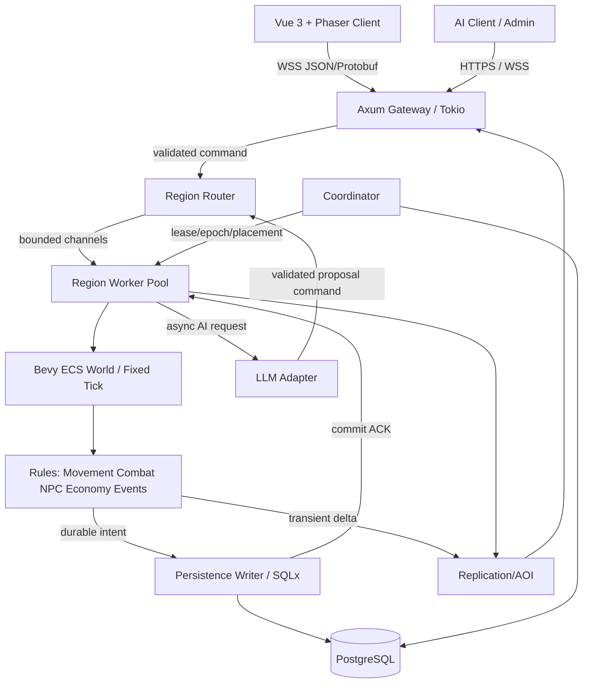
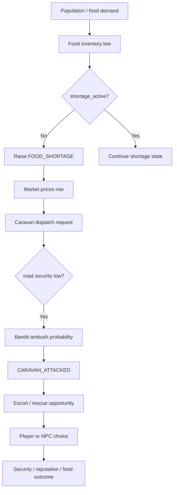
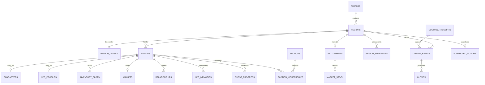
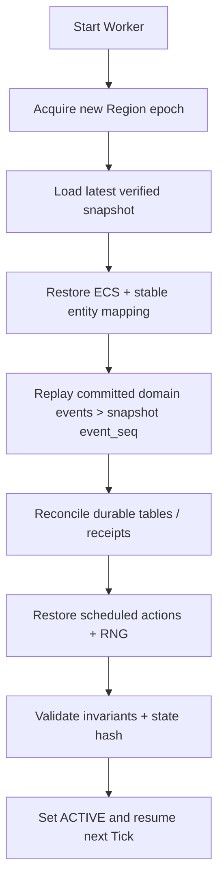
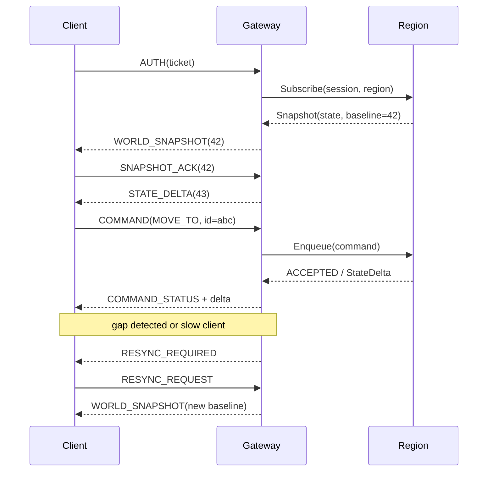
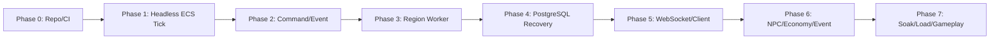

# RPG World Simulation Engine — 통합 설계서

> 자동 생성: README.md, docs/NN-*.md, schemas. 직접 편집하지 마세요.

---

<!-- source: README.md -->

# RPG World Simulation Engine — 설계 문서 패키지

> 문서 ID **RPG-WSE**, 기준일 **2026-11-09**, 상태 **설계 기준선 v1.0 / M0 개발 기반 구현**
> 기술: **Rust + Bevy ECS + Tokio + Axum + PostgreSQL + Vue 3/Phaser**
> 대상: 새로운 실시간·지속형 중세 판타지 RPG 시뮬레이션. 기존 저장소와의 호환성은 가정하지 않는다.

## 0. 먼저 읽기

1. [`docs/00-vision-scope.md`](docs/00-vision-scope.md) — 게임 목표, MVP, 비목표, 용어
2. [`docs/01-requirements.md`](docs/01-requirements.md) — 기능/비기능 요구사항과 추적 ID
3. [`docs/02-hld-architecture.md`](docs/02-hld-architecture.md) — 전체 아키텍처와 책임 경계
4. [`docs/03-core-tick.md`](docs/03-core-tick.md) — 시뮬레이션 코어, 고정 Tick, 결정성
5. [`docs/04-region-ecs.md`](docs/04-region-ecs.md) — ECS·Region Worker·소유권 및 이관
6. [`docs/05-command-event.md`](docs/05-command-event.md) — Command/Event, 검증, 순서, 중복 방지
7. [`docs/06-npc-ai.md`](docs/06-npc-ai.md) — Utility AI + GOAP + 기억과 LLM 경계
8. [`docs/07-world-systems.md`](docs/07-world-systems.md) — 이동, 전투, 경제, 세력, 환경, 동적 사건
9. [`docs/08-data-erd.md`](docs/08-data-erd.md) — ERD 및 영속/일시 데이터 소유권
10. [`docs/09-persistence-recovery.md`](docs/09-persistence-recovery.md) — DB 트랜잭션, Outbox, Snapshot, 복구
11. [`docs/10-network-replication.md`](docs/10-network-replication.md) — WebSocket, AOI, State Snapshot/Delta
12. [`docs/11-protocols.md`](docs/11-protocols.md) — 메시지 계약/오류 코드/관리 API 예시
13. [`docs/12-test-observability.md`](docs/12-test-observability.md) — 테스트 계획, 벤치마크, 지표
14. [`docs/13-implementation-backlog.md`](docs/13-implementation-backlog.md) — 선행관계 포함 구현 티켓·인수 기준
15. [`docs/14-operations-security.md`](docs/14-operations-security.md) — 운영·배포·보안·재해 복구
16. [`docs/15-adrs.md`](docs/15-adrs.md) — 확정 설계 결정(ADR)·미결정 목록
17. [`docs/16-prologue-gameplay.md`](docs/16-prologue-gameplay.md) — 플레이 경험, 프롤로그·공유 세계 진입
18. [`docs/17-developer-onboarding.md`](docs/17-developer-onboarding.md) — 신규 개발자 작업 절차
19. [`docs/18-end-to-end-example.md`](docs/18-end-to-end-example.md) — 구매·경제 이벤트 통합 시나리오
20. [`schemas/0001_initial.sql`](schemas/0001_initial.sql) — PostgreSQL 초기 스키마 초안
21. [`schemas/config.example.toml`](schemas/config.example.toml) — 환경 설정 예시

## 1. 이 문서를 활용하는 순서

- **기획/설계**: 00 → 01 → 02 → 15 → 16
- **엔진 개발**: 03 → 04 → 05 → 06 → 07
- **데이터/서버 개발**: 08 → 09 → 10 → 11 → SQL
- **QA/운영**: 12 → 13 → 14
- **새 개발자 온보딩**: 이 README, ADR, 담당 모듈 문서, 해당 구현 티켓의 *Definition of Done*을 순서대로 읽는다.

## 2. 실행 목표 / 개발 우선순위

**첫 Vertical Slice:** 64×64 타일 개척촌, 1명 플레이어, NPC 10명, 몬스터 2종, 10Hz 고정 Tick, 이동/대화/기본 전투, 식량 생산·소비, 상인 수송대 습격에서 시작되는 동적 사건 1개, 서버 재시작 시 복구. 이후 동시 플레이어 10명, NPC 1,000명으로 확장 검증.

**MVP 품질 기준:** (1) 헤드리스 10,000 Tick 재현, (2) 명령/이벤트 순서 일치, (3) 영속 거래 이중 반영 없음, (4) 클라이언트 2개에서 동일 상태 관측, (5) Tick p95 30ms 이하 *초기 목표* (측정 전 보장 아님).

## 3. 구현 불변식 (절대 깨면 안 됨)

- 동일 `region_id`에 **활성 쓰기 권한자 1개**. 영속 쓰기는 `ownership_epoch` fencing 검증.
- 네트워크·LLM·DB 작업은 **시뮬레이션 Tick을 블로킹하지 않는다**.
- 모든 외부 행위는 **Command**로 제출하고, 세계 상태 변경은 Region Worker/Global Owner만 수행한다.
- 금화·인벤토리·소유권과 같은 **Durable 상태는 DB Commit/ACK 이후에만 최종 성공 처리**한다.
- 위치/애니메이션 등의 **Transient 상태는 체크포인트 수준 복구**를 명시적으로 허용한다.
- 결정적 재현은 **엔진 버전 + 초기 상태 + RNG 규칙 + 적용 Tick/정렬된 입력 + 외부 결과 기록**을 전제한다.
- NPC LLM 출력은 권한 없는 제안이며 게임 규칙이 검증한다.

## 4. 문서 규칙

`REQ-*` 요구사항, `ADR-*` 아키텍처 결정, `TASK-*` 구현 작업, `TEST-*` 테스트를 ID로 참조한다. **[확정]**은 기준선, **[가정]**은 초기값, **[추후]**는 별도 결정 필요. 코드 블록은 계약/예시이며 전체 서버 구현이나 빌드 통과를 보장하지 않는다. 모든 메시지는 `schema_version`을 보유한다. 문서 간 모순이 생기면 `15-adrs.md`의 결정과 `09-persistence-recovery.md`의 원자성 규칙을 우선하고 변경 이력을 기록한다.

## 5. 검증 및 주의

- `schemas/0001_initial.sql`은 PostgreSQL **16+**를 가정한 설계용 초기 마이그레이션이며 운영 적용 전에 빈 테스트 DB로 검증할 것.
- Cargo 의존성은 실제 구현 시작 시 `Cargo.lock`으로 고정한다. 참조: [Bevy ECS API](https://docs.rs/bevy_ecs/latest/bevy_ecs/), [Tokio 채널](https://docs.rs/tokio/latest/tokio/sync/mpsc/), [SQLx](https://docs.rs/sqlx/latest/sqlx/), [Axum](https://docs.rs/axum/latest/axum/).
- 문서 패키지 자체는 **설계 산출물**로, 실제 컴파일/DB 마이그레이션/성능 검증을 수행한 결과물은 아니다. 미구현 기능을 구현 완료라고 표시하지 않는다.

## 6. nmain M0 개발 시작

현재 구현은 **Rust 워크스페이스·설정 로더·HTTP 상태 확인·Runner CLI·CI 기반**까지다.
게임 시뮬레이션과 DB 저장은 아직 구현하지 않았다.
상세 순서는 [개발 계획](docs/19-nmain-development-plan.md),
완료 상태는 [작업 추적표](docs/20-development-status.md),
환경 결정은 [M0 ADR](docs/21-m0-bootstrap-decisions.md)을 따른다.

- 새 엔진: `apps/`, `crates/`, 루트 `Cargo.toml`
- 새 개발 DB: [deploy/compose.dev.yml](deploy/compose.dev.yml), PostgreSQL 16.11, 전용 볼륨·loopback 55432
- 기존 루트 `docker-compose.yml`과 `src/`는 이전 게임 참조이며 새 엔진 실행 경로가 아니다.
- `main`은 기존 게임을 보존하고 신규 개발은 `nmain`에서 진행한다.
- 루트 README·분할 docs·schemas를 수정한 뒤 `python3 scripts/sync-design-docs.py`로 통합 문서와 manifest를 갱신한다.

Rust 1.90.0과 Python 3가 준비된 저장소 루트에서:

```sh
cargo build --workspace --locked
cargo run --locked -p game-server -- --check-config
cargo run --locked -p game-server
# 다른 터미널: live는 200, ready는 미구현 상태를 나타내는 503
curl http://127.0.0.1:18080/health/live
curl -i http://127.0.0.1:18080/health/ready
cargo run --locked -p simulation-runner -- --seed 42 --ticks 10000 --check
sh scripts/verify-m0.sh
```

Runner의 `--check`는 인자 검증만 수행하며 `executed_ticks=0`을 출력한다.
실제 시뮬레이션 요청은 M1 구현 전까지 오류로 종료한다.
서버는 TOML 다음 WSE 환경 변수 순서로 설정을 적용한다.
예: `WSE_HTTP_LISTEN=127.0.0.1:19080 cargo run --locked -p game-server`.

호스트에 Rust가 없으면 [Docker 검증 안내](deploy/README.md)를 사용한다.
M0 CI 파일은 [.github/workflows/wse-m0.yml](.github/workflows/wse-m0.yml)이다.
원격 GitHub CI 실행 여부는 완료 보고서에 별도 표시한다.

---

<!-- source: docs/00-vision-scope.md -->

# 00. 비전 · 게임 범위 · 용어

## 1. 제품 비전

> 플레이어가 접속하지 않아도 생태계·경제·NPC 관계·세력이 변화하고, 플레이어가 선택할 때 그 결과가 영구적인 세계 역사에 남는 실시간 중세 판타지 RPG.

### 게임 정체성
- 장르: 탑다운/아이소메트릭 2D + 샌드박스 + 지속형 세계 시뮬레이션.
- 핵심 루프: **탐색 → 정보/사건 발견 → 선택 → 시뮬레이션 반영 → 결과/평판 확인 → 새로운 선택**.
- 게임의 재미: 정해진 퀘스트 완료뿐 아니라 `월드 상태가 플레이어·NPC 행동으로 변한다`는 피드백.
- 인간과 봇/AI Agent는 동일한 서버 Command 인터페이스를 사용한다. 봇의 권한·명령량은 별도 제한.

## 2. 월드 사례: 국경의 개척촌

초기 지역 64×64 타일, 주민 20명(초기 활성 상세 NPC 10명), 경비병 3, 상인 2, 농부 3, 대장장이 1, 촌장 1, 도적 5(시뮬레이션·전투 대상), 숲/광산/교역로/창고. 값은 콘텐츠 제작을 위한 **가정**이며 프로파일링 전 고정하지 않는다.

```
마을 인구 증가 -> 식량 소비 증가 -> 식량 재고 감소
  -> 가격 상승 -> 상인 수송대 증가 -> 도적 표적 증가
  -> 습격/호위 사건 -> 플레이어 개입 -> 경제/치안/관계 변화
```

## 3. 초기 MVP 범위 (반드시 작게)

| 포함 | 완료 판정 |
|---|---|
| 단일 지역 헤드리스 시뮬레이터 | GUI 없이 10,000 Tick 진행, 결과 재현 |
| 플레이어·NPC Entity/Component | ID, 위치, 생명력, 욕구, 인벤토리 표현 |
| 타일 이동 및 경로 탐색 | 벽/장애물 회피, 도착/실패 반환 |
| 최소 전투 | 근접공격, 피해, 사망, 전리품(확정 거래) |
| NPC 기본 생활 | 농부 생산, 상인 교역, 경비병 순찰, 도적 습격 |
| 동적 사건 1개 | 식량 부족/수송대 습격이 조건에 따라 발생 |
| 공유 월드 2인 관찰 | 위치·사건 상태의 서버 권한 동기화 |
| 영속성 | 거래 원자적 확정 및 재시작 복구 |
| 운영 계측 | Tick/큐/지역/저장 지표 |

## 4. 비목표 (MVP에서 제외)

- 완전한 MMO 규모 분산 샤딩, 글로벌 플레이어 간 즉시 거래, 수천 NPC의 LLM 대화 동시 처리.
- 실시간 PvP 랭크, 복잡한 물리 엔진, 대륙 지도 생성, 실시간 외교 정치 전체 시스템.
- 완전한 이벤트 소싱(모든 미세 이동 상태의 완전한 Replay).
- 클라이언트 예측 기반 고급 전투 보정/롤백 넷코드(일단 보간·권한 서버).

## 5. 핵심 용어

| 용어 | 의미 |
|---|---|
| World | 지속형 게임 전체; Region의 집합 |
| Region | 독립된 ECS 상태/권한/시뮬레이션을 갖는 영역 |
| Region Worker | Region 한 개 이상의 Tick을 실행하는 계산 주체 |
| World Coordinator | Region 소유권, 배치, 전역 작업 조율 |
| Game Entity ID | 네트워크·DB에서 유지되는 UUID; ECS `Entity`와 별개 |
| Tick | 고정 논리 시간 단계(초기 100ms) |
| Command | 실행 의도를 가진 입력(성공 보장 X) |
| Domain Event | 규칙에 따라 실제 발생한 비즈니스 사실 |
| Delta | 현재 상태를 클라이언트에 알리는 변경 메시지 |
| Durable | DB Commit을 기준으로 확정하는 재산·소유권 등 |
| Transient | 체크포인트 손실 범위를 허용하는 좌표·경로 등 |
| Outbox | DB 트랜잭션 안에 기록되는 후속 발행 작업 |
| Epoch/Fencing | 오래된 Worker의 쓰기를 막는 Region 소유권 세대 번호 |

## 6. 플레이어 경험 검증

매 사건 결과는 게임 UI의 **소문/지역 뉴스/경제·치안 지표/NPC 대화** 중 최소 한 채널에 나타난다. 플레이어가 선택했으나 아무 반응이 없는 경우는 버그로 취급한다. 이벤트 루프 진행이 멈추지 않도록 각 단계에 `timeout`, `fallback`, `reason_code`, `recovery_hint`를 둔다. 자세한 흐름은 16번 문서 참조.

---

<!-- source: docs/01-requirements.md -->

# 01. 요구사항 명세 (SRS)

## 1. 기능 요구사항

| ID | 등급 | 요구사항 | 인수 기준 |
|---|---|---|---|
| REQ-F-001 | P0 | 클라이언트 없는 Headless 실행 | `run --seed X --ticks 10000` 가능 |
| REQ-F-002 | P0 | Region ECS/안정 ID | 재시작 이후 동일 Game Entity UUID 복원 |
| REQ-F-003 | P0 | 고정 10Hz Tick 및 시간 배율 분리 | Tick/WorldTime 상호 독립 제어 |
| REQ-F-004 | P0 | Command 검증·멱등성 | 동일 구매 Command 재전송 시 1회 확정 |
| REQ-F-005 | P0 | Region Single Writer | 동일 Epoch에 2 Worker 동시 Commit 불가 |
| REQ-F-006 | P0 | 게임 시간 동안 NPC 자율행동 | 입력 없어도 NPC 상태·작업이 변화 |
| REQ-F-007 | P0 | 이동/충돌/경로탐색 | 도달 불가 시 실패·재경로 사유 기록 |
| REQ-F-008 | P0 | 기본 전투/피해/사망 | HP·충돌·범위·쿨다운 검증 |
| REQ-F-009 | P0 | 이벤트 규칙·후속 발생 | 사건 ID로 인과관계 추적 가능 |
| REQ-F-010 | P0 | 영속 상태/재시작 복구 | Commit한 자산이 재시작 후 유지 |
| REQ-F-011 | P0 | WS 클라이언트 상태 동기화 | 2개 클라이언트 최신 Snapshot 일치 |
| REQ-F-012 | P1 | Region Active/Background | 유휴 영역의 NPC 집계 시뮬레이션 |
| REQ-F-013 | P1 | 식량 생산·소비와 시장 가격 | 재고 부족에 따른 가격/이벤트 발생 |
| REQ-F-014 | P1 | NPC 관계·기억·목표 | 구조화된 기억이 의사결정에 반영 |
| REQ-F-015 | P1 | 게임 세계 사망·경제 효과 | 월드 이력/평판/재고 일관 반영 |
| REQ-F-016 | P1 | 개인 프롤로그 → 공유 월드 | 중복 캐릭터/아이템 없이 1회 이전 |
| REQ-F-017 | P1 | 운영 도구 | Region pause/resume, health, diagnostics |
| REQ-F-018 | P2 | LLM 대화/행동 제안 | 규칙 검증 전에는 세계 상태 변경 불가 |
| REQ-F-019 | P2 | 다중 서버 Region 이관 | Epoch 기반 안전한 권한 양도 |

## 2. 비기능 요구사항

| ID | 요구사항 | 초기 목표 / 검증 방식 |
|---|---|---|
| REQ-N-001 | 재현 가능성 | 엔진/규칙 버전·Seed·입력 로그 동일 시 이벤트/상태 해시 동일 |
| REQ-N-002 | Tick 성능 | 10Hz, Active Region p95 ≤30ms, p99 ≤50ms (**목표치**) |
| REQ-N-003 | 부하 | 1,000 NPC/Region 기준 측정, 10,000 NPC는 분산/집계 실험 |
| REQ-N-004 | 내결함성 | Commit 후 ACK 손실 재처리에도 중복 거래 없음 |
| REQ-N-005 | 메모리 상한 | 채널 bounded, 적체 시 응답·폐기 정책 명시 |
| REQ-N-006 | 보안 | 서버 권한, Actor 소유권, WSS/TLS, 운영 API RBAC |
| REQ-N-007 | 관측성 | Tick, 큐, 오류, DB, 복구, 이벤트, Region 상태 지표 |
| REQ-N-008 | 진화 가능성 | JSON/Protobuf/DB schema_version, 마이그레이션 정책 |
| REQ-N-009 | 데이터 보존 | 영속 이벤트는 유실 없이, 위치는 마지막 성공 checkpoint까지 |

## 3. 전제 및 제약

- 단일 Region+단일 서버에서 시작. Phase 1에 분산 합의/Kafka 불필요.
- 게임 상태 변경은 **모두 서버**에서 검증; 클라이언트는 렌더링 주체.
- 서버는 Rust; UI는 Vue3 + Phaser; LLM은 비동기 별도 어댑터.
- **PostgreSQL 16+ 가정**, 3차원/높낮이·연속 물리는 MVP 범위 밖.
- Region 단위 컴포넌트 상태는 메모리 ECS가 소유; 재산 DB가 최종 확정 근거.

## 4. 개발 완료 정의 (공통 DoD)

1. RFC/ADR 변경이 문서에 반영됨.
2. 코드·마이그레이션·메시지 스키마에 버전 관리 적용.
3. 정상/실패/중복/재시작 경로의 자동화 테스트 존재.
4. `cargo fmt --check`, `cargo clippy -- -D warnings`, `cargo test` 통과.
5. Grafana/Prometheus에서 주요 지표 확인 가능.
6. 담당 기능의 로그에 `world_id`, `region_id`, `tick`, `command_id`, `trace_id` 중 해당 ID가 남음.
7. 통과하지 못한 성능 목표는 실제 측정값과 후속 작업으로 명시(허위 완료 처리 금지).

---

<!-- source: docs/02-hld-architecture.md -->

# 02. 전체 아키텍처 (HLD)

## 1. 컨텍스트 / 주요 외부 시스템



## 2. 컴포넌트 책임/비책임

| 컴포넌트 | 소유/책임 | 금지 사항 |
|---|---|---|
| Axum Gateway | 인증, 세션, rate limit, 프로토콜, 메시지 입력 | ECS 직접 쓰기, DB 상태 임의 변경 |
| Command Router | 지역 매핑, 입력 큐잉, admission | 플레이어 행위 결과를 임의 확정 |
| Coordinator | Region 소유권, 배치·장애 재할당, GlobalWorker 통신 | ECS 개별 Entity 직접 변경 |
| Region Worker | 해당 Region의 ECS와 Tick, 규칙·임시 상태 | Tick 내 `await`/동기 DB 작업 |
| Persistence Writer | durable transaction, receipt, outbox, snapshots | 게임 규칙 임의 해석 |
| Replicator | 구독·AOI·baseline·delta, 느린 클라이언트 분리 | Domain Event를 재정의 |
| LLM Adapter | 대화 및 비권한 제안 | 금화/체력/재고 직접 쓰기 |
| Global Worker | 세력/전역 시간/지역 간 요청의 단일 변경 책임 | 별도 Region 소유 데이터 직접 쓰기 |

## 3. 데이터/명령 방향

```
Player input ─> Gateway ─> Region command queue ─> Tick / ECS
                                               │
        ┌──────── transient state delta ◀───────┤
        │                                      durable intent
        ▼                                             │
Client state channel                    DB transaction + outbox
                                                      │
                                          commit ACK / receipt
                                                      │
                                                      ▼
                                             Region finalized state
                                                      │
                                                      ▼
                                            confirmed client result
```

**핵심 보장:** 영속 성공 응답은 DB Commit 이후. 저장 요청이 미결인 동안 관련 재화/아이템은 예약으로 보호한다. Tick은 나머지 엔티티를 계속 처리한다.

## 4. 동시성과 일관성

- Region 내부 상태를 **한 Worker가 소유**하며 초기 Bevy Schedule은 single-threaded, 명시적 System 순서 적용.
- 전역 데이터는 GlobalWorker 또는 DB 소유 도메인으로 보내고, Region에 읽기 전용 버전 Snapshot을 전달한다.
- 지역 간 이동은 `prepare source → durable transfer/lease fence → target spawn → source cleanup` 절차. MVP는 **단일 프로세스/동일 DB 안에서만** 지원(복잡한 원격 Saga는 P2).
- 지역 간 재화 거래는 MVP에서 허용하지 않는다. 필요하면 Global Transaction Owner 또는 명시적 Saga로 추가.

## 5. 장애 도메인

| 장애 | 격리/복구 |
|---|---|
| WS 단절 | 세션 만료 처리, Region 시뮬레이션 지속 |
| Command 과부하 | ingress 제한; `SERVER_BUSY`; durable intent 유실 금지 |
| Region Worker panic | 해당 지역만 격리, lease fencing 후 snapshot 복구 |
| PostgreSQL 장애 | 신규 durable action 중단, transient 허용범위 설정, 알림 |
| AI 서비스 지연 | fallback Utility AI/템플릿 대사, Tick 비차단 |
| Gateway 장애 | 재접속 + snapshot resync; 서버 월드 지속 |
| Coordinator 장애 | 이미 소유한 lease 동안 계속 실행; 재할당은 대기/제한 |

## 6. 시스템 시퀀스: 물건 구매

```mermaid
sequenceDiagram
    participant C as Client
    participant G as Gateway
    participant R as Region Worker
    participant D as DB Writer
    participant P as PostgreSQL
    C->>G: command BUY_ITEM (command_id)
    G->>R: validated envelope
    R->>R: rule validate, reserve stock/gold
    R-->>C: ACCEPTED / PENDING
    R->>D: durable intent + expected versions + epoch
    D->>P: BEGIN; fence, receipt, balances, event, outbox
    alt commit success
        P-->>D: COMMIT
        D-->>R: committed ACK
        R->>R: finalize reserved state
        R-->>C: SUCCEEDED + state delta
    else error / unknown ACK
        P-->>D: error / timeout
        D-->>R: receipt lookup or retry
        R-->>C: PENDING / FAILED after resolution
    end
```

## 7. 실행 형태

- **Phase 1:** 한 실행 파일 `game-server` 안에 Tokio runtime + Region 전용 스레드 + SQLx writer. Redis/브로커 불필요.
- **Phase 2:** 동일 머신 Region Worker Pool 및 background mode.
- **Phase 3:** 네트워크 Gateway/Region Worker 분리, Postgres fencing/라우터 재할당, 필요시 Redis/메시지 브로커(큐의 진실 원천 아님).

## 8. 기술 스택 기준선

- Rust edition 2024, Bevy ECS(버전 pin), Tokio, Axum, SQLx, Serde, UUID, tracing, Prometheus 계측 라이브러리.
- 릴리스마다 `Cargo.lock` 고정. 변경된 API는 CI에서 검증하고 `15-adrs.md`와 lock 버전 함께 업데이트.

---

<!-- source: docs/03-core-tick.md -->

# 03. 시뮬레이션 코어와 Fixed Tick (LLD)

## 1. 실행 계약

- `tick_rate_hz = 10`, `fixed_delta_ms = 100` (**[가정]**). 게임 시간 배율(`game_seconds_per_real_second=10`)은 별도 설정.
- `tick = n`의 상태 변경은 **명시적으로 정해진 순서**로만 수행한다.
- 시뮬레이션 계산에는 `Instant::elapsed()`/벽시계를 직접 사용하지 않는다. 타임아웃/운영 감시용으로만 허용.
- `WorldState`는 논리적 개념. 실제로는 각 Region에 `bevy_ecs::World` 한 개, 전역 상태는 GlobalWorker가 소유.
- 계산 순서의 결과는 무관한 해시맵 순서에 의존하지 않는다. stable UUID 정렬 또는 의도적으로 순서를 기록한 입력을 사용한다.

## 2. Tick 단계

| 순서 | 단계 | 입력 | 출력/불변식 |
|---|---|---|---|
| 0 | Admission | Gateway Commands | 적용 Tick·RegionSeq 확정, 초과/중복 거부 |
| 1 | Command Validation | Ready queue | Pending action / Rejected |
| 2 | Perception | Spatial index | 주변 가시 정보 / 위험 신호 |
| 3 | Navigation & Movement | 목표/속도/타일 맵 | 위치·충돌 결과 |
| 4 | Combat | 공격 입력/거리/HP | 피해·사망·보상 intent |
| 5 | NPC Decisions | 대상 NPC 스케줄 | 다음 Tick 실행 Command |
| 6 | World/Economy | Resource / Settlement | 생산·소비·가격·환경 |
| 7 | Event Rules | State changes/events | 결정적인 후속 명령 예약 |
| 8 | Finalize | transient changes, staged durable | delta, durable requests, trace |
| 9 | Output | Event/Delta queues | Replicator/Writer에 bounded enqueue |

중요: 영속 트랜잭션 ACK는 각 Tick의 **단계 0 전** 우선 처리하며, 영속 intent의 원래 주문 순서를 보존한다. ACK가 재정렬될 수 있는 경우 actor/item 단위 in-flight 직렬화로 일관성을 지킨다.

## 3. 핵심 Rust 인터페이스 (설계 계약)

```rust
pub struct TickContext {
    pub tick: u64,
    pub fixed_delta_ms: u32,
    pub game_time_ms: u64,
    pub seed: [u8; 32],
}

pub struct RegionRuntime {
    pub world: bevy_ecs::world::World,
    pub schedule: bevy_ecs::schedule::Schedule,
    pub metadata: RegionMetadata,
    // command inbox, pending transactions, outbox buffers,
    // stable_id <-> ECS Entity index, metrics
}

pub struct TickOutcome {
    pub tick: u64,
    pub transient_deltas: Vec<StateChange>,
    pub durable_intents: Vec<DurableIntent>,
    pub generated_commands: Vec<CommandEnvelope>,
}

pub trait HeadlessEngine {
    fn enqueue(&mut self, command: CommandEnvelope) -> Result<(), EngineError>;
    fn step(&mut self) -> Result<TickOutcome, EngineError>;
    fn snapshot_committed(&self) -> Result<RegionCheckpoint, EngineError>;
}
```

`TickOutcome`은 **아직 DB에서 확정되지 않은** durable intent를 포함할 수 있다. Replicator는 transient delta만 즉시 사용하며, durable result는 `PersistenceAck` 이후 별도로 내보낸다.

## 4. Bevy Schedule 규칙

```rust
#[derive(SystemSet, Debug, Clone, Copy, PartialEq, Eq, Hash)]
pub enum SimPhase {
    Perception, Movement, Combat, NpcDecisions, World, EventRules,
}
// schedule.configure_sets((...phase...).chain());
// schedule.set_executor(SingleThreadedExecutor::default());
```

- 시스템은 component query와 리소스만 사용, IO 없음.
- 각 System은 입력 상태와 TickContext에서만 계산. `Commands` deferred 적용 지점을 명시.
- NPC가 새 결정을 내리면 **다음 Tick** 명령에 등록한다. 피해·이동 중단처럼 같은 Tick 내 필수 반응은 Combat/Movement 단계에서만 수행.
- 초기에는 single-thread executor. 이후 병렬화할 때 golden replay 통과 필수.

## 5. NPC 분산 스케줄링

- `decision_interval_ticks=10`이면 `hash(stable_id) % 10 == tick % 10`인 NPC만 일반 판단.
- 근접 공격·피해 등 인터럽트 반응은 매 Tick 조회 가능한 별도 urgent queue.
- 장기 GOAP plan은 100 Tick 주기 또는 목표 무효화 시 실행.
- budget: `max_npc_evaluations_per_tick`, `max_path_expansions_per_tick`; 처리 못한 저우선순위 작업은 뒤로 미루되 starvation 방지용 aging.

## 6. RNG / 결정성

- RNG는 엔진 버전이 고정된 알고리즘(예: ChaCha8 계열 고정 버전) 또는 `(world_seed, region_uuid, tick, system_id, actor_uuid, counter)`를 안정된 해시로 조합한 stream으로 구성.
- `HashMap` 순회 순서, OS thread scheduling, float roundoff에 의존한 분기 금지.
- 좌표/재화/피해는 integer/fixed-point 추천(`i64` 밀리타일, 금화 정수).
- 비동기 LLM 결과는 **외부 Command**로 변환해 적용 Tick과 payload를 로그에 남긴다.
- 결정성 테스트는 `initial snapshot + engine/rules version + ordered input log + RNG state`로 출력 해시 검증.

## 7. Tick Scheduler 알고리즘 (의사코드)

```rust
let step = Duration::from_millis(100);
let mut deadline = Instant::now();
while running {
    drain_priority_acks_and_controls();
    collect_commands_with_admission_limit();
    let out = engine.step()?; // never await
    try_enqueue_transient(out.transient_deltas); // coalesce if full
    enqueue_or_reject_durable_safely(out.durable_intents)?;
    emit_metrics();
    deadline += step;
    if Instant::now() < deadline { sleep_until(deadline); }
    else {
        record_overrun();
        // 정책: 중간 상태를 생략하지 않되, 저우선 작업을 지연,
        // 지속 초과 시 admission 제한 / degraded 진입
    }
}
```

**보장 차이:** 동일 입력 시 논리 Tick 결과 재현은 목표이나, 실제 수신 시간·네트워크 지연은 재현 불가. 라이브 모드에서는 `assigned_tick`을 로그로 남긴다.

## 8. Tick 실패 정책

| 분류 | 처리 |
|---|---|
| 명령 검증 실패 | `REJECTED`, Tick 지속 |
| 계산 중 데이터 불변식 위반 | Region `PAUSED`, 증거 snapshot/log, 운영 알림 |
| DB Writer 단절 | 신규 durable intent 차단, Tick transient 제한적 지속 |
| 5회 연속 Tick 초과 | `DEGRADED`, AI 낮은 우선순위 감축 |
| 스레드 panic | Region lease 안전 해제/만료 후 복구 |

## 9. 테스트

- TEST-TICK-001: 10,000 Tick을 headless로 실행해 동일 seed/inputs에서 상태 해시가 같다.
- TEST-TICK-002: NPC별 예정 Tick 실행 횟수가 정확하다.
- TEST-TICK-003: 입력 순서가 다르면 로그상 정렬·assign 순서대로 결과가 재현된다.
- TEST-TICK-004: 초과 Tick 발생 시 tick number가 생략되지 않는다.
- TEST-TICK-005: 비동기 LLM 지연 10초가 Tick 실행 시간을 늘리지 않는다.

---

<!-- source: docs/04-region-ecs.md -->

# 04. Region Worker · ECS · Ownership (LLD)

## 1. Region 소유권 모델

- 각 Region은 정확히 **하나의 Active Owner**만 갖는다.
- `region_leases(region_id, owner_id, ownership_epoch, lease_expires_at)`를 PostgreSQL에 관리.
- 모든 **durable DB 쓰기 트랜잭션**은 lease row를 잠그고 `epoch = expected_epoch` 및 `lease_expires_at > clock_timestamp()` 검사 후 진행한다.
- GC/스케줄 지연 때문에 이전 Worker가 살아있어도 새로운 Epoch를 부여하면 이전 Worker의 Commit은 거부된다.
- Gateway의 Region routing cache는 epoch와 함께 사용하며 불일치 시 refresh 후 명령 다시 라우팅.

## 2. ECS World 구조

```
RegionRuntime
  ├── RegionMetadata { region_id, epoch, status, tick }
  ├── bevy_ecs::World
  │   ├── Entity(opaque Bevy handle) -> StableEntityId(UUID)
  │   ├── Position, Velocity, Navigation, Collider
  │   ├── Health, CombatState, InventoryProjection
  │   ├── Needs, Personality, AIState, MemoryRef
  │   └── Resources: Clock, MapGrid, SpatialIndex, Rng
  ├── Schedule (ordered systems)
  ├── stable_entity_index: UUID -> Bevy Entity
  ├── command_queue / priority_ack_queue
  ├── pending_durable: command_id -> reservations
  └── changed_entity_set / tick_metrics
```

Bevy `Entity`는 Region의 재시작 시 달라질 수 있으므로 네트워크·DB·로그에 직접 저장 금지. `StableEntityId(Uuid)`를 사용하고 복구 시 인덱스를 다시 만든다.

## 3. 필수 Components

| Component | 필드(예시) | 검증 규칙 |
|---|---|---|
| StableId | UUID | Region 내 unique |
| Position | `x_millitile:i64, y_millitile:i64` | 유효 지형·영역 좌표 |
| Velocity | `dx,dy:i32` | 이동 속도/능력 상한 |
| Navigation | target, path, path_version, state | 경로 유효/상태 머신 |
| Health | current,max:i32 | 0 ≤ current ≤ max |
| Needs | hunger,fatigue,safety:u16 | 0..1000 clamp |
| Personality | courage,greed,loyalty:i16 | -1000..1000 |
| AIState | goal,action,next_decision_tick | 유효 계획/쿨다운 |
| InventoryProjection | committed_version, slots | DB Commit 결과만 반영 |
| FactionMembership | faction_uuid,standing | GlobalWorker의 버전 검증 |

## 4. Region Worker Thread

```rust
struct RegionHandle {
    id: uuid::Uuid,
    epoch: u64,
    cmd_tx: tokio::sync::mpsc::Sender<RegionMessage>,
}

enum RegionMessage {
    Command(CommandEnvelope),
    PersistenceAck(PersistenceAck),
    GlobalStateUpdate(GlobalProjection),
    SetSimulationMode(SimulationMode),
    Shutdown,
}
```

Tokio 네트워크는 `Sender::try_send`/`send`를 상황에 맞춰 사용; Region 전용 OS 스레드는 `Receiver::try_recv`로 bounded 입력을 매 Tick 전 수집한다. `try_send` 성공은 **큐에 들어갔다는 의미**이지 성공 실행/DB 확정이 아니다.

### 큐 정책

| 큐 | 임시 상한(가정) | 가득 찼을 때 |
|---|---:|---|
| Player Command / Region | 4096 | `SERVER_BUSY` 반환; 세션별 rate limit |
| Persistence Ack | 1024 | 우선순위 보장/별도 경로; 안전 중단 |
| Transient Delta | 2048 | 위치 delta 병합/old delta 폐기 후 snapshot |
| Durable Intent | 512 | 신규 durable 명령 거부, in-flight 예약 유지 |
| Control | 64 | 우선 서비스; 불가 시 health fault |

## 5. Region Lifecycle

`LOADING → ACTIVE/BACKGROUND → PAUSED/MIGRATING → STOPPED`. 별도 `health = HEALTHY/DEGRADED/FAILED` 유지(상태와 건강을 섞지 않음).

- LOADING: Epoch 취득 → Snapshot·이벤트·영속 Projection 일치 검증 → Spatial index 재구성.
- ACTIVE: 플레이어가 있는 영역, 상세 이동/전투/AI.
- BACKGROUND: 실시간 개별 NPC 이동의 일부 생략, 생산/소비 집계; 중요 NPC 독립 상태는 보존.
- MIGRATING: 신규 Command admission 정지, durable drain/확정, 안전 checkpoint, Epoch 양도, 대상 Worker 로드 후 라우팅 변경.
- PAUSED: 관리/이상 상태; 외부 입력 명확히 거부 또는 대기.

## 6. Region 간 이동 (MVP 단일 서버)

```mermaid
sequenceDiagram
  participant S as Source Region
  participant C as Transfer Coordinator
  participant D as Durable Store
  participant T as Target Region
  S->>C: TransferRequest(entity, source_epoch)
  C->>S: Mark TRANSFERRING; stop local commands
  C->>D: transfer record unique transfer_id / fence epochs
  D-->>C: committed transfer intent
  C->>T: spawn frozen entity snapshot
  T-->>C: target ready
  C->>D: commit new region_id/location
  D-->>C: committed
  C->>S: despawn source
  C->>T: activate entity
```

실패 시 `transfer_id` receipt로 재시작: 목적지 중복 생성은 idempotent upsert, 소스/목적지 동시 활성화 금지. 구현 첫 단계에서는 `Player` 이전만 지원, 임의 NPC 이동은 후속 확대.

## 7. Global State 원칙

- Kingdom/Faction/World Clock/거시경제 등 공유 상태에는 별도 GlobalWorker single writer 적용.
- Region은 `global_projection_version`을 포함한 읽기 전용 Snapshot을 사용.
- 글로벌 명령은 GlobalWorker로 전달하고, 결과 Event를 Region에 비동기 적용.
- 일관성이 필요한 다중 지역 거래는 MVP 제외; 최종 일관성만 허용하는 이벤트는 버전·중복 처리 필수.

## 8. 테스트

- TEST-REGION-001: 동일 Region Epoch를 가진 Worker 2개 중 하나만 Commit 성공.
- TEST-REGION-002: Worker panic 후 새로운 Epoch로 복구, 이전 Worker 쓰기 거부.
- TEST-REGION-003: 2개 Region 동시 실행에서 ECS 상태 교차 수정 없음.
- TEST-REGION-004: BACKGROUND↔ACTIVE 전환 후 NPC/재고 합계 불변식 유지.
- TEST-REGION-005: transfer 중 임의 단계 종료 시 캐릭터 중복 0.

---

<!-- source: docs/05-command-event.md -->

# 05. Command / Event Pipeline · 실행 규칙 (LLD)

## 1. 불변식 및 책임

- Command = 의도, Event = 발생한 사실, Delta = 클라이언트 현재 상태 변화. 혼용 금지.
- `CommandEnvelope`는 `command_id(UUID)`, `actor_id(UUID)`, `region_id(UUID)`, `session_id(UUID)`, `client_seq`, `assigned_tick`, `ingress_seq`, `ownership_epoch`, `schema_version`, `payload`.
- `ingress_seq`는 Region Worker가 입력을 큐에서 받아 확정하는 지역 내부 단조 증가 번호. 재생에는 이 순서가 원본이다.
- Client `target_tick`은 신뢰하지 않는다. Region이 admission 시 `assigned_tick`을 지정한다.
- NPC/LLM/운영 명령도 동일 Pipeline 사용(출처와 권한 scope가 다름).

## 2. 명령 처리 계약

```rust
pub enum CommandPayload {
    MoveTo { x: i64, y: i64 },
    Attack { target_id: uuid::Uuid },
    Interact { target_id: uuid::Uuid },
    BuyItem { shop_id: uuid::Uuid, sku: String, quantity: i32 },
    NpcAction { action_id: String, target_id: Option<uuid::Uuid> },
}

pub enum CommandStatus {
    Received, Accepted, Rejected,
    PendingCommit, Succeeded, Failed,
}
```

`Received`=Gateway가 받은 상태, `Accepted`=Region 검증·큐잉, `PendingCommit`=durable intent DB 미확정, `Succeeded`=실행 성공. 단순 이동도 타일·속도·상태 검증 실패 시 거부된다.

### 검증 순서

1. WSS 인증/세션 TTL/Actor ownership 확인.
2. protocol_version/payload size/rate limit 검증.
3. Router에서 region_id/epoch 확인.
4. Region Tick에서 actor 상태, 거리, 자원, 쿨다운, 월드 규칙 확인.
5. transient effect 적용 또는 durable reservation 생성.
6. 이벤트/응답 기록, 결과를 Session에 반환.

## 3. 결정적 정렬/중복 처리

- 기본 정렬: `(assigned_tick, ingress_seq)`; `ingress_seq` 단조 증가이므로 유일함.
- 재현용 입력 로그는 **검증 결과와 적용 순서**까지 포함한다.
- durable 명령은 DB에 `UNIQUE(command_id)` receipt를 남긴다. 같은 ID + 다른 payload는 `IDEMPOTENCY_CONFLICT`.
- transient 명령 중복 제거는 session/sequence 기반 LRU 윈도우. 재시작 간 이동 입력 재전송은 snapshot 재동기화 후 폐기 가능.
- Command receipt는 최소 게임 운영 정책 기간 보존; 구매/소유권 관련 영속 receipt는 무제한 또는 감사 보존정책으로 장기 보존.

## 4. Event 구조

```json
{
  "event_id": "4c69723e-d891-4ea0-ac73-680c1d48f980",
  "event_type": "CARAVAN_DAMAGED",
  "schema_version": 1,
  "world_id": "<uuid>",
  "region_id": "<uuid>",
  "region_event_seq": 142,
  "tick": 992,
  "causation_command_id": "<uuid-or-null>",
  "correlation_id": "<uuid>",
  "source_entity_id": "<uuid>",
  "payload": {"caravan_id":"<uuid>", "hp_lost":12}
}
```

- `region_event_seq`는 durable 이벤트에 대해 DB Commit 순서 기준 단조 증가.
- transient 이벤트는 `tick_seq`로 구분 가능하며 durable event sequence를 소비하지 않는다.
- `causation_command_id`와 `correlation_id`로 연쇄 사건의 원인을 추적한다.

## 5. Event Rule 포맷

```yaml
rule_id: caravan_attack_causes_shortage_v1
priority: 100
scope: region
trigger: CARAVAN_DAMAGED
conditions:
  - expr: "settlement.food_stock < settlement.min_food_stock"
  - expr: "settlement.shortage_active == false"
commands:
  - type: RAISE_SETTLEMENT_CONDITION
    params: {condition: FOOD_SHORTAGE}
cooldown_game_seconds: 3600
max_occurrences_per_region_day: 1
```

**주의:** 표현식은 임의 문자열 `eval`로 실행하지 않는다. enum/AST 또는 검증된 DSL parser로 허용 필드와 연산만 지원. 이벤트 정의는 규칙 Command를 제안할 뿐, 직접 임의 SQL/월드 변경은 금지.

## 6. 이벤트 연쇄 제한

- 이벤트의 후속 명령은 원칙적으로 `tick+1` 이후 예약.
- 한 Tick `max_events_per_tick`, 인과관계 depth `max_causation_depth`, 규칙 단위 cooldown, `event_id` 중복 방지.
- 무한 연쇄 또는 불변식 위반 시 `RULE_CYCLE_DETECTED`를 발행하고 해당 rule만 비활성화/운영 알림.
- 과거 Event Replay는 side effect(LLM/이메일/외부 Webhook)를 재발행하지 않으며, outbox 발행자는 별도 멱등 처리.

## 7. 거래 확정 경로와 실패 모드

`Validate → Reserve → DurableIntent → DB Transaction → ACK → Commit ECS projection → SUCCEEDED`.

- Pending 동안 같은 금화/아이템을 재사용할 수 없음.
- DB Timeout은 실패와 동일하지 않음. Receipt 조회 후 결과가 불명확하면 `UNKNOWN/PENDING`으로 유지, 임의 환불/재실행 금지.
- 수신 성공만으로 성공 응답을 반환하지 않음.
- 이벤트 로그와 상태 테이블/Outbox/Receipt는 **한 DB 트랜잭션**에 기록.

## 8. 테스트

- TEST-CMD-001: 동일 구매 Command 100회, 재화 차감 1회.
- TEST-CMD-002: command_id 동일·payload 다름 → `IDEMPOTENCY_CONFLICT`.
- TEST-EVENT-001: 식량 부족 조건 1회 충족 시 단일 FOOD_SHORTAGE.
- TEST-EVENT-002: 순환 Rule이 depth 제한에서 중단되고 원인 추적 가능.
- TEST-EVENT-003: ACK 손실 후 receipt lookup으로 성공/실패 구분.
- TEST-EVENT-004: Replay 중 외부 Webhook/LLM 재발행 0건.

---

<!-- source: docs/06-npc-ai.md -->

# 06. NPC Decision Engine — Utility AI + GOAP (LLD)

## 1. 설계 목표

NPC는 플레이어가 없어도 목적·욕구에 따라 행동한다. 단, 모든 NPC를 매 Tick 재계획하지 않고 **Perception → Urgent Reaction → Utility Goal Selection → GOAP Planning → Action Execution** 단계를 분리한다. NPC AI는 영속 상태를 직접 변경하지 않으며 `NPC_ACTION` Command를 다음 Tick에 제출한다.

## 2. NPC 데이터 모델

| 구성요소 | 필드 | 저장/갱신 |
|---|---|---|
| Identity | stable_id, profession, home_region, faction_id | DB 영속 |
| Needs | hunger, fatigue, safety, wealth_pressure (0..1000) | ECS/체크포인트 |
| Personality | courage, greed, loyalty, curiosity (-1000..1000) | DB 영속 |
| Relationship | target_id, trust, affinity, fear, debt | DB 영속(중요 변화) |
| Memory | kind, target, severity, happened_tick, ttl, immutable refs | DB 중요 기억, 단기 ECS |
| Goals | survive, eat, earn, defend, revenge | AI state/체크포인트 |
| Plan | GOAP action list, current_index, precondition_hash | ECS/체크포인트 |
| AI Schedule | next_decision_tick, last_replan_tick | ECS/체크포인트 |

## 3. Perception — NPC가 아는 사실만 사용

- 주변 반경 `vision_range_tiles` 안의 Entity는 spatial hash/grid로 조회.
- `VisibleEntity`, `Threat`, `AvailableFood`, `NearbyWork`, `FactionAlert`, `KnownRoute` 등의 **관측 사실(Facts)** 생성.
- 다른 지역 내부 상태를 텔레파시처럼 즉시 읽지 않는다. 소문/메신저/세계 공지 등 전달된 사실만 반영.
- 지형/안개/시야 차단은 P1; MVP는 반경 + 장애물 단순 판정.

## 4. 긴급 반응과 일반 의사결정

**긴급 반응:** 피해/공격/기절/화재. 매 Tick 또는 이벤트 시 urgent queue에 삽입. `DODGE`, `FLEE`, `CALL_GUARD`, `COUNTERATTACK` 후보 평가. 1회 처리 후 cooldown 적용.

**일반 판단:** 초기 1초마다, NPC UUID의 안정된 해시로 Tick 분산. 현재 실행 중 행동이 유효하고 긴급 상황이 아니면 매번 목표를 바꾸지 않는다(히스테리시스).

## 5. Utility AI 점수 계산

각 목표 `g`는 입력 facts에 대해 0~1000 범위의 utility를 만든다.

\[
 U(g)=\operatorname{clamp}_{[0,1000]}(\sum_i w_{g,i}\,c_i(facts, needs) + p_g(personality) + q_g(context) - k_g(cooldown))
\]

- `c_i` = 0~1000 정수 정규화; `w` 고정소수점(예: 천분율), 내적에서 64bit intermediate 사용.
- 모든 weight와 curve는 버전 관리하는 데이터 파일에 저장.
- 최종 점수 차이가 `switch_margin=100` 이하이면 현재 goal 유지(목표 왕복 방지).
- 동점이면 `(goal_priority, stable_goal_id)`로 순서 결정.

**예: NPC 상태** `hunger=850`, `fatigue=400`, `threat=700`, `food_available=true`.

| 후보 | 정규화 입력/상황 | Utility 예시 | 결과 |
|---|---|---:|---|
| EAT | 배고픔 높고 음식 접근 가능 | 830 | 후보 |
| REST | 피로 중간, 주거 접근 가능 | 410 | 후보 |
| FLEE | 위협 높고 용기 낮음 | 930 | **선택** |
| WORK | 일터 있지만 위험 | 180 | 후보 |

수치는 예시이며 게임 밸런스 데이터로 외부화. `FLEE`를 선택하면 GOAP에 `Safe=true` 목표를 전달.

## 6. GOAP 플래너

### World Facts 예시

```rust
struct Facts {
    has_food: bool,
    near_home: bool,
    is_safe: bool,
    has_gold: bool,
    shop_open: bool,
}

struct GoapAction {
    id: &'static str,
    preconditions: Vec<FactPredicate>,
    effects: Vec<FactEffect>,
    cost_milli: u32,
    max_duration_ticks: u32,
}
```

### 기본 Action 정의

| Action | Precondition | Effect | Cost 예 |
|---|---|---|---:|
| MOVE_TO_MARKET | route_available, not_threatened | at_market=true | path_length×10 |
| BUY_FOOD | at_market, has_gold, stock>0 | has_food=true | price + queue |
| EAT_FOOD | has_food, not_in_combat | hunger_reduced=true | 200 |
| FLEE_TO_GUARD | threat_present, route_available | is_safe=true | route 위험도 |
| REST_AT_HOME | near_home, safe | fatigue_reduced=true | 500 |
| WORK_FIELD | season_ok, safe, tools_ok | earned_food=true | 700 |

### 탐색 알고리즘

1. Utility로 목표 상태(Goal Facts) 선택.
2. 현재 NPC Facts와 Action Catalog를 로드.
3. A* 또는 Dijkstra 기반으로 precondition/effect 가능한 노드 확장.
4. `max_expansions=128`, `max_plan_length=12`, `max_plan_ms` 제한(벽시계는 예산/운영에만 사용, 결과 순서 결정에는 사용 금지).
5. 행동 cost는 `duration + risk + resource + social_cost`의 정수 가중 합.
6. 동점은 stable action ID 정렬. 탐색 실패 시 `fallback = REST/WAIT/FLEE`.
7. 실행은 다음 Tick의 명령으로 제출하고 실제 비용·재고를 서버에서 다시 검증.

### 재계획 조건

- 목표 달성, 전투/위협 변경, 행동 실패, 필요한 재료 소진, 경로 차단, 계획 유효기간 만료.
- 연속 실패 3회: exponential cooldown, plan diagnostics 기록, 안전한 Idle로 전환.

## 7. GOAP 실행 상태 머신

`IDLE → EVALUATING → PLANNING → EXECUTING → (SUCCESS | FAILED | INTERRUPTED) → EVALUATING`.

각 Action은 `action_id`, `entity_id`, `plan_version`, `started_tick`, `timeout_tick`, `target_id`, `status`를 기록. Timeout에 도달했거나 stale `plan_version`이면 안전히 취소. 반복되는 액션 실패 시 `NPC_STUCK` 진단 이벤트를 기록한다.

## 8. NPC 기억/관계 설계

- 단기 기억: 시야에서 본 대상, 최근 대화, 현재 위협. 메모리 TTL(게임 시간) 만료.
- 장기 기억: 구조/배신/살인/보상 등 중요한 사건, DB에 보존.
- 관계: `(subject_id, target_id)` 쌍의 trust/affinity/fear 값을 정수로 저장.
- 사건 이후 후속 업데이트는 `RelationshipChangeCommand`로 제출하고 DB Commit 후 ECS projection 갱신.
- 기억의 주요 항목에는 `source_event_id` 고유성을 부여해 같은 사건 중복 학습 방지.

## 9. LLM 경계

```
Dialogue request (async) -> NPC facts + policy-approved memory
  -> LLM proposal (text, optional suggested_action)
  -> schema parse / content policy / rule validation
  -> dialogue broadcast or Command queued in future Tick
```

- LLM은 NPC의 실제 재산·아이템·위치 DB를 바꾸지 않는다.
- 제안 행동은 권한·가능성·자원·관계·거리 재검증 후 적용.
- timeout 시 템플릿 대사/Utility 결정으로 fallback; response는 idempotency key와 요청된 world revision 확인.
- 개인정보/대화 원문을 장기 기억에 그대로 저장하지 않는다; 목적·보존정책에 맞춘 요약만 저장.

## 10. 의사결정 성능

- `1,000 NPC / 1초 판단` 목표 시 10Hz Tick에는 평균 약 100 NPC 판단 분산.
- Perception은 spatial index를 사용하고 GOAP 전체 재계획은 목표 변동 때만 실행.
- `npc_decisions_total`, `goap_expansions_total`, `npc_plan_failures_total`, `npc_stuck_total` 계측.

## 11. 테스트/인수 기준

- TEST-AI-001: 배고픔이 높지만 급박한 위협이 있으면 FLEE가 EAT보다 우선.
- TEST-AI-002: 음식이 없어도 금화와 상점이 있으면 BUY → EAT 계획 생성.
- TEST-AI-003: 무효 경로 시 재계획, 연속 실패시 Idle 및 진단.
- TEST-AI-004: 같은 입력·seed·facts는 동일 goal/plan 생성.
- TEST-AI-005: LLM이 존재하지 않는 아이템 지급을 제안해도 실제 지급 0.
- TEST-AI-006: 중요 기억 source_event_id 중복 반영 0.

---

<!-- source: docs/07-world-systems.md -->

# 07. World Systems — 이동·전투·경제·세력·환경·사건 (LLD)

## 1. 공통 System 실행 원칙

- 월드 상태 업데이트는 `simulation-core`에서 허용한 ECS Resource/Component에만 접근.
- 순서/제약은 `03-core-tick.md`를 따른다. 시스템 간 직접 SQL 호출 금지.
- `Transient`는 Tick Commit, `Durable`는 `DurableIntent`와 DB ACK 후 Commit.
- 게임 콘텐츠 정의(YAML/JSON)는 실행 전에 JSON Schema/타입 검사 및 버전 고정.

## 2. Movement & Navigation

### 좌표 규칙
- World 좌표 `millitile` 정수(`1 tile = 1000`). Z축 제외.
- 타일은 static terrain + 동적 blocking entities + 위험도 비용으로 구성.
- 이동 모드 `IDLE, PATH_REQUESTED, FOLLOWING, BLOCKED, ARRIVED, CANCELLED`.

### 이동 Command 처리

1. actor가 존재하고 움직일 수 있는지 확인(`STUNNED`, `DEAD` 등 검사).
2. 대상 tile 유효성·도달성 검사.
3. A* pathfind(허용 노드 확장 제한, 휴리스틱 Manhattan/Octile).
4. 거리·속도·충돌 처리, 인접 셀 reservation 필요 여부 판단.
5. 도착 시 `MOVE_ARRIVED`; 막힘 지속 시 `MOVE_BLOCKED`, 재탐색/실패 사유.

### 테스트
- 벽 통과 불가, 다수 NPC 한 칸 경쟁 시 순서 일관, 경로 재탐색 무한 루프 없음, 자동 이동 버튼 재전송에도 중복 경로 실행 없음.

## 3. Combat

| 필드 | 타입/규칙 |
|---|---|
| `attack_range_millitile` | 정수, 대상까지 거리 검사 |
| `cooldown_until_tick` | 다음 공격 가능 Tick |
| `base_damage` | 정수 고정소수점 |
| `armor/mitigation` | 검증된 피해 감소 규칙 |
| `health` | 0..max, underflow 금지 |
| `status` | ALIVE/DOWNED/DEAD |
| `loot_intent` | 실제 아이템 부여 전 DB 확정 필요 |

**시퀀스:** `ATTACK command → ownership/range/cooldown → damage calculation → HP update → DIED event → durable loot/ownership intent → DB ACK → item added`.

피해 상태의 복구 보장은 정책에 따라 선택한다. MVP는 플레이어 사망/아이템 획득은 durable, 일반 이동 및 몬스터의 경미한 피해는 checkpoint 기준. `DIED`를 DB 확정 전에 최종 사용자 자산 변화로 연결하지 않는다.

## 4. Economy

### 지역 경제 최소 데이터
- Settlement: `population`, `food_stock`, `food_capacity`, `security_index`, `treasury`.
- 생산자: `production_rate`, `input_stock`, `season_modifier`.
- 소비자: 인구 × 일일 소모량.
- 시장: `base_price`, `stock`, `target_stock`, `min/max_price`, `version`.

### 1분 집계 규칙 예시

```
production = active_farms * base_yield * weather_multiplier
consumption = population * food_consumption_per_step
new_stock  = clamp(old_stock + production - consumption, 0, capacity)
scarcity   = clamp((target_stock - new_stock) / target_stock, -1, 1)
price      = clamp(base_price * (1 + scarcity_factor * scarcity), min, max)
```

운영 계산에서는 모두 **정수 또는 고정소수점**을 사용하고 나눗셈 반올림 규칙을 고정한다. 출력 가격 변화에는 시차/완충(EMA 또는 단계형)을 둬 진동 방지. 재화 총량, 자원 생산/소비의 conservation audit를 기록.

### 경제 실패/과부하 제어
- 재고 음수 금지, 같은 상품을 두 명이 동시에 구매할 때 DB row version/락으로 원자성 보장.
- 동일 이벤트가 지속 트리거되지 않도록 `shortage_active` 상태 + cooldown 사용.
- Background Region도 생산/소비는 계속하되 매 Tick NPC 위치 계산 생략.

## 5. Faction/Politics

- 전역 세력은 GlobalWorker의 단일 쓰기 상태: 영향력/영토/동맹/적대/전쟁.
- Region은 세력의 버전 projection을 읽고 `FactionActionCommand` 제안.
- 이벤트 예: 교역로 습격 증가 → 경비 요청 → 세력 영향력 감소 → 토벌 행동.
- MVP는 두 세력의 신뢰·적대도와 지역 치안 지표만; 전쟁/영지 점령은 P2.

## 6. Environment / Weather / Time

- `WorldClock`과 Time Scale을 독립 관리(초기 `game_time_scale = 10`).
- 지역별 WeatherState (`CLEAR/RAIN/STORM`)는 Seed 기반 RNG와 game-time schedule로 갱신.
- 환경 효과는 이동 비용·농업 생산·NPC 안전 욕구에 Modifier로만 적용(직접 타 시스템 수정 금지).

## 7. Emergent Event Example



확률적 조건이라도 RNG stream/seed, 적용 Tick, rule_version을 로그에 포함. 피해/물건/경제가 실제로 변하지 않은 경우 “침략 성공” 같은 거짓 Event를 생성하지 않는다.

## 8. Background Simulation

- `ACTIVE`: 개별 이동/전투/시야/대사 상세 계산.
- `BACKGROUND`: 중요 NPC의 자산/상태는 개별 보존하되, 일반 주민 이동·생산 일부를 집계함.
- 전환 경계에서는 집계 생산량을 Entity 인벤토리와 **중복 지급하지 않음**. `source_of_truth = SETTLEMENT_LEDGER`로 정해진 자원은 어느 모드에서도 동일 원장을 사용.
- “플레이어 0명”과 “진행 중 전투 0/미결 durable 0/최근 활동 유예기간 경과” 조건을 모두 만족해야 Background 전환 가능.

## 9. 모듈 테스트

| 테스트 | 입력 | 결과 |
|---|---|---|
| TEST-MOV-001 | 닫힌 벽으로 MOVE_TO | REJECTED / BLOCKED, 좌표 불변 |
| TEST-MOV-002 | 이동 중 지형 차단 | 정해진 재경로/실패; Tick 지속 |
| TEST-CMB-001 | 사거리 밖 ATTACK | 피해 0, REJECTED |
| TEST-CMB-002 | 사망 + 보상 DB 실패 | 재화/아이템 미부여 |
| TEST-ECO-001 | 생산<소비 1일 | stock 감소, 가격 상승(상한 내) |
| TEST-ECO-002 | 동시 구매 2개, 재고 1 | Commit 성공 1개 |
| TEST-FACTION-001 | 옛 Global projection 적용 | 버전 검사로 거부/무시 |
| TEST-BG-001 | 모드 전환 100회 | 재고 보존, 중요 NPC ID 유지 |

---

<!-- source: docs/08-data-erd.md -->

# 08. 영속 데이터 모델 · ERD (LLD)

## 1. 데이터 소유권

| 도메인 | SoT(진실 원천) | 캐시/Projection | 복구 |
|---|---|---|---|
| 계정/캐릭터 | PostgreSQL | Session/Game Entity | DB |
| 인벤토리/금화/거래 | PostgreSQL Commit | ECS committed projection | DB + durable event |
| 위치/속도/임시 AI 상태 | Region ECS | Client delta | 마지막 유효 checkpoint |
| 장기 NPC 기억/관계 | PostgreSQL | NPC Component | DB + durable event |
| 세력/월드 시간 | GlobalWorker + 영속 로그 | Region read projection | DB/Global checkpoint |
| 게임 사건 원인 | domain_events | UI 소문/뉴스 | 이벤트 로그 |

## 2. 논리 ERD



ERD는 관계 개념이며 물리 키/제약은 `schemas/0001_initial.sql`을 따른다. 일부 선택적 관계의 PK/FK는 물리 스키마에서 다르게 표현될 수 있다.

## 3. 주요 테이블 명세

| 테이블 | PK/Unique | 핵심 필드 | 변경 책임 |
|---|---|---|---|
| `worlds` | id UUID | seed, game_time_ms, version | GlobalWorker |
| `regions` | id UUID | world_id, grid, event_seq | Region Registry/Writer |
| `region_leases` | region_id | owner_id, epoch, expires_at | Coordinator |
| `entities` | id UUID | region_id, kind, state_version, persistent_json | Region Writer |
| `characters` | entity_id | account_id, progress | Game Domain |
| `npc_profiles` | entity_id | personality, profession, home | NPC Domain |
| `wallets` | entity_id | gold, version | Economy Writer |
| `inventory_slots` | (owner_id,item_id) | quantity, version | Economy Writer |
| `relationships` | (source_id,target_id) | trust, affinity, fear | Social Writer |
| `npc_memories` | id UUID | source_event_id, data, expires_at | NPC Domain |
| `settlements` | id UUID | region_id, food_stock, security | Economy/World |
| `market_stock` | (settlement_id,sku) | quantity, price, version | Economy Writer |
| `factions` | id UUID | influence, policy, version | GlobalWorker |
| `command_receipts` | command_id UUID | payload_hash, result, status | DB Writer |
| `domain_events` | (region_id,seq) | event_id unique, event_type, payload | DB Writer |
| `outbox` | id UUID | event_id, published_at, retry_count | DB Writer/Publisher |
| `region_snapshots` | id UUID | region_id, tick, event_seq, data, checksum | Checkpointer |
| `scheduled_actions` | id UUID | due_tick, action_type, payload | Region Domain |

## 4. 데이터 계약

- 고유 ID는 DB의 `UUID`, Rust `uuid::Uuid`. Bevy `Entity`는 저장 금지.
- 금화/재고는 `BIGINT` 정수(음수 불가), 버전 optimistic CAS.
- 관계·욕구·치안은 정수 점수(`-1000..1000` 또는 `0..1000`)로 명확히 분리.
- 이벤트 payload는 `JSONB`, `schema_version`, `rule_version` 보유.
- snapshot payload는 `BYTEA` 또는 객체 스토리지+checksum; MVP는 PostgreSQL BYTEA.
- 장기 데이터가 많아지면 `(world_id, region_id, event_seq)` partition/archive 전략 적용.

## 5. 예시: 금화 잔액 이동의 원자적 검증

```sql
-- 이미 특정 Region lease/epoch를 검증하고 BEGIN한 트랜잭션 내부
UPDATE wallets
   SET gold = gold - $2, version = version + 1
 WHERE entity_id = $1 AND gold >= $2 AND version = $3
RETURNING gold, version;
-- 반환된 행이 0개라면 insufficient funds 또는 version conflict.
```

판매/구매 때 차감과 지급, 재고 변경, receipt, event/outbox는 한 트랜잭션으로 처리. 금화 이동 총량을 검사해 복제/유실 방지.

## 6. 데이터 마이그레이션

1. `sqlx migrate run`을 CI/스테이징에서 우선 실행.
2. `schema_version` 및 이벤트별 upcaster(버전별 변환)를 제공.
3. 기존 Snapshot과 새 ECS 코드는 최소 한 버전 호환 또는 snapshot migration 제공.
4. 파괴적 변경은 Expand/Backfill/Contract 3단계로 운영.
5. 데이터 보존·파기 정책은 서비스 운영/법률 검토 후 별도 확정.

## 7. 테스트

- TEST-DB-001: FK/unique/check 제약 위반은 DB 거부.
- TEST-DB-002: 인벤토리 수량·금화는 0 미만 불가.
- TEST-DB-003: 중복 event_id/command_id 재삽입 차단.
- TEST-DB-004: Snapshot 스키마 업그레이드 및 checksum 오류 검출.

---

<!-- source: docs/09-persistence-recovery.md -->

# 09. Persistence · Transaction · Snapshot · Recovery (LLD)

## 1. 보장 수준 명시

| 상태 | 보장 | 근거 |
|---|---|---|
| 재산/소유권/중요 퀘스트/관계 | **DB Commit 이후 유실 불가** 목표 | transaction + receipt + outbox |
| 위치/이동 경로/일시적 전투 | **마지막 유효 snapshot 시점** 복원 | periodic checkpoint |
| 모든 중간 Tick의 완전 Replay | MVP 비보장 | 입력 로그와 전부 durable 기록하지 않음 |
| Outbox 소비 | at-least-once + 멱등 소비 | relay 재전송 가능 |

DB 장애 또는 디스크 재난에 대한 보장은 백업/PITR 운영 설정에 의존한다. `Commit 이후 유실 불가`는 단일 DB 장애 범위 내 트랜잭션 원자성이고, 전체 데이터센터 파괴를 포함한 무조건적 보장은 아니다.

## 2. Durable Intent 모델

```rust
pub struct DurableIntent {
    pub command_id: uuid::Uuid,
    pub region_id: uuid::Uuid,
    pub ownership_epoch: i64,
    pub actor_id: uuid::Uuid,
    pub payload_hash: [u8; 32],
    pub expected_entity_versions: Vec<(uuid::Uuid, i64)>,
    pub operations: Vec<DurableOperation>,
    pub emitted_events: Vec<DurableDomainEvent>,
}
```

Region은 검증 후 영향을 받는 자산을 예약한다. DB Writer는 아래 transaction을 수행하고 `commit_result`를 ACK로 보낸다. 동시에 관련 자산을 두 번 쓰지 않도록 actor/상품 단위 pending map 적용.

## 3. SQL 트랜잭션 순서

```text
BEGIN
 SELECT lease FOR UPDATE
 VERIFY owner/epoch/lease_not_expired
 INSERT command_receipts(command_id,payload_hash,status='PENDING') ON CONFLICT ...
    if exists: compare hash -> return previous result or reject
 SELECT wallet/inventory/market rows FOR UPDATE (stable order)
 VERIFY balances, stock, row versions
 UPDATE wallet/inventory/market
 ALLOCATE region_event_seq (under regions row lock)
 INSERT domain_events (...)
 INSERT outbox (...)
 UPDATE command_receipts SET status='SUCCEEDED', result_json=...
COMMIT
ACK(SUCCEEDED, committed_seq, updated_projections)
```

중요: receipt가 이미 `SUCCEEDED`라면 **동일 Command를 재실행하지 않고 기존 결과를 반환**한다. `PENDING`이 남은 경우 동일 DB 트랜잭션에서 부분적으로 기록되지 않도록 한 TX에서 완료한다. ACK timeout은 실패가 아니므로 receipt 조회 후 결과 결정.

## 4. SQLx 트랜잭션 코드 윤곽

```rust
async fn persist_intent(
    pool: &sqlx::PgPool,
    intent: DurableIntent,
) -> Result<PersistenceAck, PersistError> {
    let mut tx = pool.begin().await?;
    // 1. SELECT lease FOR UPDATE / verify epoch
    // 2. INSERT command receipt or select existing
    // 3. lock and update wallet, stock, inventory
    // 4. append event, outbox, receipt in same tx
    tx.commit().await?;
    // ACK can be lost; retry by command_id queries DB receipt.
    Ok(PersistenceAck::Committed { /* committed state */ })
}
```

이는 계약/흐름 예시로, 생략된 도메인 SQL을 구현한 코드가 아니다. 실제 쿼리·DB 버전·예외별 응답은 통합 테스트에서 검증해야 한다.

## 5. Checkpoint 및 스냅샷 경계

**문제:** DB 미확정 상태가 Snapshot에 포함되면 재시작 후 실제로 존재하지 않는 아이템을 복구할 수 있다.

해결 정책:

1. 체크포인트 요청 시 Region은 **새 durable intent admission을 잠시 중지**.
2. 기존 pending durable intent가 모두 Commit/Reject로 확정될 때까지 별도 우선 ack queue를 처리(Timeout 시 스냅샷 실패, Tick은 정책상 계속 또는 안전 Paused).
3. Tick 경계에서 ECS 상태(Transient + 마지막으로 Commit 완료된 Durable Projection), RNG state, Timer, scheduled actions, current tick을 직렬화.
4. `last_committed_event_seq`, `ownership_epoch`, schema/engine/rules version, SHA-256 checksum 포함.
5. `region_snapshots`에 저장한 후 checksum·참조 무결성 확인.
6. durable admission 재개.

Checkpoint가 오래 걸리면 player 경험이 나빠질 수 있으므로 충분한 테스트 후 copy-on-write snapshot 또는 바이트 복사 전략 도입. MVP는 **100% 정합성이 우선**, 체크포인트 빈도는 5~10분 가정.

## 6. Recovery 시퀀스



- 사용 가능한 Snapshot이 없으면 해당 Region의 초기 구성 + 전체 durable projection을 재구성. 이벤트만으로 모든 위치를 재현하는 것은 비보장.
- 마지막 checkpoint 이후 위치/경로와 transient 전투 상태는 유실될 수 있다. 재접속 시 클라이언트에 `world_revision`이 포함된 전체 snapshot 전송.
- DB 최신 durable data와 ECS projection이 충돌하면 **DB 최종 확정 상태가 우선**.
- 영속 event upcaster가 없는 이전 버전은 임의 무시하지 말고 복구 실패/운영 알림.

## 7. Epoch / Lease fencing

```sql
SELECT ownership_epoch, owner_id, lease_expires_at
  FROM region_leases
 WHERE region_id = $1
 FOR UPDATE;
-- expected_epoch/owner 일치 + lease_expires_at > clock_timestamp() 확인
```

- 기존 Worker가 오래된 Epoch로 저장하려는 모든 변경은 DB에서 거부.
- Coordinator 장애와 시스템 시계 차이를 고려하여 lease 판정은 **DB 시각** 기준.
- lease 갱신이 불가능하면 durable write를 신규 시작하지 않음. DB 연결 복원 전까지 같은 Epoch를 영원히 신뢰하지 않음.

## 8. Outbox 전달

1. DB transaction 내 domain event + outbox insert.
2. 별도 Outbox Publisher가 `FOR UPDATE SKIP LOCKED`로 미발행 행을 claim.
3. 외부 브로커/서비스 전달 성공 확인 후 `published_at` 마킹.
4. 중복 전송 가능하므로 소비자 `event_id` unique 처리.
5. 계속 실패 시 retry/backoff/dead-letter 운영. 전송 중 DB rollback 되었더라도 이벤트가 DB에 확정된 적이 없어야 한다.

## 9. 복구/장애 테스트 표

| ID | 장애 주입 지점 | 기대 결과 |
|---|---|---|
| TEST-PER-001 | BEGIN 전 crash | 아무 자산 변경 없음 |
| TEST-PER-002 | 자산 UPDATE 후 COMMIT 전 crash | 전체 rollback |
| TEST-PER-003 | COMMIT 후 ACK 손실 | receipt로 성공 1회 확인 |
| TEST-PER-004 | snapshot 쓰기 중 crash | 마지막 유효 snapshot 사용 |
| TEST-PER-005 | replay 도중 crash | 재기동해도 durable 중복 적용 0 |
| TEST-PER-006 | 오래된 epoch로 DB UPDATE | 0건 Commit 또는 명시적 거부 |
| TEST-PER-007 | outbox 재전달 | 소비자 중복 반영 0 |

---

<!-- source: docs/10-network-replication.md -->

# 10. 멀티플레이어 동기화 · Network/AOI (LLD)

## 1. 전송 원칙

- 서버 권한: 클라이언트는 의도 Command만 보냄, 권한 있는 Region만 위치/HP/아이템 확정.
- `HTTPS + WSS` 사용. Axum WebSocket Gateway는 Tokio Runtime에서 연결 관리.
- 초기 프로토콜은 **버전 필드가 있는 JSON**; 대역폭·CPU 측정 후 Protobuf 전환.
- 비트 단위의 모든 이동 Tick 전파는 금지; AOI 대상만 Snapshot+Delta를 보냄.

## 2. 연결 수립

1. HTTPS 로그인으로 인증 세션 확보.
2. `POST /api/v1/ws-tickets`로 짧은 TTL(30초 예시)·1회용 ticket 발급.
3. WSS `/ws` 접속 후 **5초 이내** `AUTH {ticket}` 메시지 전송(미인증 메시지 처리 금지).
4. Gateway가 ticket 재사용/만료 검증, actor_id·region_id·session_id 확보.
5. Region에서 initial snapshot + `baseline_id/world_revision` 수신.
6. 클라이언트 `SNAPSHOT_ACK`; 이후 delta 수신.

Ticket은 URL query/로그에 남기지 않는 방식을 기본으로 한다. 재연결은 새 ticket을 발급받는다.

## 3. AOI (Area of Interest)

- 초기 셀 크기: 16×16 타일. 주변 3×3 셀과 이벤트/파티/상호작용 대상 추가.
- Region Worker는 `changed_entity_set`을 만들고 Replicator가 세션별 관심 대상을 선택.
- 플레이어 이동으로 셀 전환 시 `ENTITY_ENTER`/`ENTITY_LEAVE` + 신규 Entity 전체 속성 전송.
- 비활성 객체(미관측 NPC)의 상세 변경은 구독 대상에게 전파하지 않음.
- 치안·식량 같은 지역 공공 지표는 AOI 바깥이어도 지역 뉴스 또는 별도 구독 채널로 전달 가능.

## 4. Snapshot / Delta 계약

| 메시지 | 전달 시점 | 필수 데이터 |
|---|---|---|
| `WORLD_SNAPSHOT` | 최초 접속, 재접속, 기준점 유실 | snapshot_id, world_revision, entities, region_tick |
| `STATE_DELTA` | 상태 변경 시 | baseline_id, delta_seq, region_tick, changed, removed |
| `COMMAND_STATUS` | 수신/거부/확정 | command_id, status, reason, committed_event_seq |
| `ENTITY_ENTER/LEAVE` | AOI 변경 | entity_id, state/remove |
| `RESYNC_REQUIRED` | seq gap, 늦은 클라이언트 | reason, current_revision |

**중요:** `world_revision`은 Region별 상태 버전이며, `region_event_seq`(durable event 번호)와 구분한다. transient state_delta도 revision을 변경한다.

## 5. 송수신 시퀀스



## 6. 지연·손실·순서

- WebSocket 자체의 순서 전송만으로 재접속 중 메시지 유실을 해결할 수 없음. `baseline_id`, `delta_seq`, `region_tick` 사용.
- Delta gap 감지 시 이전 버퍼에서 복원 가능한 경우 재전송, 아니면 전체 snapshot.
- `COMMAND_STATUS.SUCCEEDED`는 durable 변경이라면 DB ACK 이후에만 전송.
- 네트워크 전송량이 과도하면 위치 Delta를 5~10Hz로 묶어서 송출(서버 Tick과 별도 주기). 클라이언트 보간 사용.
- 클라이언트 예측 이동은 P2 옵션; 초기에는 서버 좌표를 부드럽게 보간.

## 7. Backpressure / 보안

- 세션별 outgoing queue bounded, 위치 delta는 가장 최신 값으로 coalesce, snapshot 재설정.
- 지속적으로 소비가 느린 연결은 종료(`SLOW_CONSUMER`) 후 재접속 유도.
- rate limit: Session, Actor, IP(공유 NAT 주의) 레벨 적용. 제한값은 부하 테스트 후 확정.
- Client가 다른 Actor ID·아직 관측하지 못한 target ID를 보내도 서버에서 권한·시야·거리 재검증.
- 각 protocol payload는 JSON schema/size/depth 제한, 악의적 대형 메시지 차단.

## 8. 테스트

- TEST-NET-001: 2 Client가 같은 NPC의 최신 좌표를 동일하게 관측.
- TEST-NET-002: Delta 1개 누락 후 resync를 통해 상태 일치.
- TEST-NET-003: 500ms 지연/재접속 중 동일 durable Command 이중 실행 없음.
- TEST-NET-004: Actor ID 위조 명령은 거부.
- TEST-NET-005: AOI 밖 NPC 변화는 관심 없는 세션에 전송되지 않음.
- TEST-NET-006: 느린 클라이언트가 Region Tick을 지연시키지 않음.

---

<!-- source: docs/11-protocols.md -->

# 11. 외부 API와 프로토콜 계약 (LLD)

## 1. 일반 Envelope

모든 메시지에 `protocol_version = 1` 및 메시지 ID를 포함한다. 예시 UUID는 설명용.

```json
{
  "protocol_version": 1,
  "message_id": "aa4a99d5-610a-4a2b-a123-f1b30361d001",
  "type": "COMMAND",
  "sent_at_ms": 1794200000000,
  "payload": {}
}
```

클라이언트의 `sent_at_ms`는 표시·진단용이고 시뮬레이션 시간 결정에 사용하지 않는다.

## 2. WebSocket 메시지 타입

| 방향 | type | payload 필드 | 처리 |
|---|---|---|---|
| C→S | AUTH | ticket | 세션 인증 |
| C→S | COMMAND | command_id, client_seq, actor_id, command | 입력 수신 |
| C→S | SNAPSHOT_ACK | snapshot_id, baseline_id | 초기화 확인 |
| C→S | RESYNC_REQUEST | last_delta_seq | 전체/증분 재동기화 |
| C→S | PING | client_nonce | 네트워크 측정 |
| S→C | AUTH_OK | session_id, actor_id, region_id | 인증 완료 |
| S→C | WORLD_SNAPSHOT | baseline_id, revision, entities, region_tick | 전체 상태 |
| S→C | STATE_DELTA | baseline_id, delta_seq, changes, region_tick | 증가분 |
| S→C | COMMAND_STATUS | command_id, status, reason_code | 명령 처리 결과 |
| S→C | DOMAIN_NOTICE | event_id, event_type, text | 소문/알림 |
| S→C | RESYNC_REQUIRED | expected_seq | 상태 기준점 재설정 |
| S→C | ERROR | code, message, trace_id | 오류 |

### COMMAND 예시

```json
{
  "protocol_version": 1,
  "message_id": "aa4a99d5-610a-4a2b-a123-f1b30361d002",
  "type": "COMMAND",
  "payload": {
    "command_id": "fcdb3443-2693-4406-8b05-a9c476150f63",
    "client_seq": 17,
    "actor_id": "77bdc378-734a-45d1-ae65-390333b5ce14",
    "command": {"kind":"MOVE_TO", "x_millitile":14000, "y_millitile":12000}
  }
}
```

### Snapshot 예시

```json
{
  "protocol_version": 1,
  "message_id": "aa4a99d5-610a-4a2b-a123-f1b30361d003",
  "type": "WORLD_SNAPSHOT",
  "payload": {
    "world_id": "f2b8bf9a-4070-421f-b8a2-ae05e18a4041",
    "region_id": "8231eeec-2bf0-4a87-8671-d61016828889",
    "baseline_id": "baseline-42",
    "revision": 4201,
    "region_tick": 123456,
    "entities": [
      {"id":"77bdc378-734a-45d1-ae65-390333b5ce14","kind":"PLAYER", "position":{"x":14000,"y":12000},"hp":100}
    ]
  }
}
```

### 상태 메시지

```json
{
  "type": "COMMAND_STATUS", "protocol_version": 1,
  "message_id": "aa4a99d5-610a-4a2b-a123-f1b30361d004",
  "payload": {
    "command_id": "fcdb3443-2693-4406-8b05-a9c476150f63",
    "status": "REJECTED", "reason_code": "PATH_UNREACHABLE",
    "region_tick": 123457
  }
}
```

## 3. HTTP 운영/인증 API

| Method | Endpoint | Request | Response |
|---|---|---|---|
| POST | `/api/v1/auth/login` | 계정 인증 | session token |
| POST | `/api/v1/ws-tickets` | 인증 Bearer | 30초 1회용 ticket |
| GET | `/api/v1/characters` | authenticated | 사용 가능 캐릭터 |
| GET | `/api/v1/regions/:id/status` | admin only | status, epoch, tick, metrics |
| POST | `/api/v1/admin/regions/:id/pause` | admin reason | operation_id |
| POST | `/api/v1/admin/regions/:id/resume` | admin reason | operation_id |
| POST | `/api/v1/admin/regions/:id/checkpoint` | admin reason | operation_id |
| GET | `/health/live` | no auth | process liveness |
| GET | `/health/ready` | restricted as needed | DB/Region readiness |
| GET | `/metrics` | internal only | Prometheus text |

로그인 방식/계정 DB는 별도 Identity 모듈. 운영 API에는 RBAC, 감사 기록, 재확인 장치가 필요하다.

## 4. 표준 오류 코드

| 코드 | 의미 | Client 대응 |
|---|---|---|
| `UNAUTHENTICATED` | ticket/세션 없음 | 재로그인 |
| `FORBIDDEN_ACTOR` | Actor 위조 | 요청 중단 |
| `SCHEMA_UNSUPPORTED` | 프로토콜 버전 불일치 | 클라이언트 업데이트 |
| `RATE_LIMITED` | 호출량 초과 | Backoff |
| `SERVER_BUSY` | 큐 포화 | 제한 재시도 |
| `STALE_REGION_EPOCH` | 라우터 소유권 정보 오래됨 | 새 Region 라우팅 |
| `PATH_UNREACHABLE` | 경로 없음 | 목적지 수정 |
| `OUT_OF_RANGE` | 공격 거리 밖 | 이동 필요 |
| `INSUFFICIENT_FUNDS` | 금화 부족 | 사용자 안내 |
| `OUT_OF_STOCK` | 재고 부족 | 사용자 안내 |
| `IDEMPOTENCY_CONFLICT` | 같은 ID·다른 요청 | 신규 ID 재제출 전 진단 |
| `PERSISTENCE_PENDING` | Commit 결과 불명확 | receipt 확인 후 대기 |
| `RESYNC_REQUIRED` | Delta gap | Snapshot 재요청 |
| `SLOW_CONSUMER` | 연결이 서버를 따라오지 못함 | 재접속 |

## 5. 버전 관리

- 새 필드는 기본 optional + default, enum 변경 시 unknown value 처리 규칙 명시.
- `protocol_version=1`을 지원하지 않는 클라이언트는 `SCHEMA_UNSUPPORTED`.
- `domain_event.schema_version`과 `network.protocol_version`은 서로 독립.
- v1 JSON 계약은 자동 schema validator와 golden fixtures로 검증.

## 6. 보안·계약 검증

- 클라이언트의 `actor_id`는 session mapping과 일치해야 한다.
- Server는 `region_id`와 `assigned_tick`을 최종 결정한다.
- 시스템 메시지에 인증 토큰·비밀번호를 반사하지 않는다.
- 모든 메시지 최대 크기·JSON depth·타입 범위를 설정.
- `COMMAND_STATUS` 상태는 `RECEIVED/ACCEPTED/PENDING_COMMIT/SUCCEEDED/REJECTED/FAILED`; `PERSISTENCE_PENDING`은 오류로 단정하지 않고 처리 중 상태로 유지할 수 있다.

---

<!-- source: docs/12-test-observability.md -->

# 12. 테스트 전략 · 벤치마크 · 관측성

## 1. 품질 게이트

모든 TASK는 `unit → integration → deterministic → recovery → load` 중 해당 범위를 통과해야 한다. 실행하지 않은 테스트는 `NOT RUN`으로 명시하며, 예상 성능 수치를 실측치로 표현하지 않는다.

## 2. 테스트 층위

| 계층 | 테스트 대상 | 도구 예시 |
|---|---|---|
| Unit | damage, AI scoring, pathfinding, utility | Rust `cargo test` |
| Property | 자원 보존, 정렬/경계값, 불변식 | proptest |
| Deterministic | 동일 입력·seed·버전의 snapshot hash | headless runner |
| Integration | Command→Region→Writer→DB→ACK | Docker Testcontainers 또는 임시 PG |
| Fault | crash/ACK 유실/DB disconnect/lease fencing | failpoint + 프로세스 중단 |
| Protocol | schema/codegen/WS state machine | client/server fixture |
| Soak | 24h~72h 시뮬레이션 | benchmark runner |
| Load | 1k/5k/10k NPC, 10/100/500 sessions | k6/커스텀 WS load generator |

## 3. 결정성 검증

### Golden Test Fixture

```yaml
fixture_id: village_food_shortage_v1
engine_version: 0.1.0
rules_version: 1
world_seed: 12345
region_id: 8231eeec-2bf0-4a87-8671-d61016828889
initial_snapshot: fixtures/village_initial.bin
inputs: fixtures/village_inputs.jsonl  # assigned_tick + ingress_seq 포함
run_ticks: 10000
expected_state_hash: "<record-after-first-validated-run>"
expected_event_hash: "<record-after-first-validated-run>"
```

`expected_*`를 실제 실행/검토 없이 작성하면 안 된다. 최초 기준선은 승인된 빌드 결과를 `golden`으로 저장하고 변경 이유/리뷰를 기록.

### 테스트 절차

1. 최신 snapshot + RNG + 규칙 버전 로드.
2. 입력 로그를 `(assigned_tick, ingress_seq)` 순서로 주입.
3. 10,000 Tick 실행.
4. stable UUID로 정렬·정규화된 상태를 직렬화하고 SHA-256 hash.
5. 도메인 이벤트를 `(region_event_seq,event_type,payload)` 기준 정규화 후 hash.
6. baseline과 비교; 다른 경우 최초 divergence tick 및 entity/event ID 출력.

## 4. 장애 주입 매트릭스

| 지점 | 장애 | 기대 사항 |
|---|---|---|
| Gateway | Command 중복/순서 역전 | receipt/idempotency 유지 |
| Queue | full | 명확한 거부/대역폭 보호, RAM 폭증 없음 |
| Worker | Tick 도중 panic | Region 격리 + safe recovery |
| DB | BEGIN 이전 실패 | durable 상태 불변 |
| DB | UPDATE 후 COMMIT 전 kill | rollback |
| DB | COMMIT 직후 ACK 유실 | receipt 조회로 1회 확정 |
| Lease | old epoch로 쓰기 | DB fencing 거부 |
| Outbox | 중복 발행 | 소비자 멱등성 |
| Snapshot | checksum 손상 | 이전 snapshot fallback |
| LLM | 30s 지연/오답 | Tick 비차단, 불법 행동 거부 |
| Client | reconnect 중 delta gap | full snapshot sync |

## 5. 성능 목표(가정, 미측정)

| Metric | 임시 목표 | 측정 조건 |
|---|---|---|
| Tick frequency | 10Hz | single Active Region |
| `tick_duration_seconds` p95 | ≤30ms | 1k active NPC 중 실제 행동 10% |
| `tick_duration_seconds` p99 | ≤50ms | 동일 조건 |
| overrun (>100ms) | 1분 0.1% 미만 | 30분 부하 |
| DB durable command result | p95 ≤150ms | 동일 네트워크, 기본 거래 |
| WS snapshot resync | p95 ≤2s | 10~100 sessions |
| Region recovery | ≤30s 가정 | 1k NPC / 10MB snapshot |
| queue memory | bounded | backpressure 테스트 |

해당 숫자는 **승인/실측 전에 재조정 가능한 목표**이며, CPU 세대·NPC 수·전투율·규칙 수에 크게 좌우된다. 비교 시 서버 하드웨어/릴리스 빌드/seed/active 비율/OS를 기록.

## 6. Prometheus 메트릭 이름

| Metric | Type | Labels |
|---|---|---|
| `wse_tick_duration_seconds` | Histogram | region, mode |
| `wse_tick_overruns_total` | Counter | region |
| `wse_region_entities` | Gauge | region, entity_kind |
| `wse_npc_decisions_total` | Counter | region, goal_kind |
| `wse_goap_expansions_total` | Counter | region |
| `wse_command_queue_depth` | Gauge | region, queue_type |
| `wse_command_rejections_total` | Counter | region, reason |
| `wse_persistence_latency_seconds` | Histogram | operation |
| `wse_snapshot_age_seconds` | Gauge | region |
| `wse_region_epoch_changes_total` | Counter | region |
| `wse_replication_bytes_total` | Counter | region, message_type |
| `wse_client_resync_total` | Counter | reason |

개별 `entity_id/command_id`를 Prometheus label로 사용 금지(고카디널리티). 이들은 tracing/log에서 추적.

## 7. 구조화 로그/추적

JSON log의 공통 key: `timestamp`, `level`, `service`, `world_id`, `region_id`, `tick`, `epoch`, `command_id`, `event_id`, `actor_id`, `trace_id`, `error_code`, `duration_ms`. 사용자 비밀번호/토큰/민감 대화는 로깅 금지.

추천 Trace 흐름: `WS receive → admission → Region assigned tick → rule evaluation → durable intent → SQL commit → ACK → client final response`.

## 8. QA 통과 기준

- 기능 테스트 P0 항목 모두 PASS.
- 재생 가능한 사건 재현 데이터(`seed`, `inputs`, `rules`, `first_bad_tick`)를 버그에 첨부.
- durable 중복 거래·유실 및 두 Worker 동시 Commit 사례 **0건**.
- 성능 목표 미달이면 측정 결과와 병목 분석으로 승인 절차를 거친 뒤에만 예외 수용.

---

<!-- source: docs/13-implementation-backlog.md -->

# 13. 구현 백로그 · 작업 지시서 (실행 계획)

> 각 작업은 담당자가 달라도 독립적으로 시작할 수 있도록 **목표, 선행, 구체 산출물, 수용 테스트**를 포함한다. 소요 기간은 추정하지 않았으며, 팀 역량·환경에 따라 계획한다.

## 1. 단계 게이트



## 2. 작업 목록

### TASK-001 — Rust Workspace/CI 생성
- **선행:** 없음.
- **수행:** `apps/game-server`, `apps/simulation-runner`, `crates/{simulation-core,ecs-components,simulation-systems,game-domain,persistence,networking,shared-protocol}` 생성. Rust edition/버전 pin, `Cargo.lock`, lint, unit test CI, 기본 tracing.
- **산출물:** 컴파일 가능한 Workspace, `cargo fmt`, `cargo clippy`, `cargo test` 워크플로.
- **DoD:** 빈 게임 서버/Runner 기동, 실패 CI 차단, README 실행 절차.

### TASK-002 — Entity/Region State + ID
- **선행:** TASK-001.
- **수행:** Bevy ECS World per Region, StableId(UUID) ↔ Bevy Entity index, Position/Velocity/Health/Needs, create/delete/query, typed Component registry.
- **DoD:** 10,000 entity 생성·삭제 후 인덱스 정합, 영속 ID 재로드 가능; TEST-REGION 기본.

### TASK-003 — Fixed Tick Scheduler/Determinism
- **선행:** TASK-002.
- **수행:** `TickContext`, SimulationPhase/ordered schedule, game time/real time 분리, seed/RNG, headless `--ticks --seed`, 고정 정렬.
- **DoD:** 10,000 Tick 반복 재생 해시 일치; TEST-TICK-001~005.

### TASK-004 — Command & Event Contracts
- **선행:** TASK-003.
- **수행:** Envelope/validator/assigned_tick/ingress_seq, Event type/correlation, 중복 제거, 이벤트 예산 제한, error mapping.
- **DoD:** 단일 Region에서 중복 transient 명령 1회 처리, 순서 재현, Rule cycle 차단.

### TASK-005 — Movement + Combat Minimal Systems
- **선행:** TASK-004.
- **수행:** 정수 millitile 이동, A* budget, collision, health/damage/death/cooldown, no path diagnostics.
- **DoD:** 자동이동/벽/막힘/전투 정상; TEST-MOV/CMB.

### TASK-006 — Tokio Region Worker / Coordinator
- **선행:** TASK-004.
- **수행:** dedicated thread, bounded channels, lifecycle, Router, Epoch validation hook, tick lag detection, shutdown drain.
- **DoD:** Region 2개 독립 실행, backpressure 시 무한 메모리 증가 0, 테스트된 종료·재시작.

### TASK-007 — DB Migration + Durable Transaction
- **선행:** TASK-004, TASK-006.
- **수행:** `schemas/0001_initial.sql` 적용, SQLx writer, wallet/stock/receipt/event/outbox 1트랜잭션, lease fencing, ACK receipt lookup.
- **DoD:** DB failpoint 5가지, 구매 재전송 100회 중 결제 1회; TEST-PER-001~003/006.

### TASK-008 — Snapshot/Recovery
- **선행:** TASK-007.
- **수행:** snapshot DTO/version/checksum, no-pending barrier, ECS restore, committed replay/reconcile, crash recovery, scheduled actions+RNG.
- **DoD:** snapshot 중 종료/손상 복구, 데이터 무결, checksum 검증; TEST-PER-004/005.

### TASK-009 — Axum WebSocket + AOI
- **선행:** TASK-006, TASK-007.
- **수행:** ticket AUTH, protocol v1, AOI, snapshot+delta+seq, client reconnect/resync, rate limiting.
- **DoD:** 2개 Client 동기화, delta gap 회복, 위조 actor 거부; TEST-NET 전부.

### TASK-010 — NPC Utility AI / GOAP
- **선행:** TASK-002, TASK-003, TASK-005.
- **수행:** Perception, Needs, score curves, GOAP actions/planner, fallback, memory/relationships, budgets, 다음 Tick action.
- **DoD:** NPC 10명 독립 생활, 위협시 도주, 1k NPC 분산 판단; TEST-AI.

### TASK-011 — Economy / Faction / Event Rule
- **선행:** TASK-007, TASK-010.
- **수행:** Settlement food ledger/market supply-demand, reputation, dynamic rule DSL/AST, shortage→caravan→ambush chain.
- **DoD:** 입력 없어도 사건 발생, 식량 stock 음수 X, duplicate rule 없음; TEST-ECO/EVENT.

### TASK-012 — Client Vertical Slice / Prologue
- **선행:** TASK-005, TASK-009, TASK-010.
- **수행:** Vue3/Phaser tile render, WebSocket, NPC interaction, quest guidance, 개인 프롤로그→shared migration, UI 상태 매핑.
- **DoD:** 15분 경험(예시) 완주, 자동이동/버튼 정상, 공유 진입 후 프롤로그 버튼 사라짐.

### TASK-013 — Observability / Soak / Fault Injection
- **선행:** TASK-007, TASK-009, TASK-011.
- **수행:** metrics/tracing/dashboard, golden replay, load generator, fault injections, profiling report.
- **DoD:** P0 기능 PASS, p95/p99 실측 공유, 복구·중복 방지 테스트 결과 첨부.

### TASK-014 — 운영 안전성/배포
- **선행:** TASK-008, TASK-009, TASK-013.
- **수행:** TLS/WSS, secrets, backup/PITR restore drill, RBAC, health probes, graceful shutdown, version compatibility.
- **DoD:** 운영 Runbook 재현 및 복구 훈련 PASS, 서비스 키 노출 0.

## 3. 작업용 Pull Request 템플릿

```markdown
## TASK ID / 요구사항
TASK-___ / REQ-___
## 변경 사항
- [ ] 구현 범위 및 비범위
- [ ] 설계 문서/ADR 변경
- [ ] DB/API schema compatibility
## 테스트 증거
- [ ] cargo fmt --check
- [ ] cargo clippy -- -D warnings
- [ ] cargo test
- [ ] 해당 deterministic/integration/failpoint test
## 운영 영향
Rollback 방법 / 데이터 Migration / metrics
## 미결 사항
담당자/다음 작업 링크
```

## 4. 첫 릴리스 체크리스트

- [ ] WorldSeed 고정 후 헤드리스 반복 재생 동일 결과.
- [ ] NPC, 플레이어, 이동, 전투, 동적 사건 1개 완주.
- [ ] 두 클라이언트에서 위치·NPC 상태 동기화.
- [ ] 구매 DB Commit/ACK 유실 시 중복 실행 0.
- [ ] 재시작 전후 재산·장기 기억 유지, 일시 좌표 복구 정책 일치.
- [ ] 이벤트가 멈추면 rule trace와 fallback 작동.
- [ ] Region Tick/큐/DB/AI 지표 실측 및 문서화.

---

<!-- source: docs/14-operations-security.md -->

# 14. 운영 · 보안 · 배포 · 장애 대응

## 1. 배포 방식

**MVP:** Docker Compose 또는 단일 서버 프로세스 + PostgreSQL, 개별 game-server Tokio runtime과 Region Worker threads. K8s는 필요 시 도입; 초기에 DB/실시간 Tick/여러 서비스 간 분산 복잡도 증가를 피한다.

**확장:** Gateway Deployment(stateless), Region Worker Stateful domain(lease fencing), PostgreSQL HA/PITR, Redis는 session/token cache에만 선택 도입. Region ownership의 source-of-truth는 DB lease.

## 2. 환경 변수 / 설정

| 키 | 기본(가정) | 비고 |
|---|---|---|
| `WSE_TICK_RATE_HZ` | 10 | 운영에서 변경 시 deterministic version 주의 |
| `WSE_GAME_TIME_SCALE` | 10 | 게임 시간 / 현실 시간 |
| `WSE_REGION_CMD_CAP` | 4096 | bounded channel |
| `WSE_DURABLE_CAP` | 512 | 채널이 차면 신규 durable 명령 거부 |
| `WSE_SNAPSHOT_INTERVAL_SEC` | 300 | checkpoint 주기 |
| `DATABASE_URL` | secret | 평문 config에 저장 금지 |
| `WSE_REGION_LEASE_SEC` | 15 | DB clock 기준 |
| `WSE_LEASE_RENEW_SEC` | 5 | 만료 전 실패 여유 확보 |
| `WSE_WS_AUTH_TIMEOUT_SEC` | 5 | WSS 연결 후 ticket 인증 |

샘플은 `schemas/config.example.toml` 참조. 운영에서는 환경/Secret 관리 도구로 비밀을 주입한다.

## 3. Kubernetes 운영시 유의점

- readiness는 **Gateway와 필수 Region이 명령을 처리할 준비**가 되었을 때만 true.
- liveness 실패가 Region 저장 중에 강제 재시작을 반복하지 않도록 graceful shutdown/terminationGracePeriod 구성.
- 리더/리스 fencing은 K8s Lease만 믿지 말고 **DB 트랜잭션에서 검증**.
- CPU request/limit과 Region active NPC 수를 매칭; 스레드 수가 과도하면 CPU scheduling 지연.
- 지표 수집은 Prometheus; 로그 추적은 trace ID 포함 JSON; data stores는 백업/PITR.

## 4. 보안 위협 모델

| 위험 | 대책 |
|---|---|
| 플레이어가 actor_id 위조 | token↔character ownership 서버 검증 |
| 중복 구매/아이템 복사 | command receipt + DB transaction |
| 클라이언트 이동 속도 조작 | 서버 검증/서버 권한 위치 |
| WebSocket 대량 연결 | 인증 전 timeout, IP/session rate limit, msg max size |
| 이벤트 DSL을 통한 임의 실행 | 제한 AST + 타입 검증, OS/SQL 호출 금지 |
| LLM prompt injection | LLM은 제안만; server action whitelist/검증 |
| 오래된 Worker의 쓰기 | Epoch fencing/DB lease lock |
| 운영 API 남용 | 관리자 RBAC, MFA/감사 로그, 네트워크 제한 |
| Secret 유출 | Secret store, 로깅 마스킹, 키 회전 |
| 백업 데이터 유출 | 백업 암호화/접근 통제, 보존 정책 |

## 5. 장애 Runbook

### DB 연결 실패
1. `wse_persistence_latency_seconds`, connection health, Postgres alert 확인.
2. 신규 durable 명령 admission 중단; 보류 명령 상태는 `PENDING_COMMIT` 유지 또는 receipt resolve.
3. 데이터베이스 복구 후 lease/epoch 갱신 및 command receipt 조회.
4. 미해결 거래는 기존 command_id로 조회하며 중복 실행하지 않음.
5. backlog/Outbox와 inventory·wallet invariant 검증.

### Region Worker 종료/Deadlock
1. Region `FAILED/PAUSED`; Gateway에 `REGION_UNAVAILABLE` 노출.
2. 이전 lease 만료 또는 강제 fencing 후 새 epoch 획득.
3. 최신 유효 Snapshot 로드, durable event/reconciliation.
4. 핵심 entity count/재산/상태 hash 검증 후 ACTIVE.
5. 클라이언트에 `RESYNC_REQUIRED`를 보내 full snapshot으로 재연결.

### 이벤트 진행 중단
1. `event_id`, `correlation_id`, `tick`, `rule_id` 조회.
2. 조건 미충족인지, queue full인지, cooldown인지, rejected command인지 구분.
3. Retry 정책/timeout/fallback 적용; 동일 Event 이중 반영 금지.
4. 테스트 재현용 initial state/seed/ordered inputs 저장.

## 6. 백업과 복구

- PostgreSQL logical/physical backup 정책과 PITR(WAL)을 환경에 맞게 구성.
- 월간 복구 훈련으로 실제 RPO/RTO 측정; 초기 RPO/RTO는 **미확정**.
- snapshot과 DB event/wallet projection 사이의 consistency watermark 필수.
- Backup만 존재하고 복구 훈련이 없다면 운영 준비 완료로 처리하지 않는다.

## 7. 롤백 정책

- 코드는 Git Tag/이미지 digest로 고정.
- Schema는 Expand/Contract 방식; 이벤트 스키마 upcaster/다운그레이드 한계 문서화.
- 영속 이벤트를 기록한 새 버전에서 구 버전으로 직접 롤백할 수 있는지는 검증 필요. 불가능하면 이전 스냅샷+이벤트 변환 또는 마이그레이션 작업을 따로 준비한다.

---

<!-- source: docs/15-adrs.md -->

# 15. 아키텍처 결정 기록(ADR) 및 미결 사항

## 1. 결정 기준선

| ADR | 상태 | 결정 | 근거/대안 |
|---|---|---|---|
| ADR-001 | 채택 | Rust 엔진/서버, Bevy ECS, Tokio, Axum | ECS/메모리 관리·I/O 분리. 대안 Go 단일 서버 |
| ADR-002 | 채택 | Region별 ECS World + single writer | 상태 충돌 억제. 대안 global ECS lock |
| ADR-003 | 채택 | 10Hz fixed Tick + game clock 분리 | 검증 용이. Tick rate는 측정에 따라 조정 |
| ADR-004 | 채택 | 초기 SingleThreaded ECS schedule | 결정성 재현 우선. 병렬 ECS는 후속 |
| ADR-005 | 채택 | Command/Event/StateDelta 분리 | 의도와 사실, UI 표현을 혼동하지 않음 |
| ADR-006 | 채택 | Durable DB Commit ACK 전 최종 성공 금지 | 중복 지급/phantom asset 방지 |
| ADR-007 | 채택 | PostgreSQL receipt + event + outbox 단일 TX | 원자성/관찰 가능성 |
| ADR-008 | 채택 | Snapshot + durable event/reconciliation | 변경 종류별 복구 보장 구분 |
| ADR-009 | 채택 | Epoch 기반 DB fencing | stale Region Worker 쓰기 차단 |
| ADR-010 | 채택 | Utility AI + GOAP, LLM 보조 | Tick 예측가능성과 자연어 유연성 |
| ADR-011 | 채택 | MVP JSON WebSocket → 필요시 Protobuf | 초기 개발 속도 |
| ADR-012 | 채택 | 단일 프로세스 먼저, Region Worker Pool 후 확장 | 분산 복잡도 최소화 |
| ADR-013 | 채택 | Stable entity ID는 UUID | ECS 런타임 핸들과 분리 |
| ADR-014 | 채택 | 액션·돈·좌표 계산은 정수/fixed-point | 재현/정합성 향상 |
| ADR-015 | 채택 | 지역 간 즉시 거래 MVP 제외 | 다중 Region 원자적 상태 관리 연기 |

## 2. 구현 중 반드시 결정할 항목

| ID | 항목 | 현재 가정 | 결정 담당/기한(프로젝트에서 지정) |
|---|---|---|---|
| OPEN-001 | 엔진 성능 목표/하드웨어 | p95 30ms/1k NPC | Tech Lead / 벤치마크 전 |
| OPEN-002 | 실시간 게임 시간 배율 | 10x | Game Designer / 콘텐츠 작성 전 |
| OPEN-003 | HP/사망 상태 durability | 플레이어 사망 durable | Game/Server / 전투 구현 전 |
| OPEN-004 | 플레이어 로그아웃 시 행동 | 접속 해제 후 NPC처럼 자동 이동 금지 | Game Designer / Multiplayer 구현 전 |
| OPEN-005 | Realm/World 소유와 멀티 지역 경계 | 단일 World, 1 Region | Architect / Region 이관 구현 전 |
| OPEN-006 | RNG 구현체 및 버전 | 고정 알고리즘 + 안정 해시 | Core Engineer / Golden Test 전 |
| OPEN-007 | 이벤트·스냅샷 보존기간 | 영속 이벤트 장기 보존 | Operations / 운영 전 |
| OPEN-008 | 계정/인증 방식 | HTTPS ticket + session | Security/Backend / WS 공개 전 |
| OPEN-009 | Region 크기/AOI 비용 | Region 64×64, AOI cell 16×16 | Game/Server / 부하 테스트 |
| OPEN-010 | SQL 마이그레이션 전략/DB 버전 | PostgreSQL 16+ | DBA/Backend / DB 최초 적용 전 |
| OPEN-011 | 저속 클라이언트 disconnect 한계 | 2초 backlog 가정 | Backend / WS 부하 테스트 |
| OPEN-012 | 개인 프롤로그 공유세계 이주 | idempotent transfer | Game Designer / 프롤로그 MVP 전 |

## 3. 변경 관리 절차

1. 변경 제안은 ADR 번호를 새로 발급하고 *문제/선택지/결정/영향/되돌리기 방법* 기록.
2. 변경이 `Tick`, `이벤트 스키마`, `영속성`, `Region ownership`에 영향을 주면 deterministic/recovery tests 갱신.
3. 주요 데이터 경계 변경에는 데이터 마이그레이션과 구버전 클라이언트 호환 정책을 반드시 포함.
4. 한 번 결정된 값이라도 실제 벤치마크/장애 테스트 결과가 다르면 변경 가능하나 이유와 영향 문서를 남긴다.

## 4. ADR 템플릿

```markdown
## ADR-XXX: 제목
- Status: proposed / accepted / deprecated
- Context: 해결할 문제와 범위
- Decision: 정확한 선택과 적용 시점
- Alternatives: 대안과 배제 이유
- Consequences: 성능/복잡도/운영 영향
- Verification: 통과해야 하는 TEST ID
- Migration/Rollback: 기존 시스템 전환 절차
```

---

<!-- source: docs/16-prologue-gameplay.md -->

# 16. 플레이어 경험 · 프롤로그 · 공유 세계 진입 설계

## 1. 목적

게임이 시뮬레이션 중심이어도 첫 15분에 플레이어가 할 일을 알 수 있어야 한다. 개인 프롤로그는 핵심 기능을 순서 있게 보여주지만, 후반의 공유 세계는 자율 사건 중심으로 운영한다.

## 2. 15분 프롤로그 흐름(초기 가정)

| 단계 | 플레이어 행동 | 학습/검증 포인트 | 실패·대체 경로 |
|---|---|---|---|
| P0 | 개척촌 입장·NPC 대화 | 이동/상호작용 | 대화 실패시 다시 시도/강조 표시 |
| P1 | 자원 획득·NPC 도움 | 소유권·인벤토리 | 수용량 부족시 보관함/회수 |
| P2 | 국경 전초기지 이동 | 자동 경로 탐색 | 막히면 재탐색/대체 길 |
| P3 | 카엘 구조·고블린 전투 | 전투/피해/관계 | 패배/이탈해도 복구 가능한 상태 |
| P4 | 보급품 챙겨 이주 | 거래·자원·이벤트 | 선행 이벤트 자동 복구 점검 |
| P5 | 공유 정착지 도착 | 개인→공유 world transfer | timeout 시 transfer receipt 재조회 |

## 3. 프롤로그 상태 머신

`NOT_STARTED → IN_PROGRESS → READY_TO_TRANSFER → TRANSFERRING → COMPLETED`. 전이와 `completed_at`, `transfer_id`, `reward_receipts`는 DB durable 기록.

- 모든 이벤트에 `prerequisites`, `completion`, `timeout`, `fallback`, `diagnostics` 필드 부여.
- 사용자 행동의 선택지를 무리하게 한 경로로 고정하지 않고, 필수 학습 기능만 게이트로 둔다.
- 카엘 구조 이벤트 이후 다음 이벤트가 멈추는 버그 방지를 위해 `READY_TO_TRANSFER` 진입 조건을 **단일 선행 이벤트 완료**에만 의존하지 않도록 복구 경로 정의.
- 서버에 `COMPLETED`가 확정되면 클라이언트는 **개인 프롤로그 시작 버튼을 숨긴다**. UI 로컬 상태만 믿지 말고 서버 상태 기반 표시.
- `transfer_id` 재시도는 idempotent. NPC/아이템/캐릭터의 공유 세계 중복 생성 금지.

## 4. UI/게임 상태 계약

| UI | 서버 소유 상태 | 주의 |
|---|---|---|
| 자동 이동 버튼 | Navigation state | 수신/경로탐색/이동중/완료/실패 표시 |
| 대화 선택지 | Interaction availability | 거리/권한/대화 세션 재검증 |
| 보급품 취득 | Durable Inventory receipt | 성공 ACK 전 획득 표시 확정 금지 |
| 프롤로그 시작 버튼 | Prologue state | COMPLETED이면 숨김 |
| 월드 뉴스 | Confirmed domain events | 미확정 이벤트를 최종 사실로 노출 금지 |

## 5. 흥미를 유지하는 동적 상황

프롤로그 이후 공유 정착지에는 `Food shortage → Caravan ambush → Guard call → Player/NPC intervention` 루프를 제공한다. 플레이어가 방관해도 NPC가 결과를 만들고, 상점/치안/관계에 변화가 나타나도록 한다. 월드 변화는 지역 뉴스·NPC 대사·가격 지표로 관찰 가능해야 한다.

## 6. 테스트 및 DoD

- TEST-PRO-001: 신규 계정 프롤로그 시작→완료→공유 세계 전환.
- TEST-PRO-002: 모든 이벤트 단계에서 접속 끊김/재접속 후 계속 진행.
- TEST-PRO-003: READY_TO_TRANSFER 후 같은 transfer 재시도 100회, 캐릭터/아이템 중복 0.
- TEST-PRO-004: 완료 후 새 접속의 프롤로그 버튼 숨김.
- TEST-PRO-005: 자동 이동 실패 시 5초 이내 상태/사유 표시(초기 UX 목표).
- TEST-PRO-006: 경로/전투 실패·NPC 사망 때문에 필수 튜토리얼이 영구적으로 막히지 않음.

---

<!-- source: docs/17-developer-onboarding.md -->

# 17. 신규 개발자 온보딩 · 작업 시작 가이드

## 1. 이 문서로 합류한 개발자의 첫 작업

### Step 1. 게임 의도·범위 확인

`README → 00-vision-scope → 01-requirements → 02-hld-architecture → 15-adrs` 순서로 읽는다. 본인이 맡을 작업에 관련된 문서는 추가로 읽는다. 예를 들어 Tick 담당자는 03·04·05·12를 읽는다.

### Step 2. 최소 개발 환경 준비

- Rust stable + Cargo (버전은 팀에서 `rust-toolchain.toml`로 고정)
- PostgreSQL 16 이상 테스트 인스턴스(영속 모듈 담당 시)
- `cargo fmt`, `cargo clippy`, `cargo test`
- Docker 또는 컨테이너 실행 환경(통합 테스트 시)
- Git, DB migration tool (`sqlx-cli` 등), Grafana/Prometheus(성능 담당 시)

```bash
# 프로젝트 저장소를 팀이 준비한 뒤 실행할 명령의 기준
rustc --version
cargo --version
cargo fmt --all -- --check
cargo clippy --workspace --all-targets -- -D warnings
cargo test --workspace
```

**주의:** 현재 패키지는 설계 문서 세트이며 Cargo 구현 프로젝트가 아닙니다. `Cargo.toml` Workspace/실제 코드는 `TASK-001` 수행 후 생성해야 합니다. Rust 및 SQLx의 세부 버전은 첫 구현 PR에서 lock으로 고정하십시오.

### Step 3. 첫 작업 선정

- 엔진 담당: `TASK-001 → TASK-002 → TASK-003`
- 도메인 담당: `TASK-004 → TASK-005 → TASK-010/011`
- DB 담당: `TASK-007 → TASK-008`
- 서버/클라이언트 담당: `TASK-006 → TASK-009 → TASK-012`
- QA/운영 담당: `TASK-013 → TASK-014`

**병렬 작업 조건:** API/이벤트/DB 계약이 먼저 리뷰되어야 후속 모듈을 독립 개발할 수 있다. 공유 계약 변경은 해당 인터페이스 소유자에게 리뷰 요청.

## 2. 작업 시작 전 반드시 답할 질문

1. 담당 상태의 **진실 원천**이 ECS인지 PostgreSQL인지?
2. 상태를 바꾸는 **유일한 Writer**는 누구인지?
3. 같은 Command가 100회 반복되면 결과가 어떻게 되는지?
4. 서버가 DB Commit 직후 죽으면 어떻게 복구되는지?
5. 이 작업은 몇 Tick에 적용되며 어떤 순서로 Replay되는지?
6. 성공/실패를 어떤 이벤트·메트릭·테스트로 관측하는지?

하나라도 불명확하면 PR보다 먼저 ADR/설계 명세를 보강한다.

## 3. 디렉터리와 소유자

| 디렉터리 | 책임 | 리뷰 대상 |
|---|---|---|
| `crates/simulation-core` | Tick, Region, ownership | Core/Architect |
| `crates/ecs-components` | Component contracts, Stable ID | Core/Domain |
| `crates/simulation-systems` | Movement/Combat/NPC/Economy | Domain/Core |
| `crates/game-domain` | Command/Event/rules | Architect/Domain |
| `crates/persistence` | DB transaction/snapshot/recovery | DB/Core |
| `crates/networking` | Axum/session/AOI/delta | Backend/Security |
| `crates/shared-protocol` | 외부 메시지 버전 | Backend/Frontend |
| `apps/simulation-runner` | 결정적 재현/부하 | QA/Core |

## 4. 구현 과정 예시: 새 NPC 액션 추가

1. 요구사항 ID(예: `REQ-F-006`)와 수행 TEST ID 확인.
2. AI Action 카탈로그에 `action_id`, preconditions, effects, cost/timeout 정의.
3. GOAP는 Action 실행을 명령으로 예약할 뿐 상태를 직접 변경하지 않도록 구현.
4. 다음 Tick에서 Command Handler가 거리/자원/상태 재검증.
5. durable 결과라면 DB Writer의 receipt/transaction/ACK를 경유.
6. Domain Event가 NPC 기억/퀘스트에 영향을 주는 경우 규칙을 추가.
7. Golden replay, 실패/중복 테스트 통과 및 이벤트 추적 로그 확인.

## 5. 문제 발생 시 1차 진단

| 현상 | 우선 확인 |
|---|---|
| 자동이동 클릭 무반응 | Client COMMAND 발생 여부→Gateway receipt→Region queue→Navigation state→Reject reason |
| NPC 정지 | next_decision_tick, Utility score, GOAP fail reason, budget exhaustion |
| 퀘스트 다음 단계 미진행 | rule prerequisite, event chain causation, cooldown, tick, outbox/retry |
| 아이템 중복 | command_id, receipt hash, DB tx/unique, actor reservation |
| 재접속 상태 불일치 | snapshot baseline, delta seq gap, Region revision, reconnect path |
| Worker 재기동 무한 루프 | lease epoch, checkpoint checksum, migration/upcaster, durable reconciliation |
| 성능 저하 | Tick per-system duration, path expansion, AI evaluations, channel depth |

## 6. 리뷰 / 인계 형식

각 TASK를 끝낼 때 다음을 남긴다.

```markdown
### Task completion: TASK-XXX
- 구현한 코드 위치:
- 문서/ADR 변경:
- API/DB/이벤트 schema_version:
- 통과한 테스트와 커맨드:
- 측정한 성능과 환경:
- 실패 복구/rollback 절차:
- 알려진 제한과 후속 TASK:
```

---

<!-- source: docs/18-end-to-end-example.md -->

# 18. 끝까지 따라가는 구현 예제 — 구매와 식량 부족

이 문서는 서로 다른 개발자가 작성한 Gateway/Region/DB/Event/Client가 어떻게 한 흐름으로 연결되는지 검증하는 **통합 시나리오 계약**이다.

## A. 구매: 재고 1개, 동시 플레이어 2명

### 초기 상태

- `market_stock(settlement_id,sku='FOOD',quantity=1,price=10,version=4)`
- 플레이어 A 금화 20, 플레이어 B 금화 20.
- 두 Client가 각각 다른 `command_id`로 `BUY_ITEM quantity=1` 요청.

### 서버 처리

1. Gateway 세션→Actor→Region 확인, input 검증.
2. Region Tick은 `assigned_tick`, `ingress_seq`를 확정하고 도메인 검증.
3. 첫 명령은 FOOD 1개와 금화 10을 **예약**. 동일 재고에 대한 두 번째 요청은 예약을 고려해 거부하거나 pending 상태에서 재평가.
4. 첫 DurableIntent를 Writer로 전달. Tick은 다른 Entity 처리 계속.
5. Writer는 Region lease epoch를 검증한 뒤 wallet/market/inventory를 고정된 순서로 row lock.
6. 재고와 금화를 재검증하고 DB 값을 변경; receipt/event/outbox 같은 트랜잭션에 기록.
7. COMMIT 후 ACK; Region은 예약 해제하고 ECS committed projection 반영.
8. Gateway는 A에게 `COMMAND_STATUS.SUCCEEDED` 및 새 재고/금화 delta 전달. B에게는 `OUT_OF_STOCK`.

### 핵심 SQL 윤곽 (트랜잭션 내부 예시)

```sql
-- 0) command_receipts 고유 키/해시 및 Region lease epoch 검증 완료 가정
-- 1) 잠금 순서는 항상 market_stock -> wallets -> inventory_slots로 고정
SELECT quantity, price, version
  FROM market_stock
 WHERE settlement_id = $1 AND sku = $2
 FOR UPDATE;

SELECT gold, version FROM wallets WHERE entity_id = $3 FOR UPDATE;

-- 금화 충분/stock 충분/Version 합당한 경우에만 적용
UPDATE market_stock SET quantity = quantity - 1, version = version + 1
 WHERE settlement_id = $1 AND sku = $2 AND quantity >= 1;
UPDATE wallets SET gold = gold - $4, version = version + 1
 WHERE entity_id = $3 AND gold >= $4;

-- inventory_slots는 기존 행이면 UPSERT: 동일 row lock/serial order를
-- 맞추고, 영속 명령 ID 멱등 처리 후 1회만 quantity 추가한다.
-- domain_events, outbox, receipt는 동일 BEGIN...COMMIT 내에서 기록.
```

**주의:** SQL은 의도적인 윤곽이며 바로 실행 가능한 전체 트랜잭션이 아니다. 실제 구현에서는 각 UPDATE의 `RETURNING` 행 수, `command_id` uniqueness, 출처/상품 보유 여부, 서버가 계산한 가격, 버전, epoch fencing, 부재한 slot의 동시 insert 처리까지 테스트로 검증해야 한다.

### 장애 재현

- COMMIT 이후 Worker가 즉시 죽어도 A 구매 1회만 유지.
- ACK만 유실되면 재시도 중 구매하지 말고 receipt 상태 조회.
- B는 재고가 다시 1이 되는 후속 Event 전까지 구매할 수 없음.

## B. NPC 생산/소비에서 사건 생성

### 초기 상태

`population=20`, `food_stock=100`, `target_stock=200`, `security=400`, `shortage_active=false`.

### 시간 진행

1. World/Economy System이 게임 시간 단위로 생산/소비 반영.
2. `food_stock < shortage_threshold`가 **false → true**로 변경되면 Event Rule이 `RAISE_FOOD_SHORTAGE` Command 예약.
3. 다음 Tick Command Handler가 조건과 `shortage_active=false`를 재검증.
4. 변경이 durable이라면 DB ACK 이후 `FOOD_SHORTAGE_STARTED` Domain Event 확정.
5. Outbox/Region rule이 상인 호위/수송대 요청을 예약; 단일 원인 correlation ID 추적.
6. 상인 NPC는 Utility AI로 교역 목표를 평가, GOAP `BUY_SUPPLIES → TRAVEL → DELIVER` 계획 수립.
7. 도적 NPC는 낮은 치안·높은 교역량을 감지하여 습격을 제안.
8. 플레이어는 호위/공격/방관을 선택하고, 사건 결과가 실제 food_stock/security/reputation에 반영.

### 사건 전개 테스트

| TEST ID | 상태/행동 | 기대 |
|---|---|---|
| TEST-E2E-001 | `food_stock` 임계값 이하 | shortage 이벤트 1회, 뉴스 노출 |
| TEST-E2E-002 | 임계값 상태로 1,000 Tick 유지 | 반복 shortage 이벤트 없음 |
| TEST-E2E-003 | caravan 습격 성공 | 실제 보급 부족/치안 변화 |
| TEST-E2E-004 | player caravan 호위 | 생존·시장 재고 증가·관계 변화 |
| TEST-E2E-005 | NPC GOAP 경로 차단 | 재경로 또는 명시적 실패, 이벤트 정체 없음 |
| TEST-E2E-006 | DB Writer 중단 | durable 품목/보상이 최종 지급된 것으로 보이지 않음 |

## C. 인수 완료 기준

동일한 Seed/Rules/입력 로그에서 초기부터 10,000 Tick 결과를 재현한다. E2E Event의 `correlation_id`로 경제/AI/전투/보상/뉴스의 인과관계를 추적한다. DB Commit/ACK 유실/다중 클라이언트 재접속을 거쳐도 거래 이중 반영이 없어야 한다.

---

<!-- source: docs/19-nmain-development-plan.md -->

# nmain 신규 개발 상세 실행 계획

작성일: 2026-11-09 (Asia/Seoul)
상태: 구현 착수용 계획. 최신 진행 상태는 20-development-status.md와 outbox 완료 보고서를 참조한다.

구현 대상은 개발자가 준비한 환경의 저장소 체크아웃이다. 서버 주소와 설치 경로는 각 환경에 맞게 지정한다. 아래 출발점과 nmain 브랜치 명칭은 계획 작성 당시의 기록이다.

## 1. 목표와 현재 출발점

README와 docs/00~18의 설계 기준선을 기반으로 Rust + Bevy ECS + Tokio + Axum + PostgreSQL + Vue 3/Phaser 게임을 신규 개발한다. 기존 Go/React 게임과의 API·DB·저장 데이터 호환은 첫 릴리스 범위에 포함하지 않는다. 기존 기능의 자동 이식도 가정하지 않는다.

확인한 저장소 상태:

- 작업 브랜치: nmain, 로컬 추적 대상 origin/nmain. 원격 최신 상태를 fetch한 것은 아니다.
- 시작 커밋: e75fa61 `feat:init WSE`.
- main은 3a715bc에 있으며 이 계획 작업에서 변경하지 않는다.
- 루트 README, docs/00~18, schemas/config.example.toml이 설계 기준이다.
- Cargo.toml과 apps 디렉터리는 아직 없다.
- schemas/0001_initial.sql은 로컬에 있지만 `*.sql` ignore 규칙으로 Git 추적에서 빠져 있다. 신규 체크아웃에서도 받을 수 있도록 TASK-000에서 해결한다.
- Resume.md와 Resume_KR.md는 사용자 미추적 파일이므로 개발 변경에 포함하지 않는다.

첫 목표는 64×64 개척촌에서 플레이어 1명, NPC 10명, 몬스터 2종이 움직이고, 식량 부족과 수송대 습격에 개입하며, 서버 재시작 후 확정 재산이 유지되는 작은 완성 게임이다. 2개 클라이언트의 동일 상태 관찰을 검증한 뒤 동시 플레이어 10명/NPC 1,000명으로 확장한다.

## 2. 범위와 구현 원칙

- 단일 프로세스·단일 공유 Region부터 시작한다. 프롤로그 단계에서 개인 Region과 공유 Region 간 이관을 추가한다.
- Region의 ECS 쓰기는 한 Worker만 수행한다. 네트워크·DB·LLM은 Tick 밖에서 실행한다.
- Command(의도), Domain Event(확정 사실), State Delta(표현)를 별도 타입으로 관리한다.
- 금화·인벤토리·소유권·중요 진행 상태는 DB Commit 확인 뒤 확정한다. ACK 유실은 실패로 단정하지 않고 receipt로 조회한다.
- 위치 등 transient 상태의 손실 허용 범위를 체크포인트 정책으로 명시한다.
- 초기 ECS 실행은 단일 스레드 순서를 고정한다. Region 간 실행 분리와 ECS 내부 병렬화를 혼동하지 않는다.
- 템플릿 대화와 규칙 기반 NPC로 첫 게임을 완성한다. LLM은 후속 선택 기능이다.
- 분산 샤딩, 다중 서버 이관, 지역 간 즉시 거래, 고급 PvP 보정, 대규모 월드, 기존 던전·패시브·만신전 이식은 후속 백로그다.
- Prometheus 지표와 구조화 로그는 초기부터 추가하고 최종 단계에서 대시보드·부하 검증을 완성한다.

## 3. 예정 디렉터리와 책임

```text
Cargo.toml / Cargo.lock / rust-toolchain.toml
apps/
  game-server/          # 프로세스 조립, 설정, 런타임, 종료
  simulation-runner/    # seed/입력 로그/재생/해시/벤치마크
  web-client/           # Vue 3 + TypeScript + Phaser
crates/
  game-domain/         # ID, Command/Event, 거래·오류 타입
  ecs-components/      # ECS 컴포넌트, StableId 매핑
  simulation-core/     # Tick, Region 실행, RNG, 결정적 스케줄
  simulation-systems/  # 이동, 전투, NPC, 경제, 사건 규칙
  persistence/         # SQLx, receipt, lease, outbox, snapshot
  networking/          # Axum, 인증, WS, AOI, replication
  shared-protocol/     # 버전별 wire DTO와 계약 fixture
schemas/               # SQL 마이그레이션 및 설정 예제
fixtures/              # 월드, 입력 로그, 프로토콜, golden 기준
deploy/                # 신규 개발/검증용 Compose, 모니터링
docs/                  # 설계, ADR, 실행 계획, runbook
```

도메인 규칙은 Axum·SQLx에 의존하지 않는다. persistence/networking이 ECS를 직접 수정하지 않도록 메시지 경계를 둔다. Rust/TypeScript 간 계약은 공통 fixture로 검증하고 생성 도구 채택 여부는 TASK-004에서 결정한다. 위 경로는 예정 구조이며 실제 생성은 TASK-001부터 진행한다.

## 4. 단계별 구현 티켓과 완료 기준

### M0 — 재현 가능한 개발 환경 (TASK-000~001)

**TASK-000: 저장소·설계 기준 정리 — 선행 없음**

1. 추적 파일과 남은 디렉터리를 조사하고 신규 빌드 진입점/레거시 참조를 분리한다. 일괄 삭제하지 않는다.
2. `.gitignore`에 Rust 산출물 규칙과 `schemas/*.sql` 예외를 추가하고 초기 SQL을 추적한다. 설정 예제와 필요한 마이그레이션이 새 체크아웃에 포함되는지 확인한다.
3. README의 링크·실행 안내·문서 우선순위를 확인한다. 분할 설계 문서를 편집 기준으로 삼고 통합본/manifest 재생성 방식을 정해 문서 간 드리프트를 막는다.
4. 신규 DB 이름·볼륨·포트를 분리하는 개발 Compose 계획을 확정한다. 기존 서비스·DB를 연결하지 않는다.
5. REQ→TASK→TEST 대응표와 진행 상태표를 만든다.

완료: 새 체크아웃에 설계·SQL이 모두 존재하고, 새 게임의 실행 경로가 명확하다.

**TASK-001: Rust 워크스페이스·CI — 선행 TASK-000**

1. 예정 apps/crates를 만들고 Rust edition 2024, 컴파일러, 의존성 버전을 실제 호환 확인 후 고정한다.
2. Cargo.lock, 설정 로더, 환경 변수 덮어쓰기, tracing, 오류 타입을 구성한다.
3. game-server의 health/liveness와 simulation-runner의 CLI를 만든다. readiness는 실제 준비 상태와 구분한다.
4. CI에 fmt, clippy, test를 연결한다. PostgreSQL 통합 테스트 작업은 TASK-007에서 추가한다.
5. 신규 개발용 PostgreSQL Compose와 `.env.example`을 작성한다.

완료: 빈 서버와 Runner가 실행되고 깨끗한 체크아웃에서 빌드·검사가 재현된다.

### M1 — 결정적인 헤드리스 월드 (TASK-002~004)

**TASK-002: Region·Entity 모델 — 선행 TASK-001**

- World/Region/Stable UUID와 ECS Entity 매핑, 생성·삭제·조회 및 생명주기 구현.
- Position/Velocity/Health/Needs/Inventory projection 등 최소 컴포넌트와 64×64 테스트 월드 구성.
- canonical 상태 DTO를 ECS 내부 핸들과 분리. 복원 후에도 외부 ID가 유지되도록 설계.
- 검증: 10,000 Entity 생성/삭제/재생성에서 매핑 정합성, 중복 ID 거부.

**TASK-003: Fixed Tick·RNG·재현성 — 선행 TASK-002**

- 100ms 논리 Tick과 게임 시간 배율 분리, phase 실행 순서 고정.
- RNG 알고리즘/버전과 스트림 분리 규칙 확정. UUID 생성 및 외부 결과도 재현 가능한 입력 또는 결정적 생성 규칙으로 관리.
- 안정 정렬, 정수/fixed-point 계산, canonical 직렬화 및 상태/이벤트 해시 구현.
- Runner에 seed, ticks, 입력 fixture, report, 최초 불일치 Tick 출력 추가.
- 검증: 동일 seed/초기 상태/입력/버전으로 10,000 Tick 반복 시 상태와 이벤트 순서 일치. headless는 벽시계 대기 없이 실행.

**TASK-004: Command/Event 계약 — 선행 TASK-003**

- command_id, actor/region, payload_hash, assigned_tick, ingress_seq 및 검증 오류 정의.
- Command 수신/거부/실행/저장 대기/성공/실패 상태 전이와 재조회 계약 통일.
- event_id, causation_id, correlation_id, schema/rules version, region_event_seq 정의.
- transient 중복 제거와 durable DB receipt의 보장 범위 분리. payload가 다른 command_id 재사용 거부.
- 이벤트 예산·인과 깊이·후속 Tick 예약 규칙으로 무한 연쇄 차단.
- 검증: 순서 역전·중복 입력, 규칙 순환, 알 수 없는 버전/필드 처리.

**M1 게이트:** UI·DB 없이 10,000 Tick 재현 테스트 통과. 이 단계의 메모리 중복 방지를 재시작 내구성으로 표현하지 않는다.

### M2 — 이동·전투·Worker 실행 경계 (TASK-005~006)

**TASK-005: 최소 이동·전투 — 선행 TASK-004**

- 정수 millitile 이동, 타일 충돌, A* 탐색 예산, 동적 장애물 재탐색 구현.
- 이동 수신→경로 탐색→진행→완료/실패 상태와 사유를 외부에 노출.
- 몬스터 2종, 사거리·쿨다운·피해·사망 규칙 구현.
- 전리품과 사망의 영속 효과는 durable intent로 출력하며 TASK-007 이전에는 운영 수준 지급 완료로 취급하지 않는다.
- 검증: 벽 통과/속도 조작/거리 밖 공격 거부, 길 없음·대상 사망·중복 보상 요청 처리.

**TASK-006: Region Worker·Router — 선행 TASK-004, 통합 검증 시 TASK-005**

- Region 전용 실행 스레드와 Tokio I/O 사이 bounded channel 구성.
- Command/ACK/Durable/Transient 큐를 분리하고 ACK 우선 처리·포화 정책 구현.
- Region lifecycle, single writer, epoch 검증 훅, pause/resume, 정상 종료 drain 구현.
- 두 Region 격리 테스트를 추가하되 분산 서버는 도입하지 않는다.
- 검증: 큐 포화 시 명시적 거부, 저장 지연 중 무관 Entity Tick 진행, Worker 하나의 장애가 다른 Region에 미치는 영향 확인.

### M3 — 재산 확정과 재시작 복구 (TASK-007~008)

**TASK-007: PostgreSQL 거래·Lease·Outbox — 선행 TASK-004/006**

- 초기 SQL을 일회성 빈 PostgreSQL 16+ DB에서 검증하고 버전별 migration 실행·기동 정책 구현.
- wallet/stock/inventory와 receipt/event/outbox를 하나의 트랜잭션으로 확정.
- 자산 예약, 고정 잠금 순서, version 재검증, lease/epoch fencing, ACK 후 ECS 확정 구현.
- ACK timeout은 receipt 조회로 해결. 동일 명령 재실행과 다른 payload 재사용 차단.
- Outbox 재발행과 소비자 중복 제거 구현. DB 장애 시 durable admission을 중단하고 상태를 노출.
- 검증: 재고 1개에 구매자 2명, 동일 구매 100회, Commit 전 중단, Commit 후 ACK 유실, 오래된 Worker 쓰기, Outbox 중복 발행.

**TASK-008: Checkpoint·Recovery — 선행 TASK-007**

- 신규 durable admission 중지→pending 해소→Tick 경계 snapshot 순서 구현.
- 엔진/스키마/규칙 버전, checksum, 확정 이벤트 watermark, RNG, 예약 행동을 저장.
- 새 epoch 획득→유효 snapshot 복원→DB 확정 데이터 대조→불변식 검사→ACTIVE 기동 경로 구현.
- 손상 snapshot의 이전 버전 fallback과 호환 불가 시 명시적 실패 처리.
- 검증: snapshot 중 종료, checksum 손상, Commit 이후 재시작, 타이머/RNG 복원, receipt로 미확정 결과 해결.

**M3 게이트:** 실제 PostgreSQL과 프로세스 중단 테스트에서 확정 자산 유실·중복 0. 직렬화 함수 단위 테스트만으로 복구 완료 처리하지 않는다.

### M4 — 두 클라이언트가 같은 세계 관찰 (TASK-009, TASK-012A)

**TASK-009: 인증·WebSocket·AOI — 선행 TASK-006/007, 재시작 검증 TASK-008**

- 계정/캐릭터 소유권, 세션, 짧은 수명의 1회용 WS ticket과 인증 timeout 구현.
- protocol/schema version, 메시지 크기·빈도 제한, 잘못된 입력 거부.
- AOI 셀 구독, baseline snapshot, delta_seq, ACK, gap/resync 및 느린 연결 격리 구현.
- reconnect 시 최신 상태와 pending command 결과 재조회.
- 검증: actor 위조, ticket 재사용, 두 클라이언트 상태 일치, 메시지 누락/중복/단절, queue backlog.

**TASK-012A: 최초 플레이 화면 — 선행 TASK-005/009**

- Vue 3/TypeScript/Phaser 앱, 타일 월드·캐릭터·카메라·직접 이동 구현.
- HP, 대화, 인벤토리, 명령 진행/실패 UI와 확정 후 재산 표시 구현.
- placeholder 아트로 플레이를 먼저 검증. 리소스 출처·사용 조건 기록.
- 단위/프로토콜 테스트와 실제 브라우저 2개 접속 E2E 실행.

**M4 게이트:** 로그인→접속→이동→전투→재접속을 실제 브라우저에서 수행. 프론트 빌드 성공을 플레이 검증으로 대체하지 않는다.

### M5 — NPC 생활과 사건이 이어지는 첫 게임 (TASK-010~011)

**TASK-010: Utility AI·GOAP — 선행 TASK-002/003/005**

- Perception/Needs/관계·기억, 목표 점수, 제한된 GOAP 액션과 계획 예산 구현.
- 농부 생산, 상인 교역, 경비 순찰, 도적 습격·도주 행동 구성.
- 판단을 Tick에 분산하고 다음 Tick Command로 제출. 경로 실패·대상 소멸에 fallback.
- 초기 대화는 템플릿으로 제공. 구조화된 중요 기억은 TASK-007 저장 경로에 연결.
- 검증: NPC 10명 무입력 생활, 위험 회피, 막힌 계획 해제, 잘못된 행동도 공통 검증에서 거부.

**TASK-011: 식량·시장·수송대·사건 — 선행 TASK-007/010**

- 생산/소비/재고/가격·치안·평판 규칙, 장부와 음수·중복 반영 불변식 구현.
- 임계값 false→true 전이로 부족 사건 발생, 지속 부족 상태에서 중복 생성 차단.
- 부족→보급 요청→수송대 이동→도적 습격→호위/공격/방관→결과 반영 연결.
- 제한된 규칙 표현/검증기를 사용하고 임의 코드 실행은 허용하지 않는다.
- 확정된 사건을 지역 뉴스·가격·NPC 대화로 표시. 각 단계에 timeout/fallback/diagnostics 제공.
- 검증: docs/18의 구매 및 TEST-E2E-001~006 시나리오. 플레이어가 방관해도 NPC 행동으로 사건이 종료되어야 한다.

**M5 게이트:** README의 첫 Vertical Slice 완주. 확정 경제 효과와 재시작 복구, 2클라이언트 일관성 포함.

### M6 — 개인 프롤로그와 공유 세계 진입 (TASK-012B)

선행: TASK-008/009/010/011/012A. 원본 TASK-012를 화면 구축과 이관으로 분리하여 복구 이전에 이관을 완성하는 순서 오류를 피한다.

- 개인 Region 생성, P0 입장/대화→P1 자원→P2 이동→P3 구조/전투→P4 보급→P5 공유 정착 흐름 구현.
- NOT_STARTED→IN_PROGRESS→READY_TO_TRANSFER→TRANSFERRING→COMPLETED를 영속 상태로 관리.
- transfer_id 및 보상 receipt로 캐릭터·NPC·아이템 이관을 멱등 처리. 단일 프로세스/동일 DB 범위만 지원.
- 이관 중 source/target 가시성과 쓰기 권한을 정하고, 장애 후 재조정까지 구현.
- 완료 후 재접속에서도 시작 버튼 숨김. NPC 사망·경로 실패·연결 해제에 대체 진행 경로 제공.
- 검증: TEST-PRO-001~006, 이관 재시도 100회 중복 0, 모든 단계 연결 해제/복구. 약 15분은 UX 가정이며 실제 플레이 결과로 조정.

### M7 — 부하·장애·운영 준비 (TASK-013~014)

**TASK-013: 계측·확장·장기 실행 — 선행 M5, 최종 인수는 M6 포함**

- 기존 단계의 Tick/큐/DB/복구 지표를 Prometheus/Grafana에 연결하고 trace로 명령 전체 경로 추적.
- 10명/NPC 1,000명 목표 환경, 하드웨어, seed, 행동 비율, release 빌드 조건 고정.
- Tick p95≤30ms/p99≤50ms, DB 결과 p95≤150ms, resync p95≤2초를 목표로 실측. 미달 시 병목과 조치 기록.
- 30분 부하→24시간 soak→필요 시 72시간으로 확대. fault matrix를 실제 프로세스/DB/연결에 적용.
- Active/Background 전환과 집계 규칙을 추가할 경우 자산 보존·시간 경과·활성 복귀를 별도 검증. 상세 NPC 부하 시험을 집계 모드로 대체하지 않는다.
- 5k/10k NPC, 100/500세션은 확장 실험으로 분리하고 MVP 완료 조건을 불필요하게 키우지 않는다.

**TASK-014: 배포·복구 훈련 — 선행 TASK-008/009/013, 대상 릴리스 M6 완료**

- 신규 환경용 Docker 이미지/Compose, TLS/WSS, secret 주입, 관리자 RBAC와 감사 로그 구성.
- health/readiness, drain, DB 장애·Worker 복구·이벤트 정체 runbook 작성.
- backup/PITR 복원 훈련, RPO/RTO 실측, 버전 변경·롤백 가능 범위 검증.
- 이미지 digest·DB migration·rules version·릴리스 체크리스트를 묶어 배포 후보 생성.
- 실제 서비스 공개/전환은 별도 배포 작업으로 수행한다. 계획 수립을 운영 전환 완료로 간주하지 않는다.

## 5. 착수 전에 해소할 설계 결정

아래는 계획상 제안이며 기존 OPEN 항목을 임의로 확정한 것이 아니다. 구현 담당 단계에서 ADR에 근거와 테스트를 기록한다.

| 결정 | 초기 제안 | 확정 시점 |
|---|---|---|
| 툴체인/라이브러리 버전 | Rust edition 2024, 호환 확인 후 버전 pin | TASK-001 |
| RNG·ID·해시 | 버전 고정 RNG, 외부 입력 기록, canonical 상태 | TASK-003 |
| protocol_version / schema_version | 통신 규약과 payload 스키마 의미 분리 | TASK-004 |
| 명령 상태 명칭 | 문서별 PENDING/PENDING_COMMIT 등 차이를 단일 상태 머신으로 정리 | TASK-004 |
| HP·사망 durability | 플레이어 사망/보상 durable, 일시 전투 상태 별도 | TASK-005 이전 |
| DB 버전·migration | 격리된 PostgreSQL 16+ 하나를 정확한 이미지 버전으로 고정 | TASK-007 |
| UUID·기존 데이터 | 새 월드·신규 계정 시작, 구 데이터 이식 후속 | TASK-002/007 |
| 인증·로그아웃 | 세션+1회 ticket, 로그아웃 후 무단 자동 이동 금지 | TASK-009 |
| 게임 시간 배율 | 10x 설정값으로 시작, 생산/소비 밸런스에서 검증 | TASK-010/011 |
| 프롤로그 transfer | 같은 DB의 멱등 이관 및 crash reconciliation | TASK-012B |
| 서버 사양·예산 | 실측 머신과 active 비율 명시 | TASK-013 이전 |
| snapshot/이벤트 보존·RPO/RTO | 복구 요구와 실제 저장량을 기준으로 결정 | TASK-014 이전 |

인증 방식·콘텐츠 UX처럼 제품 선택이 필요한 사항은 해당 단계에 구체 대안을 준비하고 사용자 결정을 받는다. 개발 환경·타입 분리·테스트 구성 등의 통상 구현 선택은 설계 기준 안에서 진행한다.

## 6. 작업 순서와 진행 관리

기본 순서: M0 → M1 → M2 → M3 → M4 → M5 → M6 → M7.

TASK-010의 순수 AI 규칙은 M2 이후 개발 가능하지만 영속 기억·경제 통합은 M3 이후 완료한다. 계측·인증 검증·실패 테스트는 담당 기능과 함께 만들고 M7까지 미루지 않는다. 이 의존 관계는 동시 에이전트 실행 지시가 아니다.

각 티켓은 가능한 경우 계약/타입→정상 동작→실패·재시작→문서/증거 단위로 작게 나눈다. 작업 기록은 다음을 포함한다.

- TASK/REQ/TEST ID와 실제 변경 파일
- 상태: NOT STARTED / IN PROGRESS / BLOCKED / DONE
- 실행한 명령, 결과, 미실행 항목과 사유
- schema/rules/protocol 영향과 복구·롤백 제약
- 남은 작업 및 다음 착수 가능한 티켓

Rust 공통 검사 예정 명령:

```sh
cargo fmt --all -- --check
cargo clippy --workspace --all-targets -- -D warnings
cargo test --workspace --locked
```

DB 통합·브라우저 E2E·부하 테스트는 별도 명령과 환경을 담당 티켓에서 추가한다. Golden hash는 실제 검증된 실행 후에만 기록하며 테스트 실패를 없애려고 자동 갱신하지 않는다. 달력 일정은 TASK-001~003 실측 후 산정한다.

## 7. 바로 다음 작업 묶음

1. TASK-000: SQL 추적 누락·ignore·문서 링크·신규 실행 경계 정리.
2. TASK-001: Rust 워크스페이스와 서버/Runner 기동, CI 기반.
3. TASK-002: 최소 ECS 월드와 StableId.
4. TASK-003: 10,000 Tick 재현성 게이트.

첫 작업 묶음의 데모는 GUI 없는 동일 시나리오 반복 실행과 동일 해시다. 이후 Command/이동/전투를 연결한다. 본 계획 작성 시 신규 엔진 구현·테스트·배포는 수행하지 않았다.

## 8. 근거 문서

- [README](../README.md): 첫 Vertical Slice, 품질 기준, 구현 불변식
- [요구사항](01-requirements.md), [아키텍처](02-hld-architecture.md)
- [저장·복구](09-persistence-recovery.md), [테스트·관측성](12-test-observability.md)
- [원본 TASK-001~014](13-implementation-backlog.md), [운영](14-operations-security.md)
- [ADR·OPEN 항목](15-adrs.md), [프롤로그](16-prologue-gameplay.md)
- [통합 시나리오](18-end-to-end-example.md)

---

<!-- source: docs/20-development-status.md -->

# 개발 상태와 요구사항 추적

기준: nmain 신규 엔진. 기존 게임의 테스트 결과를 신규 엔진 완료 증거로 사용하지 않는다.

| TASK | REQ | 검증 | 상태 |
|---|---|---|---|
| 000 저장소 | N-008 | SQL/설정 Git 포함, 문서 링크·manifest check | DONE (M0 로컬 게이트) |
| 001 환경 | F-001 기반, N-007 기반 | fmt/clippy/test/build, 실제 HTTP/CLI smoke, CI 정의 | DONE (M0 로컬 게이트) |
| 002 ECS | F-002 | Stable ID 생성/삭제/복원 | NOT STARTED |
| 003 Tick | F-001/003, N-001 | 10,000 Tick 상태·이벤트 hash | NOT STARTED |
| 004 계약 | F-004/009, N-008 | 중복/순서/버전/규칙 순환 | NOT STARTED |
| 005 이동/전투 | F-007/008/015 | 충돌/경로/사거리/사망 | NOT STARTED |
| 006 Worker | F-005/017, N-005 | single writer, bounded queue, 종료 | NOT STARTED |
| 007 영속 거래 | F-004/005/010, N-004/009 | 실제 PG, Commit/ACK failpoint | NOT STARTED |
| 008 복구 | F-010, N-009 | checksum/재시작/receipt/RNG | NOT STARTED |
| 009 통신 | F-011, N-006/008 | 2 Client/위조/gap/reconnect | NOT STARTED |
| 010 NPC | F-006/014 | 무입력 생활/계획 실패 복구 | NOT STARTED |
| 011 경제 | F-009/013/015 | 부족→수송대→습격→경제 결과 | NOT STARTED |
| 012A 화면 | F-007/008/011 | 실제 브라우저 E2E | NOT STARTED |
| 012B 프롤로그 | F-016 | TEST-PRO-001~006 | NOT STARTED |
| 013 계측/부하 | F-012, N-002/003/005/007 | 지표/부하/soak/Background 정합성 | NOT STARTED |
| 014 운영 | F-017, N-006/009 | 백업 복원/배포/runbook | NOT STARTED |
| 후속 LLM | F-018 | 비권한 제안, timeout/fallback | DEFERRED |
| 후속 분산 | F-019 | 다중 서버 Region 이관 | DEFERRED |

REQ 표의 F/N 접두사는 docs/01의 REQ-F/REQ-N을 뜻한다. 테스트 구체 ID는 담당 TASK에서 연결한다.
M0의 Runner --check는 CLI 검증이며 REQ-F-001의 헤드리스 시뮬레이션 완료가 아니다.
M0에서는 Tick 지표나 저장 지표를 거짓 값으로 노출하지 않는다.

완료 근거: [M0 보고서](../outbox/2026-11-09-m0-completion.md). GitHub 호스팅 CI는 커밋/push 전이므로 NOT RUN.

---

<!-- source: docs/21-m0-bootstrap-decisions.md -->

# M0 개발 환경 결정

상태: M0 구현 결정. 기존 ADR-001~015를 변경하지 않는다.

## ADR-016: 신규 실행 경계와 도구 고정

- Rust 1.90.0, edition 2024, Cargo resolver 3을 고정한다.
- Axum 0.8.6 / Tokio 1.48.0 / Bevy ECS 0.17.2 / SQLx 0.8.6과 직접 의존성을 정확한 버전으로 고정하고 Cargo.lock으로 전이 의존성도 재현한다.
- 최신 버전 추종보다 이 조합의 컴파일·테스트 증거를 우선한다. 업데이트는 별도 변경으로 검증한다.
- game-domain과 simulation 계열은 네트워크/SQLx 의존성이 없다. persistence/networking은 별도 crate다.
- 서버는 live=200, ready=503으로 시작한다. Region·DB가 없는 M0를 운영 준비 완료로 표시하지 않는다.
- Runner는 --check만 성공하며 executed_ticks=0이다. 실제 실행 요청은 미구현 오류로 끝낸다.
- Windows 도구 설치 대신 대상 Linux 서버의 격리된 Rust Docker 이미지로 검증한다.
- 신규 개발 DB는 별도 Compose project/DB/volume을 사용하고 127.0.0.1:55432에만 바인딩한다.
- 구 게임의 루트 Compose는 참고 자료로 보존한다. 구 서비스 재시작·데이터 이식은 수행하지 않는다.

## 설정과 비밀 경계

- 명시한 TOML 파일을 읽은 뒤 WSE_* 환경 변수로 덮어쓰고 검증한다.
- 파일 누락/알 수 없는 키/잘못된 수치/지원하지 않는 프로토콜은 시작 오류다.
- WSE_HTTP_LISTEN, WSE_WS_AUTH_TIMEOUT_SEC, WSE_TICK_RATE_HZ, WSE_GAME_TIME_SCALE,
  WSE_REGION_CMD_CAP, WSE_DURABLE_CAP, WSE_SNAPSHOT_INTERVAL_SEC,
  WSE_REGION_LEASE_SEC, WSE_LEASE_RENEW_SEC를 지원한다.
- 기타 설정은 TOML로 관리한다. DATABASE_URL은 TASK-007부터 사용하며 M0에서 로깅하거나 접속하지 않는다.
- 기본 서버 listen은 개발 안전성을 위해 127.0.0.1:18080으로 설정한다.
- health endpoint는 프로세스 상태만 알리며 게임 데이터·비밀값은 반환하지 않는다.

## 문서 편집과 검증

README.md, docs/NN-*.md, schemas가 편집 원본이다.
RPG_WSE_Complete_Design.md와 manifest.json은 다음 명령으로 생성하며 직접 편집하지 않는다.

```sh
python3 scripts/sync-design-docs.py
python3 scripts/sync-design-docs.py --check
```

manifest는 생성 시각 대신 원본 byte/hash를 기록하여 동일 원본에서 동일 결과를 만든다.
SQL 파일은 신규 DB 검증 전의 설계 초안이다. Git에 포함된 것과 DB 실행 검증을 구분한다.
CI는 nmain 대상 PR 및 nmain/codex 브랜치 push에서 실행한다. 워크플로 파일 작성과 원격 실행 PASS는 별도 상태다.

---

<!-- source: schemas/0001_initial.sql -->

```sql
-- RPG World Simulation Engine schema v1
-- Target: PostgreSQL 16+
-- Design baseline: validate with disposable DB and SQLx migrations before production.
-- UUIDs are generated by the application or gen_random_uuid().
BEGIN;

CREATE TABLE worlds (
    id UUID PRIMARY KEY DEFAULT gen_random_uuid(),
    name TEXT NOT NULL,
    seed BIGINT NOT NULL,
    game_time_ms BIGINT NOT NULL DEFAULT 0 CHECK (game_time_ms >= 0),
    rules_version INTEGER NOT NULL DEFAULT 1 CHECK (rules_version > 0),
    created_at TIMESTAMPTZ NOT NULL DEFAULT clock_timestamp()
);

CREATE TABLE accounts (
    id UUID PRIMARY KEY DEFAULT gen_random_uuid(),
    login_name TEXT NOT NULL UNIQUE,
    created_at TIMESTAMPTZ NOT NULL DEFAULT clock_timestamp()
);

CREATE TABLE regions (
    id UUID PRIMARY KEY DEFAULT gen_random_uuid(),
    world_id UUID NOT NULL REFERENCES worlds(id),
    name TEXT NOT NULL,
    grid_width INTEGER NOT NULL CHECK (grid_width > 0),
    grid_height INTEGER NOT NULL CHECK (grid_height > 0),
    durable_event_seq BIGINT NOT NULL DEFAULT 0 CHECK (durable_event_seq >= 0),
    status TEXT NOT NULL DEFAULT 'LOADING'
       CHECK (status IN ('LOADING','ACTIVE','BACKGROUND','PAUSED','MIGRATING','STOPPED')),
    UNIQUE (world_id, name)
);
CREATE INDEX idx_regions_world ON regions(world_id);

CREATE TABLE region_leases (
    region_id UUID PRIMARY KEY REFERENCES regions(id) ON DELETE CASCADE,
    owner_id TEXT,
    ownership_epoch BIGINT NOT NULL DEFAULT 0 CHECK (ownership_epoch >= 0),
    lease_expires_at TIMESTAMPTZ,
    updated_at TIMESTAMPTZ NOT NULL DEFAULT clock_timestamp()
);

CREATE TABLE entities (
    id UUID PRIMARY KEY DEFAULT gen_random_uuid(),
    region_id UUID NOT NULL REFERENCES regions(id),
    kind TEXT NOT NULL CHECK (kind IN ('PLAYER','NPC','MONSTER','BUILDING','RESOURCE','ITEM')),
    state_version BIGINT NOT NULL DEFAULT 0 CHECK (state_version >= 0),
    -- durable projection only; transient position is recovered from snapshots
    persistent_json JSONB NOT NULL DEFAULT '{}'::jsonb,
    created_at TIMESTAMPTZ NOT NULL DEFAULT clock_timestamp()
);
CREATE INDEX idx_entities_region ON entities(region_id, kind);

CREATE TABLE characters (
    entity_id UUID PRIMARY KEY REFERENCES entities(id) ON DELETE CASCADE,
    account_id UUID NOT NULL REFERENCES accounts(id),
    name TEXT NOT NULL,
    level INTEGER NOT NULL DEFAULT 1 CHECK (level >= 1),
    prologue_state TEXT NOT NULL DEFAULT 'NOT_STARTED'
       CHECK (prologue_state IN ('NOT_STARTED','IN_PROGRESS','READY_TO_TRANSFER','TRANSFERRING','COMPLETED')),
    transfer_id UUID,
    UNIQUE (account_id, name)
);
CREATE INDEX idx_characters_account ON characters(account_id);

CREATE TABLE npc_profiles (
    entity_id UUID PRIMARY KEY REFERENCES entities(id) ON DELETE CASCADE,
    profession TEXT NOT NULL,
    home_region_id UUID REFERENCES regions(id),
    courage SMALLINT NOT NULL DEFAULT 0 CHECK (courage BETWEEN -1000 AND 1000),
    greed SMALLINT NOT NULL DEFAULT 0 CHECK (greed BETWEEN -1000 AND 1000),
    loyalty SMALLINT NOT NULL DEFAULT 0 CHECK (loyalty BETWEEN -1000 AND 1000),
    memory_version BIGINT NOT NULL DEFAULT 0 CHECK (memory_version >= 0)
);

CREATE TABLE item_catalog (
    sku TEXT PRIMARY KEY,
    name TEXT NOT NULL,
    stackable BOOLEAN NOT NULL DEFAULT TRUE,
    max_stack BIGINT NOT NULL DEFAULT 999999 CHECK (max_stack > 0),
    base_price BIGINT NOT NULL CHECK (base_price >= 0)
);

CREATE TABLE wallets (
    entity_id UUID PRIMARY KEY REFERENCES entities(id) ON DELETE CASCADE,
    gold BIGINT NOT NULL DEFAULT 0 CHECK (gold >= 0),
    version BIGINT NOT NULL DEFAULT 0 CHECK (version >= 0)
);

CREATE TABLE inventory_slots (
    owner_entity_id UUID NOT NULL REFERENCES entities(id) ON DELETE CASCADE,
    sku TEXT NOT NULL REFERENCES item_catalog(sku),
    quantity BIGINT NOT NULL CHECK (quantity >= 0),
    version BIGINT NOT NULL DEFAULT 0 CHECK (version >= 0),
    PRIMARY KEY (owner_entity_id, sku)
);

CREATE TABLE factions (
    id UUID PRIMARY KEY DEFAULT gen_random_uuid(),
    world_id UUID NOT NULL REFERENCES worlds(id),
    name TEXT NOT NULL,
    influence INTEGER NOT NULL DEFAULT 0 CHECK (influence BETWEEN -1000 AND 1000),
    version BIGINT NOT NULL DEFAULT 0 CHECK (version >= 0),
    UNIQUE (world_id, name)
);

CREATE TABLE faction_memberships (
    entity_id UUID NOT NULL REFERENCES entities(id) ON DELETE CASCADE,
    faction_id UUID NOT NULL REFERENCES factions(id) ON DELETE CASCADE,
    standing INTEGER NOT NULL DEFAULT 0 CHECK (standing BETWEEN -1000 AND 1000),
    PRIMARY KEY (entity_id, faction_id)
);

CREATE TABLE relationships (
    source_entity_id UUID NOT NULL REFERENCES entities(id) ON DELETE CASCADE,
    target_entity_id UUID NOT NULL REFERENCES entities(id) ON DELETE CASCADE,
    trust INTEGER NOT NULL DEFAULT 0 CHECK (trust BETWEEN -1000 AND 1000),
    affinity INTEGER NOT NULL DEFAULT 0 CHECK (affinity BETWEEN -1000 AND 1000),
    fear INTEGER NOT NULL DEFAULT 0 CHECK (fear BETWEEN 0 AND 1000),
    version BIGINT NOT NULL DEFAULT 0 CHECK (version >= 0),
    PRIMARY KEY (source_entity_id, target_entity_id),
    CHECK (source_entity_id <> target_entity_id)
);

CREATE TABLE settlements (
    id UUID PRIMARY KEY DEFAULT gen_random_uuid(),
    region_id UUID NOT NULL REFERENCES regions(id),
    name TEXT NOT NULL,
    population INTEGER NOT NULL DEFAULT 0 CHECK (population >= 0),
    food_stock BIGINT NOT NULL DEFAULT 0 CHECK (food_stock >= 0),
    food_capacity BIGINT NOT NULL DEFAULT 0 CHECK (food_capacity >= 0),
    security_index INTEGER NOT NULL DEFAULT 500 CHECK (security_index BETWEEN 0 AND 1000),
    shortage_active BOOLEAN NOT NULL DEFAULT FALSE,
    version BIGINT NOT NULL DEFAULT 0 CHECK (version >= 0),
    UNIQUE (region_id, name),
    CHECK (food_stock <= food_capacity)
);

CREATE TABLE market_stock (
    settlement_id UUID NOT NULL REFERENCES settlements(id) ON DELETE CASCADE,
    sku TEXT NOT NULL REFERENCES item_catalog(sku),
    quantity BIGINT NOT NULL DEFAULT 0 CHECK (quantity >= 0),
    price BIGINT NOT NULL CHECK (price >= 1),
    target_stock BIGINT NOT NULL DEFAULT 1 CHECK (target_stock > 0),
    version BIGINT NOT NULL DEFAULT 0 CHECK (version >= 0),
    PRIMARY KEY (settlement_id, sku)
);

CREATE TABLE command_receipts (
    command_id UUID PRIMARY KEY,
    world_id UUID NOT NULL REFERENCES worlds(id),
    region_id UUID NOT NULL REFERENCES regions(id),
    actor_id UUID REFERENCES entities(id),
    payload_hash BYTEA NOT NULL CHECK (octet_length(payload_hash) = 32),
    status TEXT NOT NULL CHECK (status IN ('PENDING','SUCCEEDED','FAILED','REJECTED')),
    committed_tick BIGINT CHECK (committed_tick IS NULL OR committed_tick >= 0),
    result_json JSONB NOT NULL DEFAULT '{}'::jsonb,
    created_at TIMESTAMPTZ NOT NULL DEFAULT clock_timestamp(),
    completed_at TIMESTAMPTZ
);
CREATE INDEX idx_receipts_region_created ON command_receipts(region_id, created_at DESC);

CREATE TABLE domain_events (
    region_id UUID NOT NULL REFERENCES regions(id),
    region_event_seq BIGINT NOT NULL CHECK (region_event_seq > 0),
    event_id UUID NOT NULL UNIQUE,
    world_id UUID NOT NULL REFERENCES worlds(id),
    command_id UUID REFERENCES command_receipts(command_id),
    event_type TEXT NOT NULL,
    schema_version INTEGER NOT NULL CHECK (schema_version > 0),
    rules_version INTEGER NOT NULL CHECK (rules_version > 0),
    tick BIGINT NOT NULL CHECK (tick >= 0),
    causation_event_id UUID,
    correlation_id UUID NOT NULL,
    payload JSONB NOT NULL,
    created_at TIMESTAMPTZ NOT NULL DEFAULT clock_timestamp(),
    PRIMARY KEY (region_id, region_event_seq)
);
CREATE INDEX idx_domain_events_command ON domain_events(command_id);
CREATE INDEX idx_domain_events_correlation ON domain_events(correlation_id);

CREATE TABLE npc_memories (
    id UUID PRIMARY KEY DEFAULT gen_random_uuid(),
    entity_id UUID NOT NULL REFERENCES entities(id) ON DELETE CASCADE,
    source_event_id UUID REFERENCES domain_events(event_id),
    kind TEXT NOT NULL,
    severity INTEGER NOT NULL DEFAULT 0 CHECK (severity BETWEEN 0 AND 1000),
    payload JSONB NOT NULL DEFAULT '{}'::jsonb,
    happened_tick BIGINT NOT NULL CHECK (happened_tick >= 0),
    expires_at TIMESTAMPTZ,
    UNIQUE (entity_id, source_event_id)
);
CREATE INDEX idx_npc_memories_entity ON npc_memories(entity_id, happened_tick DESC);

CREATE TABLE outbox (
    id UUID PRIMARY KEY DEFAULT gen_random_uuid(),
    event_id UUID NOT NULL UNIQUE REFERENCES domain_events(event_id),
    topic TEXT NOT NULL,
    payload JSONB NOT NULL,
    attempts INTEGER NOT NULL DEFAULT 0 CHECK (attempts >= 0),
    next_attempt_at TIMESTAMPTZ NOT NULL DEFAULT clock_timestamp(),
    published_at TIMESTAMPTZ,
    created_at TIMESTAMPTZ NOT NULL DEFAULT clock_timestamp()
);
CREATE INDEX idx_outbox_due ON outbox(next_attempt_at)
    WHERE published_at IS NULL;

CREATE TABLE region_snapshots (
    id UUID PRIMARY KEY DEFAULT gen_random_uuid(),
    region_id UUID NOT NULL REFERENCES regions(id),
    tick BIGINT NOT NULL CHECK (tick >= 0),
    committed_event_seq BIGINT NOT NULL CHECK (committed_event_seq >= 0),
    ownership_epoch BIGINT NOT NULL CHECK (ownership_epoch >= 0),
    schema_version INTEGER NOT NULL CHECK (schema_version > 0),
    engine_version TEXT NOT NULL,
    rules_version INTEGER NOT NULL CHECK (rules_version > 0),
    sha256 BYTEA NOT NULL CHECK (octet_length(sha256) = 32),
    payload BYTEA NOT NULL,
    created_at TIMESTAMPTZ NOT NULL DEFAULT clock_timestamp(),
    UNIQUE (region_id, tick, committed_event_seq)
);
CREATE INDEX idx_region_snapshots_latest
    ON region_snapshots(region_id, tick DESC);

CREATE TABLE scheduled_actions (
    id UUID PRIMARY KEY DEFAULT gen_random_uuid(),
    region_id UUID NOT NULL REFERENCES regions(id),
    entity_id UUID REFERENCES entities(id),
    due_tick BIGINT NOT NULL CHECK (due_tick >= 0),
    action_type TEXT NOT NULL,
    payload JSONB NOT NULL,
    status TEXT NOT NULL DEFAULT 'SCHEDULED'
       CHECK (status IN ('SCHEDULED','RUNNING','COMPLETED','CANCELLED')),
    created_at TIMESTAMPTZ NOT NULL DEFAULT clock_timestamp()
);
CREATE INDEX idx_scheduled_actions_due
    ON scheduled_actions(region_id, due_tick) WHERE status = 'SCHEDULED';

CREATE TABLE quest_progress (
    entity_id UUID NOT NULL REFERENCES entities(id) ON DELETE CASCADE,
    quest_id TEXT NOT NULL,
    stage_id TEXT NOT NULL,
    state_json JSONB NOT NULL DEFAULT '{}'::jsonb,
    version BIGINT NOT NULL DEFAULT 0 CHECK (version >= 0),
    updated_at TIMESTAMPTZ NOT NULL DEFAULT clock_timestamp(),
    PRIMARY KEY (entity_id, quest_id)
);

CREATE TABLE prologue_transfers (
    transfer_id UUID PRIMARY KEY,
    character_entity_id UUID NOT NULL REFERENCES characters(entity_id),
    source_region_id UUID NOT NULL REFERENCES regions(id),
    target_region_id UUID NOT NULL REFERENCES regions(id),
    status TEXT NOT NULL CHECK (status IN ('PREPARING','PENDING','COMMITTED','ABORTED')),
    created_at TIMESTAMPTZ NOT NULL DEFAULT clock_timestamp(),
    updated_at TIMESTAMPTZ NOT NULL DEFAULT clock_timestamp(),
    UNIQUE(character_entity_id, transfer_id)
);
CREATE UNIQUE INDEX uq_inflight_prologue_transfer_per_character
    ON prologue_transfers(character_entity_id)
    WHERE status IN ('PREPARING','PENDING');

COMMIT;
```

---

<!-- source: schemas/config.example.toml -->

```toml
# WSE sample configuration. Place secrets in environment/secret manager.
[server]
http_listen = "127.0.0.1:18080"
ws_auth_timeout_seconds = 5
protocol_version = 1

[simulation]
tick_rate_hz = 10
game_time_scale = 10
npc_decision_interval_ticks = 10
npc_long_planning_interval_ticks = 100
max_npc_evaluations_per_tick = 200
max_goap_expansions_per_plan = 128
max_events_per_tick = 1000
max_causation_depth = 8

[region]
command_queue_capacity = 4096
persistence_ack_queue_capacity = 1024
durable_queue_capacity = 512
transient_delta_queue_capacity = 2048
lease_seconds = 15
lease_renew_seconds = 5
snapshot_interval_seconds = 300
active_to_background_grace_seconds = 60

[network]
aoi_cell_tile_size = 16
aoi_radius_cells = 1
state_delta_hz = 10
max_message_bytes = 65536

[persistence]
# DATABASE_URL must be injected as env var, not checked in
pool_max_connections = 20
transaction_timeout_ms = 5000
outbox_batch_size = 100
```
