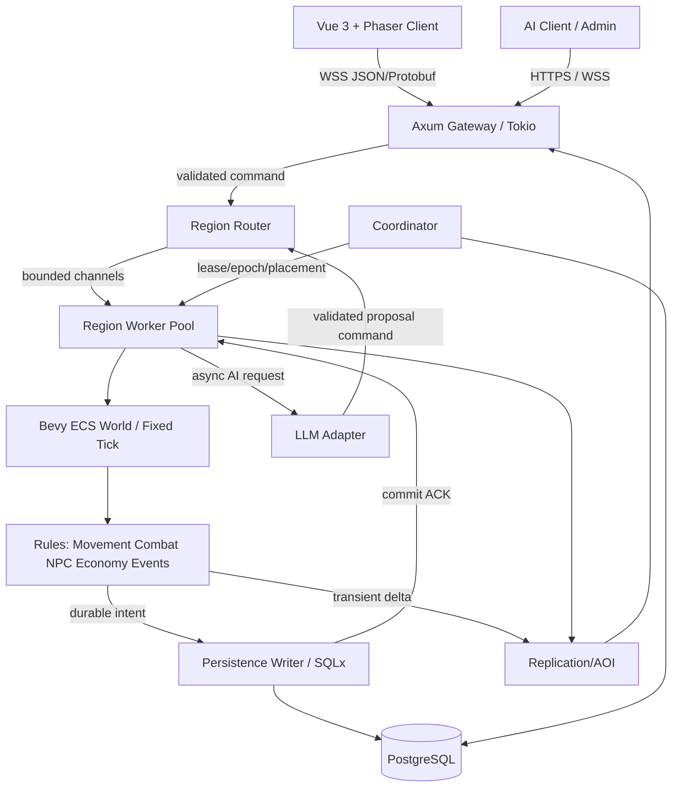

# 02. 전체 아키텍처 (HLD)

**한국어** | [English](en/02-hld-architecture.md)

## 1. 컨텍스트 / 주요 외부 시스템



## 2. 컴포넌트 책임/비책임

| 컴포넌트 | 소유/책임 | 금지 사항 |
|---|---|---|
| Axum Gateway | 인증, 세션, rate limit, 프로토콜, 메시지 입력 | ECS 직접 쓰기, DB 상태 임의 변경 |
| Command Router | 지역 매핑, 입력 큐잉, admission | 플레이어 행위 결과를 임의 확정 |
| Coordinator | Region 소유권, 배치·장애 재할당, GlobalWorker 통신 | ECS 개별 Entity 직접 변경 |
| Region Worker | 해당 Region의 ECS와 Tick, 규칙·임시 상태 | Tick 내 `await`/동기 DB 작업 |
| Persistence Writer | durable transaction, receipt, outbox, snapshots | 게임 규칙 임의 해석 |
| Replicator | 구독·AOI·baseline·delta, 느린 클라이언트 분리 | Domain Event를 재정의 |
| LLM Adapter | 대화 및 비권한 제안 | 금화/체력/재고 직접 쓰기 |
| Global Worker | 세력/전역 시간/지역 간 요청의 단일 변경 책임 | 별도 Region 소유 데이터 직접 쓰기 |

## 3. 데이터/명령 방향

```
Player input ─> Gateway ─> Region command queue ─> Tick / ECS
                                               │
        ┌──────── transient state delta ◀───────┤
        │                                      durable intent
        ▼                                             │
Client state channel                    DB transaction + outbox
                                                      │
                                          commit ACK / receipt
                                                      │
                                                      ▼
                                             Region finalized state
                                                      │
                                                      ▼
                                            confirmed client result
```

**핵심 보장:** 영속 성공 응답은 DB Commit 이후. 저장 요청이 미결인 동안 관련 재화/아이템은 예약으로 보호한다. Tick은 나머지 엔티티를 계속 처리한다.

## 4. 동시성과 일관성

- Region 내부 상태를 **한 Worker가 소유**하며 초기 Bevy Schedule은 single-threaded, 명시적 System 순서 적용.
- 전역 데이터는 GlobalWorker 또는 DB 소유 도메인으로 보내고, Region에 읽기 전용 버전 Snapshot을 전달한다.
- 지역 간 이동은 `prepare source → durable transfer/lease fence → target spawn → source cleanup` 절차. MVP는 **단일 프로세스/동일 DB 안에서만** 지원(복잡한 원격 Saga는 P2).
- 지역 간 재화 거래는 MVP에서 허용하지 않는다. 필요하면 Global Transaction Owner 또는 명시적 Saga로 추가.

## 5. 장애 도메인

| 장애 | 격리/복구 |
|---|---|
| WS 단절 | 세션 만료 처리, Region 시뮬레이션 지속 |
| Command 과부하 | ingress 제한; `SERVER_BUSY`; durable intent 유실 금지 |
| Region Worker panic | 해당 지역만 격리, lease fencing 후 snapshot 복구 |
| PostgreSQL 장애 | 신규 durable action 중단, transient 허용범위 설정, 알림 |
| AI 서비스 지연 | fallback Utility AI/템플릿 대사, Tick 비차단 |
| Gateway 장애 | 재접속 + snapshot resync; 서버 월드 지속 |
| Coordinator 장애 | 이미 소유한 lease 동안 계속 실행; 재할당은 대기/제한 |

## 6. 시스템 시퀀스: 물건 구매

```mermaid
sequenceDiagram
    participant C as Client
    participant G as Gateway
    participant R as Region Worker
    participant D as DB Writer
    participant P as PostgreSQL
    C->>G: command BUY_ITEM (command_id)
    G->>R: validated envelope
    R->>R: rule validate, reserve stock/gold
    R-->>C: ACCEPTED / PENDING
    R->>D: durable intent + expected versions + epoch
    D->>P: BEGIN; fence, receipt, balances, event, outbox
    alt commit success
        P-->>D: COMMIT
        D-->>R: committed ACK
        R->>R: finalize reserved state
        R-->>C: SUCCEEDED + state delta
    else error / unknown ACK
        P-->>D: error / timeout
        D-->>R: receipt lookup or retry
        R-->>C: PENDING / FAILED after resolution
    end
```

## 7. 실행 형태

- **Phase 1:** 한 실행 파일 `game-server` 안에 Tokio runtime + Region 전용 스레드 + SQLx writer. Redis/브로커 불필요.
- **Phase 2:** 동일 머신 Region Worker Pool 및 background mode.
- **Phase 3:** 네트워크 Gateway/Region Worker 분리, Postgres fencing/라우터 재할당, 필요시 Redis/메시지 브로커(큐의 진실 원천 아님).

## 8. 기술 스택 기준선

- Rust edition 2024, Bevy ECS(버전 pin), Tokio, Axum, SQLx, Serde, UUID, tracing, Prometheus 계측 라이브러리.
- 릴리스마다 `Cargo.lock` 고정. 변경된 API는 CI에서 검증하고 `15-adrs.md`와 lock 버전 함께 업데이트.
