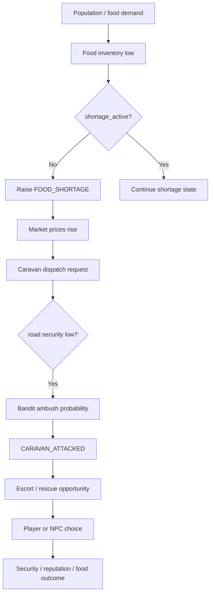

# 07. World Systems — 이동·전투·경제·세력·환경·사건 (LLD)

## 1. 공통 System 실행 원칙

- 월드 상태 업데이트는 `simulation-core`에서 허용한 ECS Resource/Component에만 접근.
- 순서/제약은 `03-core-tick.md`를 따른다. 시스템 간 직접 SQL 호출 금지.
- `Transient`는 Tick Commit, `Durable`는 `DurableIntent`와 DB ACK 후 Commit.
- 게임 콘텐츠 정의(YAML/JSON)는 실행 전에 JSON Schema/타입 검사 및 버전 고정.

## 2. Movement & Navigation

### 좌표 규칙
- World 좌표 `millitile` 정수(`1 tile = 1000`). Z축 제외.
- 타일은 static terrain + 동적 blocking entities + 위험도 비용으로 구성.
- 이동 모드 `IDLE, PATH_REQUESTED, FOLLOWING, BLOCKED, ARRIVED, CANCELLED`.

### 이동 Command 처리

1. actor가 존재하고 움직일 수 있는지 확인(`STUNNED`, `DEAD` 등 검사).
2. 대상 tile 유효성·도달성 검사.
3. A* pathfind(허용 노드 확장 제한, 휴리스틱 Manhattan/Octile).
4. 거리·속도·충돌 처리, 인접 셀 reservation 필요 여부 판단.
5. 도착 시 `MOVE_ARRIVED`; 막힘 지속 시 `MOVE_BLOCKED`, 재탐색/실패 사유.

### 테스트
- 벽 통과 불가, 다수 NPC 한 칸 경쟁 시 순서 일관, 경로 재탐색 무한 루프 없음, 자동 이동 버튼 재전송에도 중복 경로 실행 없음.

## 3. Combat

| 필드 | 타입/규칙 |
|---|---|
| `attack_range_millitile` | 정수, 대상까지 거리 검사 |
| `cooldown_until_tick` | 다음 공격 가능 Tick |
| `base_damage` | 정수 고정소수점 |
| `armor/mitigation` | 검증된 피해 감소 규칙 |
| `health` | 0..max, underflow 금지 |
| `status` | ALIVE/DOWNED/DEAD |
| `loot_intent` | 실제 아이템 부여 전 DB 확정 필요 |

**시퀀스:** `ATTACK command → ownership/range/cooldown → damage calculation → HP update → DIED event → durable loot/ownership intent → DB ACK → item added`.

피해 상태의 복구 보장은 정책에 따라 선택한다. MVP는 플레이어 사망/아이템 획득은 durable, 일반 이동 및 몬스터의 경미한 피해는 checkpoint 기준. `DIED`를 DB 확정 전에 최종 사용자 자산 변화로 연결하지 않는다.

## 4. Economy

### 지역 경제 최소 데이터
- Settlement: `population`, `food_stock`, `food_capacity`, `security_index`, `treasury`.
- 생산자: `production_rate`, `input_stock`, `season_modifier`.
- 소비자: 인구 × 일일 소모량.
- 시장: `base_price`, `stock`, `target_stock`, `min/max_price`, `version`.

### 1분 집계 규칙 예시

```
production = active_farms * base_yield * weather_multiplier
consumption = population * food_consumption_per_step
new_stock  = clamp(old_stock + production - consumption, 0, capacity)
scarcity   = clamp((target_stock - new_stock) / target_stock, -1, 1)
price      = clamp(base_price * (1 + scarcity_factor * scarcity), min, max)
```

운영 계산에서는 모두 **정수 또는 고정소수점**을 사용하고 나눗셈 반올림 규칙을 고정한다. 출력 가격 변화에는 시차/완충(EMA 또는 단계형)을 둬 진동 방지. 재화 총량, 자원 생산/소비의 conservation audit를 기록.

### 경제 실패/과부하 제어
- 재고 음수 금지, 같은 상품을 두 명이 동시에 구매할 때 DB row version/락으로 원자성 보장.
- 동일 이벤트가 지속 트리거되지 않도록 `shortage_active` 상태 + cooldown 사용.
- Background Region도 생산/소비는 계속하되 매 Tick NPC 위치 계산 생략.

## 5. Faction/Politics

- 전역 세력은 GlobalWorker의 단일 쓰기 상태: 영향력/영토/동맹/적대/전쟁.
- Region은 세력의 버전 projection을 읽고 `FactionActionCommand` 제안.
- 이벤트 예: 교역로 습격 증가 → 경비 요청 → 세력 영향력 감소 → 토벌 행동.
- MVP는 두 세력의 신뢰·적대도와 지역 치안 지표만; 전쟁/영지 점령은 P2.

## 6. Environment / Weather / Time

- `WorldClock`과 Time Scale을 독립 관리(초기 `game_time_scale = 10`).
- 지역별 WeatherState (`CLEAR/RAIN/STORM`)는 Seed 기반 RNG와 game-time schedule로 갱신.
- 환경 효과는 이동 비용·농업 생산·NPC 안전 욕구에 Modifier로만 적용(직접 타 시스템 수정 금지).

## 7. Emergent Event Example



확률적 조건이라도 RNG stream/seed, 적용 Tick, rule_version을 로그에 포함. 피해/물건/경제가 실제로 변하지 않은 경우 “침략 성공” 같은 거짓 Event를 생성하지 않는다.

## 8. Background Simulation

- `ACTIVE`: 개별 이동/전투/시야/대사 상세 계산.
- `BACKGROUND`: 중요 NPC의 자산/상태는 개별 보존하되, 일반 주민 이동·생산 일부를 집계함.
- 전환 경계에서는 집계 생산량을 Entity 인벤토리와 **중복 지급하지 않음**. `source_of_truth = SETTLEMENT_LEDGER`로 정해진 자원은 어느 모드에서도 동일 원장을 사용.
- “플레이어 0명”과 “진행 중 전투 0/미결 durable 0/최근 활동 유예기간 경과” 조건을 모두 만족해야 Background 전환 가능.

## 9. 모듈 테스트

| 테스트 | 입력 | 결과 |
|---|---|---|
| TEST-MOV-001 | 닫힌 벽으로 MOVE_TO | REJECTED / BLOCKED, 좌표 불변 |
| TEST-MOV-002 | 이동 중 지형 차단 | 정해진 재경로/실패; Tick 지속 |
| TEST-CMB-001 | 사거리 밖 ATTACK | 피해 0, REJECTED |
| TEST-CMB-002 | 사망 + 보상 DB 실패 | 재화/아이템 미부여 |
| TEST-ECO-001 | 생산<소비 1일 | stock 감소, 가격 상승(상한 내) |
| TEST-ECO-002 | 동시 구매 2개, 재고 1 | Commit 성공 1개 |
| TEST-FACTION-001 | 옛 Global projection 적용 | 버전 검사로 거부/무시 |
| TEST-BG-001 | 모드 전환 100회 | 재고 보존, 중요 NPC ID 유지 |
