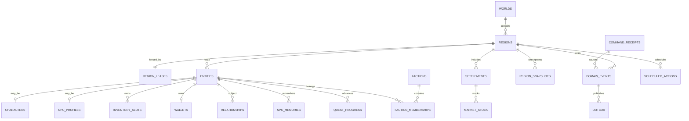

# 08. 영속 데이터 모델 · ERD (LLD)

## 1. 데이터 소유권

| 도메인 | SoT(진실 원천) | 캐시/Projection | 복구 |
|---|---|---|---|
| 계정/캐릭터 | PostgreSQL | Session/Game Entity | DB |
| 인벤토리/금화/거래 | PostgreSQL Commit | ECS committed projection | DB + durable event |
| 위치/속도/임시 AI 상태 | Region ECS | Client delta | 마지막 유효 checkpoint |
| 장기 NPC 기억/관계 | PostgreSQL | NPC Component | DB + durable event |
| 세력/월드 시간 | GlobalWorker + 영속 로그 | Region read projection | DB/Global checkpoint |
| 게임 사건 원인 | domain_events | UI 소문/뉴스 | 이벤트 로그 |

## 2. 논리 ERD



ERD는 관계 개념이며 물리 키/제약은 `schemas/0001_initial.sql`을 따른다. 일부 선택적 관계의 PK/FK는 물리 스키마에서 다르게 표현될 수 있다.

## 3. 주요 테이블 명세

| 테이블 | PK/Unique | 핵심 필드 | 변경 책임 |
|---|---|---|---|
| `worlds` | id UUID | seed, game_time_ms, version | GlobalWorker |
| `regions` | id UUID | world_id, grid, event_seq | Region Registry/Writer |
| `region_leases` | region_id | owner_id, epoch, expires_at | Coordinator |
| `entities` | id UUID | region_id, kind, state_version, persistent_json | Region Writer |
| `characters` | entity_id | account_id, progress | Game Domain |
| `npc_profiles` | entity_id | personality, profession, home | NPC Domain |
| `wallets` | entity_id | gold, version | Economy Writer |
| `inventory_slots` | (owner_id,item_id) | quantity, version | Economy Writer |
| `relationships` | (source_id,target_id) | trust, affinity, fear | Social Writer |
| `npc_memories` | id UUID | source_event_id, data, expires_at | NPC Domain |
| `settlements` | id UUID | region_id, food_stock, security | Economy/World |
| `market_stock` | (settlement_id,sku) | quantity, price, version | Economy Writer |
| `factions` | id UUID | influence, policy, version | GlobalWorker |
| `command_receipts` | command_id UUID | payload_hash, result, status | DB Writer |
| `domain_events` | (region_id,seq) | event_id unique, event_type, payload | DB Writer |
| `outbox` | id UUID | event_id, published_at, retry_count | DB Writer/Publisher |
| `region_snapshots` | id UUID | region_id, tick, event_seq, data, checksum | Checkpointer |
| `scheduled_actions` | id UUID | due_tick, action_type, payload | Region Domain |

## 4. 데이터 계약

- 고유 ID는 DB의 `UUID`, Rust `uuid::Uuid`. Bevy `Entity`는 저장 금지.
- 금화/재고는 `BIGINT` 정수(음수 불가), 버전 optimistic CAS.
- 관계·욕구·치안은 정수 점수(`-1000..1000` 또는 `0..1000`)로 명확히 분리.
- 이벤트 payload는 `JSONB`, `schema_version`, `rule_version` 보유.
- snapshot payload는 `BYTEA` 또는 객체 스토리지+checksum; MVP는 PostgreSQL BYTEA.
- 장기 데이터가 많아지면 `(world_id, region_id, event_seq)` partition/archive 전략 적용.

## 5. 예시: 금화 잔액 이동의 원자적 검증

```sql
-- 이미 특정 Region lease/epoch를 검증하고 BEGIN한 트랜잭션 내부
UPDATE wallets
   SET gold = gold - $2, version = version + 1
 WHERE entity_id = $1 AND gold >= $2 AND version = $3
RETURNING gold, version;
-- 반환된 행이 0개라면 insufficient funds 또는 version conflict.
```

판매/구매 때 차감과 지급, 재고 변경, receipt, event/outbox는 한 트랜잭션으로 처리. 금화 이동 총량을 검사해 복제/유실 방지.

## 6. 데이터 마이그레이션

1. `sqlx migrate run`을 CI/스테이징에서 우선 실행.
2. `schema_version` 및 이벤트별 upcaster(버전별 변환)를 제공.
3. 기존 Snapshot과 새 ECS 코드는 최소 한 버전 호환 또는 snapshot migration 제공.
4. 파괴적 변경은 Expand/Backfill/Contract 3단계로 운영.
5. 데이터 보존·파기 정책은 서비스 운영/법률 검토 후 별도 확정.

## 7. 테스트

- TEST-DB-001: FK/unique/check 제약 위반은 DB 거부.
- TEST-DB-002: 인벤토리 수량·금화는 0 미만 불가.
- TEST-DB-003: 중복 event_id/command_id 재삽입 차단.
- TEST-DB-004: Snapshot 스키마 업그레이드 및 checksum 오류 검출.
