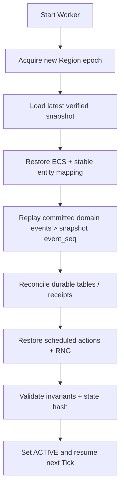

# 09. Persistence · Transaction · Snapshot · Recovery (LLD)

## 1. 보장 수준 명시

| 상태 | 보장 | 근거 |
|---|---|---|
| 재산/소유권/중요 퀘스트/관계 | **DB Commit 이후 유실 불가** 목표 | transaction + receipt + outbox |
| 위치/이동 경로/일시적 전투 | **마지막 유효 snapshot 시점** 복원 | periodic checkpoint |
| 모든 중간 Tick의 완전 Replay | MVP 비보장 | 입력 로그와 전부 durable 기록하지 않음 |
| Outbox 소비 | at-least-once + 멱등 소비 | relay 재전송 가능 |

DB 장애 또는 디스크 재난에 대한 보장은 백업/PITR 운영 설정에 의존한다. `Commit 이후 유실 불가`는 단일 DB 장애 범위 내 트랜잭션 원자성이고, 전체 데이터센터 파괴를 포함한 무조건적 보장은 아니다.

## 2. Durable Intent 모델

```rust
pub struct DurableIntent {
    pub command_id: uuid::Uuid,
    pub region_id: uuid::Uuid,
    pub ownership_epoch: i64,
    pub actor_id: uuid::Uuid,
    pub payload_hash: [u8; 32],
    pub expected_entity_versions: Vec<(uuid::Uuid, i64)>,
    pub operations: Vec<DurableOperation>,
    pub emitted_events: Vec<DurableDomainEvent>,
}
```

Region은 검증 후 영향을 받는 자산을 예약한다. DB Writer는 아래 transaction을 수행하고 `commit_result`를 ACK로 보낸다. 동시에 관련 자산을 두 번 쓰지 않도록 actor/상품 단위 pending map 적용.

## 3. SQL 트랜잭션 순서

```text
BEGIN
 SELECT lease FOR UPDATE
 VERIFY owner/epoch/lease_not_expired
 INSERT command_receipts(command_id,payload_hash,status='PENDING') ON CONFLICT ...
    if exists: compare hash -> return previous result or reject
 SELECT wallet/inventory/market rows FOR UPDATE (stable order)
 VERIFY balances, stock, row versions
 UPDATE wallet/inventory/market
 ALLOCATE region_event_seq (under regions row lock)
 INSERT domain_events (...)
 INSERT outbox (...)
 UPDATE command_receipts SET status='SUCCEEDED', result_json=...
COMMIT
ACK(SUCCEEDED, committed_seq, updated_projections)
```

중요: receipt가 이미 `SUCCEEDED`라면 **동일 Command를 재실행하지 않고 기존 결과를 반환**한다. `PENDING`이 남은 경우 동일 DB 트랜잭션에서 부분적으로 기록되지 않도록 한 TX에서 완료한다. ACK timeout은 실패가 아니므로 receipt 조회 후 결과 결정.

## 4. SQLx 트랜잭션 코드 윤곽

```rust
async fn persist_intent(
    pool: &sqlx::PgPool,
    intent: DurableIntent,
) -> Result<PersistenceAck, PersistError> {
    let mut tx = pool.begin().await?;
    // 1. SELECT lease FOR UPDATE / verify epoch
    // 2. INSERT command receipt or select existing
    // 3. lock and update wallet, stock, inventory
    // 4. append event, outbox, receipt in same tx
    tx.commit().await?;
    // ACK can be lost; retry by command_id queries DB receipt.
    Ok(PersistenceAck::Committed { /* committed state */ })
}
```

이는 계약/흐름 예시로, 생략된 도메인 SQL을 구현한 코드가 아니다. 실제 쿼리·DB 버전·예외별 응답은 통합 테스트에서 검증해야 한다.

## 5. Checkpoint 및 스냅샷 경계

**문제:** DB 미확정 상태가 Snapshot에 포함되면 재시작 후 실제로 존재하지 않는 아이템을 복구할 수 있다.

해결 정책:

1. 체크포인트 요청 시 Region은 **새 durable intent admission을 잠시 중지**.
2. 기존 pending durable intent가 모두 Commit/Reject로 확정될 때까지 별도 우선 ack queue를 처리(Timeout 시 스냅샷 실패, Tick은 정책상 계속 또는 안전 Paused).
3. Tick 경계에서 ECS 상태(Transient + 마지막으로 Commit 완료된 Durable Projection), RNG state, Timer, scheduled actions, current tick을 직렬화.
4. `last_committed_event_seq`, `ownership_epoch`, schema/engine/rules version, SHA-256 checksum 포함.
5. `region_snapshots`에 저장한 후 checksum·참조 무결성 확인.
6. durable admission 재개.

Checkpoint가 오래 걸리면 player 경험이 나빠질 수 있으므로 충분한 테스트 후 copy-on-write snapshot 또는 바이트 복사 전략 도입. MVP는 **100% 정합성이 우선**, 체크포인트 빈도는 5~10분 가정.

## 6. Recovery 시퀀스



- 사용 가능한 Snapshot이 없으면 해당 Region의 초기 구성 + 전체 durable projection을 재구성. 이벤트만으로 모든 위치를 재현하는 것은 비보장.
- 마지막 checkpoint 이후 위치/경로와 transient 전투 상태는 유실될 수 있다. 재접속 시 클라이언트에 `world_revision`이 포함된 전체 snapshot 전송.
- DB 최신 durable data와 ECS projection이 충돌하면 **DB 최종 확정 상태가 우선**.
- 영속 event upcaster가 없는 이전 버전은 임의 무시하지 말고 복구 실패/운영 알림.

## 7. Epoch / Lease fencing

```sql
SELECT ownership_epoch, owner_id, lease_expires_at
  FROM region_leases
 WHERE region_id = $1
 FOR UPDATE;
-- expected_epoch/owner 일치 + lease_expires_at > clock_timestamp() 확인
```

- 기존 Worker가 오래된 Epoch로 저장하려는 모든 변경은 DB에서 거부.
- Coordinator 장애와 시스템 시계 차이를 고려하여 lease 판정은 **DB 시각** 기준.
- lease 갱신이 불가능하면 durable write를 신규 시작하지 않음. DB 연결 복원 전까지 같은 Epoch를 영원히 신뢰하지 않음.

## 8. Outbox 전달

1. DB transaction 내 domain event + outbox insert.
2. 별도 Outbox Publisher가 `FOR UPDATE SKIP LOCKED`로 미발행 행을 claim.
3. 외부 브로커/서비스 전달 성공 확인 후 `published_at` 마킹.
4. 중복 전송 가능하므로 소비자 `event_id` unique 처리.
5. 계속 실패 시 retry/backoff/dead-letter 운영. 전송 중 DB rollback 되었더라도 이벤트가 DB에 확정된 적이 없어야 한다.

## 9. 복구/장애 테스트 표

| ID | 장애 주입 지점 | 기대 결과 |
|---|---|---|
| TEST-PER-001 | BEGIN 전 crash | 아무 자산 변경 없음 |
| TEST-PER-002 | 자산 UPDATE 후 COMMIT 전 crash | 전체 rollback |
| TEST-PER-003 | COMMIT 후 ACK 손실 | receipt로 성공 1회 확인 |
| TEST-PER-004 | snapshot 쓰기 중 crash | 마지막 유효 snapshot 사용 |
| TEST-PER-005 | replay 도중 crash | 재기동해도 durable 중복 적용 0 |
| TEST-PER-006 | 오래된 epoch로 DB UPDATE | 0건 Commit 또는 명시적 거부 |
| TEST-PER-007 | outbox 재전달 | 소비자 중복 반영 0 |
