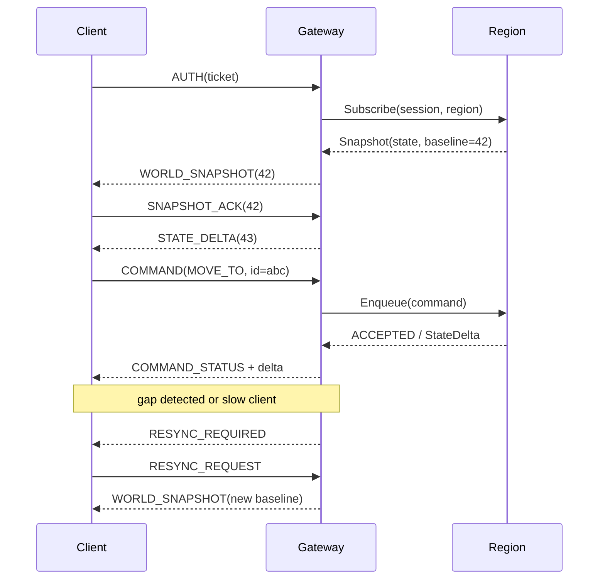

# 10. 멀티플레이어 동기화 · Network/AOI (LLD)

## 1. 전송 원칙

- 서버 권한: 클라이언트는 의도 Command만 보냄, 권한 있는 Region만 위치/HP/아이템 확정.
- `HTTPS + WSS` 사용. Axum WebSocket Gateway는 Tokio Runtime에서 연결 관리.
- 초기 프로토콜은 **버전 필드가 있는 JSON**; 대역폭·CPU 측정 후 Protobuf 전환.
- 비트 단위의 모든 이동 Tick 전파는 금지; AOI 대상만 Snapshot+Delta를 보냄.

## 2. 연결 수립

1. HTTPS 로그인으로 인증 세션 확보.
2. `POST /api/v1/ws-tickets`로 짧은 TTL(30초 예시)·1회용 ticket 발급.
3. WSS `/ws` 접속 후 **5초 이내** `AUTH {ticket}` 메시지 전송(미인증 메시지 처리 금지).
4. Gateway가 ticket 재사용/만료 검증, actor_id·region_id·session_id 확보.
5. Region에서 initial snapshot + `baseline_id/world_revision` 수신.
6. 클라이언트 `SNAPSHOT_ACK`; 이후 delta 수신.

Ticket은 URL query/로그에 남기지 않는 방식을 기본으로 한다. 재연결은 새 ticket을 발급받는다.

## 3. AOI (Area of Interest)

- 초기 셀 크기: 16×16 타일. 주변 3×3 셀과 이벤트/파티/상호작용 대상 추가.
- Region Worker는 `changed_entity_set`을 만들고 Replicator가 세션별 관심 대상을 선택.
- 플레이어 이동으로 셀 전환 시 `ENTITY_ENTER`/`ENTITY_LEAVE` + 신규 Entity 전체 속성 전송.
- 비활성 객체(미관측 NPC)의 상세 변경은 구독 대상에게 전파하지 않음.
- 치안·식량 같은 지역 공공 지표는 AOI 바깥이어도 지역 뉴스 또는 별도 구독 채널로 전달 가능.

## 4. Snapshot / Delta 계약

| 메시지 | 전달 시점 | 필수 데이터 |
|---|---|---|
| `WORLD_SNAPSHOT` | 최초 접속, 재접속, 기준점 유실 | snapshot_id, world_revision, entities, region_tick |
| `STATE_DELTA` | 상태 변경 시 | baseline_id, delta_seq, region_tick, changed, removed |
| `COMMAND_STATUS` | 수신/거부/확정 | command_id, status, reason, committed_event_seq |
| `ENTITY_ENTER/LEAVE` | AOI 변경 | entity_id, state/remove |
| `RESYNC_REQUIRED` | seq gap, 늦은 클라이언트 | reason, current_revision |

**중요:** `world_revision`은 Region별 상태 버전이며, `region_event_seq`(durable event 번호)와 구분한다. transient state_delta도 revision을 변경한다.

## 5. 송수신 시퀀스

## 6. 지연·손실·순서

- WebSocket 자체의 순서 전송만으로 재접속 중 메시지 유실을 해결할 수 없음. `baseline_id`, `delta_seq`, `region_tick` 사용.
- Delta gap 감지 시 이전 버퍼에서 복원 가능한 경우 재전송, 아니면 전체 snapshot.
- `COMMAND_STATUS.SUCCEEDED`는 durable 변경이라면 DB ACK 이후에만 전송.
- 네트워크 전송량이 과도하면 위치 Delta를 5~10Hz로 묶어서 송출(서버 Tick과 별도 주기). 클라이언트 보간 사용.
- 클라이언트 예측 이동은 P2 옵션; 초기에는 서버 좌표를 부드럽게 보간.

## 7. Backpressure / 보안

- 세션별 outgoing queue bounded, 위치 delta는 가장 최신 값으로 coalesce, snapshot 재설정.
- 지속적으로 소비가 느린 연결은 종료(`SLOW_CONSUMER`) 후 재접속 유도.
- rate limit: Session, Actor, IP(공유 NAT 주의) 레벨 적용. 제한값은 부하 테스트 후 확정.
- Client가 다른 Actor ID·아직 관측하지 못한 target ID를 보내도 서버에서 권한·시야·거리 재검증.
- 각 protocol payload는 JSON schema/size/depth 제한, 악의적 대형 메시지 차단.

## 8. 테스트

- TEST-NET-001: 2 Client가 같은 NPC의 최신 좌표를 동일하게 관측.
- TEST-NET-002: Delta 1개 누락 후 resync를 통해 상태 일치.
- TEST-NET-003: 500ms 지연/재접속 중 동일 durable Command 이중 실행 없음.
- TEST-NET-004: Actor ID 위조 명령은 거부.
- TEST-NET-005: AOI 밖 NPC 변화는 관심 없는 세션에 전송되지 않음.
- TEST-NET-006: 느린 클라이언트가 Region Tick을 지연시키지 않음.
