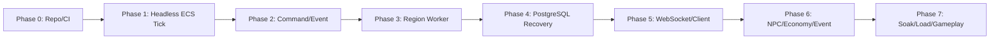

# 13. 구현 백로그 · 작업 지시서 (실행 계획)

**한국어** | [English](en/13-implementation-backlog.md)

> 각 작업은 담당자가 달라도 독립적으로 시작할 수 있도록 **목표, 선행, 구체 산출물, 수용 테스트**를 포함한다. 소요 기간은 추정하지 않았으며, 팀 역량·환경에 따라 계획한다.

## 1. 단계 게이트



## 2. 작업 목록

### TASK-001 — Rust Workspace/CI 생성
- **선행:** 없음.
- **수행:** `apps/game-server`, `apps/simulation-runner`, `crates/{simulation-core,ecs-components,simulation-systems,game-domain,persistence,networking,shared-protocol}` 생성. Rust edition/버전 pin, `Cargo.lock`, lint, unit test CI, 기본 tracing.
- **산출물:** 컴파일 가능한 Workspace, `cargo fmt`, `cargo clippy`, `cargo test` 워크플로.
- **DoD:** 빈 게임 서버/Runner 기동, 실패 CI 차단, README 실행 절차.

### TASK-002 — Entity/Region State + ID
- **선행:** TASK-001.
- **수행:** Bevy ECS World per Region, StableId(UUID) ↔ Bevy Entity index, Position/Velocity/Health/Needs, create/delete/query, typed Component registry.
- **DoD:** 10,000 entity 생성·삭제 후 인덱스 정합, 영속 ID 재로드 가능; TEST-REGION 기본.

### TASK-003 — Fixed Tick Scheduler/Determinism
- **선행:** TASK-002.
- **수행:** `TickContext`, SimulationPhase/ordered schedule, game time/real time 분리, seed/RNG, headless `--ticks --seed`, 고정 정렬.
- **DoD:** 10,000 Tick 반복 재생 해시 일치; TEST-TICK-001~005.

### TASK-004 — Command & Event Contracts
- **선행:** TASK-003.
- **수행:** Envelope/validator/assigned_tick/ingress_seq, Event type/correlation, 중복 제거, 이벤트 예산 제한, error mapping.
- **DoD:** 단일 Region에서 중복 transient 명령 1회 처리, 순서 재현, Rule cycle 차단.

### TASK-005 — Movement + Combat Minimal Systems
- **선행:** TASK-004.
- **수행:** 정수 millitile 이동, A* budget, collision, health/damage/death/cooldown, no path diagnostics.
- **DoD:** 자동이동/벽/막힘/전투 정상; TEST-MOV/CMB.

### TASK-006 — Tokio Region Worker / Coordinator
- **선행:** TASK-004.
- **수행:** dedicated thread, bounded channels, lifecycle, Router, Epoch validation hook, tick lag detection, shutdown drain.
- **DoD:** Region 2개 독립 실행, backpressure 시 무한 메모리 증가 0, 테스트된 종료·재시작.

### TASK-007 — DB Migration + Durable Transaction
- **선행:** TASK-004, TASK-006.
- **수행:** `schemas/0001_initial.sql` 적용, SQLx writer, wallet/stock/receipt/event/outbox 1트랜잭션, lease fencing, ACK receipt lookup.
- **DoD:** DB failpoint 5가지, 구매 재전송 100회 중 결제 1회; TEST-PER-001~003/006.

### TASK-008 — Snapshot/Recovery
- **선행:** TASK-007.
- **수행:** snapshot DTO/version/checksum, no-pending barrier, ECS restore, committed replay/reconcile, crash recovery, scheduled actions+RNG.
- **DoD:** snapshot 중 종료/손상 복구, 데이터 무결, checksum 검증; TEST-PER-004/005.

### TASK-009 — Axum WebSocket + AOI
- **선행:** TASK-006, TASK-007.
- **수행:** ticket AUTH, protocol v1, AOI, snapshot+delta+seq, client reconnect/resync, rate limiting.
- **DoD:** 2개 Client 동기화, delta gap 회복, 위조 actor 거부; TEST-NET 전부.

### TASK-010 — NPC Utility AI / GOAP
- **선행:** TASK-002, TASK-003, TASK-005.
- **수행:** Perception, Needs, score curves, GOAP actions/planner, fallback, memory/relationships, budgets, 다음 Tick action.
- **DoD:** NPC 10명 독립 생활, 위협시 도주, 1k NPC 분산 판단; TEST-AI.

### TASK-011 — Economy / Faction / Event Rule
- **선행:** TASK-007, TASK-010.
- **수행:** Settlement food ledger/market supply-demand, reputation, dynamic rule DSL/AST, shortage→caravan→ambush chain.
- **DoD:** 입력 없어도 사건 발생, 식량 stock 음수 X, duplicate rule 없음; TEST-ECO/EVENT.

### TASK-012 — Client Vertical Slice / Prologue
- **선행:** TASK-005, TASK-009, TASK-010.
- **수행:** Vue3/Phaser tile render, WebSocket, NPC interaction, quest guidance, 개인 프롤로그→shared migration, UI 상태 매핑.
- **DoD:** 15분 경험(예시) 완주, 자동이동/버튼 정상, 공유 진입 후 프롤로그 버튼 사라짐.

### TASK-013 — Observability / Soak / Fault Injection
- **선행:** TASK-007, TASK-009, TASK-011.
- **수행:** metrics/tracing/dashboard, golden replay, load generator, fault injections, profiling report.
- **DoD:** P0 기능 PASS, p95/p99 실측 공유, 복구·중복 방지 테스트 결과 첨부.

### TASK-014 — 운영 안전성/배포
- **선행:** TASK-008, TASK-009, TASK-013.
- **수행:** TLS/WSS, secrets, backup/PITR restore drill, RBAC, health probes, graceful shutdown, version compatibility.
- **DoD:** 운영 Runbook 재현 및 복구 훈련 PASS, 서비스 키 노출 0.

## 3. 작업용 Pull Request 템플릿

```markdown
## TASK ID / 요구사항
TASK-___ / REQ-___
## 변경 사항
- [ ] 구현 범위 및 비범위
- [ ] 설계 문서/ADR 변경
- [ ] DB/API schema compatibility
## 테스트 증거
- [ ] cargo fmt --check
- [ ] cargo clippy -- -D warnings
- [ ] cargo test
- [ ] 해당 deterministic/integration/failpoint test
## 운영 영향
Rollback 방법 / 데이터 Migration / metrics
## 미결 사항
담당자/다음 작업 링크
```

## 4. 첫 릴리스 체크리스트

- [ ] WorldSeed 고정 후 헤드리스 반복 재생 동일 결과.
- [ ] NPC, 플레이어, 이동, 전투, 동적 사건 1개 완주.
- [ ] 두 클라이언트에서 위치·NPC 상태 동기화.
- [ ] 구매 DB Commit/ACK 유실 시 중복 실행 0.
- [ ] 재시작 전후 재산·장기 기억 유지, 일시 좌표 복구 정책 일치.
- [ ] 이벤트가 멈추면 rule trace와 fallback 작동.
- [ ] Region Tick/큐/DB/AI 지표 실측 및 문서화.
