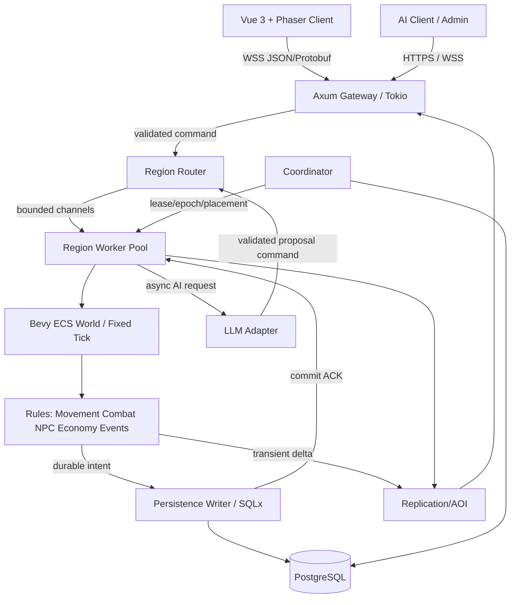

# 02. Overall Architecture (HLD)

[한국어](../02-hld-architecture.md) | **English**

## 1. Context and external systems



## 2. Component responsibilities and boundaries

| Component | Ownership/responsibility | Prohibited |
|---|---|---|
| Axum Gateway | Authentication, sessions, rate limits, protocol, message ingress | Direct ECS writes or arbitrary DB-state changes |
| Command Router | Region mapping, input queues, admission | Arbitrarily finalizing player-action outcomes |
| Coordinator | Region ownership, placement/failover, GlobalWorker communication | Direct mutation of individual ECS entities |
| Region Worker | Its Region's ECS/ticks, rules, temporary state | `await` or synchronous DB work inside a Tick |
| Persistence Writer | Durable transactions, receipts, outbox, snapshots | Independently interpreting game rules |
| Replicator | Subscriptions, AOI, baseline/delta, isolation of slow clients | Redefining Domain Events |
| LLM Adapter | Dialogue and non-authoritative proposals | Direct gold/health/stock writes |
| Global Worker | Sole writer for factions/global time/inter-region requests | Direct writes to data owned by another Region |

## 3. Data and command flow

```
Player input ─> Gateway ─> Region command queue ─> Tick / ECS
                                               │
        ┌──────── transient state delta ◀───────┤
        │                                      durable intent
        ▼                                             │
Client state channel                    DB transaction + outbox
                                                      │
                                          commit ACK / receipt
                                                      │
                                                      ▼
                                             Region finalized state
                                                      │
                                                      ▼
                                            confirmed client result
```

**Core guarantee:** durable success is reported only after DB Commit. Reserve affected currency/items while persistence is pending. The Tick continues processing other entities.

## 4. Concurrency and consistency

- **One Worker owns** each Region. Initially, use a single-threaded Bevy Schedule with explicit System ordering.
- Route global data to a GlobalWorker or DB-owned domain; Regions receive versioned read-only Snapshots.
- Region transfer: `prepare source → durable transfer/lease fence → target spawn → source cleanup`. The MVP supports this **within one process and one DB only**; complex remote Sagas are P2.
- Cross-region asset trading is excluded from the MVP. Add a Global Transaction Owner or explicit Saga if needed.

## 5. Failure domains

| Failure | Isolation/recovery |
|---|---|
| WS disconnect | Expire the session; keep the Region simulation running |
| Command overload | Limit ingress; return `SERVER_BUSY`; never lose durable intents |
| Region Worker panic | Isolate that Region; fence the lease and recover from snapshot |
| PostgreSQL outage | Stop new durable actions; define allowed transient work; alert |
| AI service delay | Utility AI/template-dialogue fallback; never block Tick |
| Gateway outage | Reconnect and snapshot resync; server world continues |
| Coordinator outage | Continue during existing leases; wait/restrict reassignment |

## 6. Purchase sequence

```mermaid
sequenceDiagram
    participant C as Client
    participant G as Gateway
    participant R as Region Worker
    participant D as DB Writer
    participant P as PostgreSQL
    C->>G: command BUY_ITEM (command_id)
    G->>R: validated envelope
    R->>R: rule validate, reserve stock/gold
    R-->>C: ACCEPTED / PENDING
    R->>D: durable intent + expected versions + epoch
    D->>P: BEGIN; fence, receipt, balances, event, outbox
    alt commit success
        P-->>D: COMMIT
        D-->>R: committed ACK
        R->>R: finalize reserved state
        R-->>C: SUCCEEDED + state delta
    else error / unknown ACK
        P-->>D: error / timeout
        D-->>R: receipt lookup or retry
        R-->>C: PENDING / FAILED after resolution
    end
```

## 7. Deployment forms

- **Phase 1:** one `game-server` executable with Tokio runtime, dedicated Region threads, and SQLx writer. No Redis/broker required.
- **Phase 2:** Region Worker Pool and background mode on one machine.
- **Phase 3:** separate Gateway/Region Worker networking, Postgres fencing/router reassignment; optional Redis/message broker, never the queue's source of truth.

## 8. Technology baseline

- Rust edition 2024, pinned Bevy ECS, Tokio, Axum, SQLx, Serde, UUID, tracing, and a Prometheus instrumentation library.
- Pin `Cargo.lock` for every release. Verify changed APIs in CI and update [ADRs](15-adrs.md) alongside lock versions.
