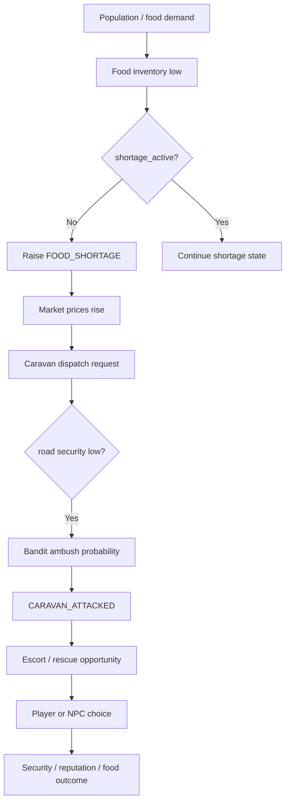

# 07. World Systems — Movement, Combat, Economy, Factions, Environment, Events (LLD)

[한국어](../07-world-systems.md) | **English**

## 1. Shared System execution rules

- World updates access only ECS Resources/Components allowed by `simulation-core`.
- Follow ordering/constraints in [03](03-core-tick.md). No direct SQL calls between systems.
- Commit `Transient` state at Tick completion; commit `Durable` state through `DurableIntent` and DB ACK.
- Validate content YAML/JSON with JSON Schema/type checks and pin versions before execution.

## 2. Movement and navigation

### Coordinate rules

- Integer world coordinates in `millitile` (`1 tile = 1000`); no Z axis.
- Tiles combine static terrain, dynamic blocking entities, and risk costs.
- Movement modes: `IDLE, PATH_REQUESTED, FOLLOWING, BLOCKED, ARRIVED, CANCELLED`.

### Movement Command handling

1. Check that the actor exists and can move (`STUNNED`, `DEAD`, etc.).
2. Validate the destination tile and reachability.
3. Run A* with bounded node expansions and Manhattan/Octile heuristics.
4. Handle distance, speed, collision, and any neighboring-cell reservations.
5. Emit `MOVE_ARRIVED` on arrival; persistent blocking produces `MOVE_BLOCKED` with repath/failure reasons.

### Tests

No wall traversal; consistent order when NPCs compete for one cell; no infinite repath loops; repeated auto-move requests do not execute duplicate paths.

## 3. Combat

| Field | Type/rule |
|---|---|
| `attack_range_millitile` | Integer; validate target distance |
| `cooldown_until_tick` | Next allowed attack Tick |
| `base_damage` | Integer fixed-point |
| `armor/mitigation` | Validated damage-reduction rules |
| `health` | 0..max; no underflow |
| `status` | ALIVE/DOWNED/DEAD |
| `loot_intent` | Requires DB finalization before granting actual items |

**Sequence:** `ATTACK command → ownership/range/cooldown → damage calculation → HP update → DIED event → durable loot/ownership intent → DB ACK → item added`.

Damage recovery guarantees depend on policy. In the MVP, player death/item acquisition are durable; ordinary movement and minor monster damage recover from checkpoints. Do not turn `DIED` into a final user-asset change before DB finalization.

## 4. Economy

### Minimal local economy data

- Settlement: `population`, `food_stock`, `food_capacity`, `security_index`, `treasury`.
- Producers: `production_rate`, `input_stock`, `season_modifier`.
- Consumers: population × daily consumption.
- Market: `base_price`, `stock`, `target_stock`, `min/max_price`, `version`.

### Example one-minute aggregation

```
production = active_farms * base_yield * weather_multiplier
consumption = population * food_consumption_per_step
new_stock  = clamp(old_stock + production - consumption, 0, capacity)
scarcity   = clamp((target_stock - new_stock) / target_stock, -1, 1)
price      = clamp(base_price * (1 + scarcity_factor * scarcity), min, max)
```

Use **integer or fixed-point** arithmetic in production with fixed division-rounding rules. Smooth/delay price changes with EMA or steps to prevent oscillation. Record conservation audits for currency totals and resource production/consumption.

### Failure and overload controls

- No negative stock. DB row versions/locks guarantee atomicity when two buyers request the same item.
- Use `shortage_active` plus cooldown to avoid repeatedly triggering the same event.
- Background Regions continue production/consumption while omitting per-Tick NPC-position calculations.

## 5. Factions and politics

- GlobalWorker is the sole writer of global faction influence, territory, alliances, hostility, and wars.
- Regions read versioned faction projections and propose `FactionActionCommand`.
- Example: more trade-route raids → guard request → reduced faction influence → suppression action.
- MVP: trust/hostility between two factions and local security only. Wars/territory conquest are P2.

## 6. Environment, weather, and time

- Manage `WorldClock` and Time Scale independently; initially `game_time_scale = 10`.
- Update regional WeatherState (`CLEAR/RAIN/STORM`) using seeded RNG and a game-time schedule.
- Environmental effects are Modifiers on movement cost, farm output, and NPC safety needs; never directly mutate other systems.

## 7. Emergent event example



Even probabilistic conditions log RNG stream/seed, application Tick, and rule_version. Do not emit false facts such as a successful invasion when damage, goods, or the economy did not actually change.

## 8. Background simulation

- `ACTIVE`: detailed individual movement, combat, vision, and dialogue.
- `BACKGROUND`: preserve important NPC assets/state individually; aggregate some ordinary-resident movement/production.
- Never **double-grant** aggregate production into Entity inventories at transitions. Resources whose `source_of_truth = SETTLEMENT_LEDGER` use that same ledger in both modes.
- Enter Background only with zero players, zero ongoing combats, zero pending durable operations, and an expired recent-activity grace period.

## 9. Module tests

| Test | Input | Result |
|---|---|---|
| TEST-MOV-001 | MOVE_TO through a closed wall | REJECTED / BLOCKED; coordinates unchanged |
| TEST-MOV-002 | Terrain blocks movement in progress | Defined repath/failure; Tick continues |
| TEST-CMB-001 | ATTACK outside range | Zero damage; REJECTED |
| TEST-CMB-002 | Death + reward DB failure | No currency/items granted |
| TEST-ECO-001 | Production < consumption for a day | Stock decreases; prices rise within caps |
| TEST-ECO-002 | Two concurrent purchases, stock of one | One successful Commit |
| TEST-FACTION-001 | Apply an old Global projection | Reject/ignore through version check |
| TEST-BG-001 | 100 mode transitions | Preserve stock and important NPC IDs |
