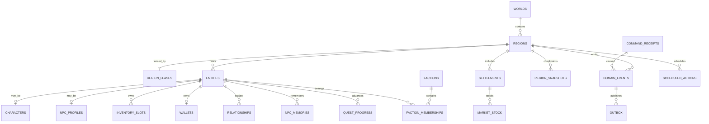

# 08. Persistent Data Model and ERD (LLD)

[한국어](../08-data-erd.md) | **English**

## 1. Data ownership

| Domain | Source of truth | Cache/projection | Recovery |
|---|---|---|---|
| Accounts/characters | PostgreSQL | Session/Game Entity | DB |
| Inventory/gold/transactions | PostgreSQL Commit | ECS committed projection | DB + durable event |
| Position/velocity/temporary AI state | Region ECS | Client delta | Latest valid checkpoint |
| Long-term NPC memory/relationships | PostgreSQL | NPC Component | DB + durable event |
| Factions/world time | GlobalWorker + durable log | Region read projection | DB/Global checkpoint |
| Causes of game events | domain_events | UI rumors/news | Event log |

## 2. Logical ERD



This ERD describes conceptual relationships. Physical keys/constraints follow [schemas/0001_initial.sql](../../schemas/0001_initial.sql); some optional PK/FK relationships may be represented differently there.

## 3. Main tables

| Table | PK/Unique | Key fields | Writer |
|---|---|---|---|
| `worlds` | id UUID | seed, game_time_ms, version | GlobalWorker |
| `regions` | id UUID | world_id, grid, event_seq | Region Registry/Writer |
| `region_leases` | region_id | owner_id, epoch, expires_at | Coordinator |
| `entities` | id UUID | region_id, kind, state_version, persistent_json | Region Writer |
| `characters` | entity_id | account_id, progress | Game Domain |
| `npc_profiles` | entity_id | personality, profession, home | NPC Domain |
| `wallets` | entity_id | gold, version | Economy Writer |
| `inventory_slots` | (owner_id,item_id) | quantity, version | Economy Writer |
| `relationships` | (source_id,target_id) | trust, affinity, fear | Social Writer |
| `npc_memories` | id UUID | source_event_id, data, expires_at | NPC Domain |
| `settlements` | id UUID | region_id, food_stock, security | Economy/World |
| `market_stock` | (settlement_id,sku) | quantity, price, version | Economy Writer |
| `factions` | id UUID | influence, policy, version | GlobalWorker |
| `command_receipts` | command_id UUID | payload_hash, result, status | DB Writer |
| `domain_events` | (region_id,seq) | event_id unique, event_type, payload | DB Writer |
| `outbox` | id UUID | event_id, published_at, retry_count | DB Writer/Publisher |
| `region_snapshots` | id UUID | region_id, tick, event_seq, data, checksum | Checkpointer |
| `scheduled_actions` | id UUID | due_tick, action_type, payload | Region Domain |

## 4. Data contracts

- IDs use DB `UUID` and Rust `uuid::Uuid`; never persist Bevy `Entity`.
- Gold/stock use nonnegative `BIGINT` integers with optimistic version CAS.
- Clearly distinguish integer score ranges for relationships, needs, and security: `-1000..1000` or `0..1000`.
- Event payloads use `JSONB`, with `schema_version` and `rule_version`.
- Snapshot payloads use `BYTEA` or object storage plus checksum; MVP uses PostgreSQL BYTEA.
- As long-term data grows, partition/archive by `(world_id, region_id, event_seq)`.

## 5. Atomic validation of a gold-balance transfer

```sql
-- Inside a transaction after BEGIN and Region lease/epoch validation
UPDATE wallets
   SET gold = gold - $2, version = version + 1
 WHERE entity_id = $1 AND gold >= $2 AND version = $3
RETURNING gold, version;
-- Zero returned rows mean insufficient funds or a version conflict.
```

Debit, credit, stock change, receipt, event, and outbox all belong in one transaction. Audit total gold transferred to prevent duplication/loss.

## 6. Data migration

1. Run `sqlx migrate run` in CI/staging first.
2. Provide `schema_version` and per-event upcasters.
3. Maintain compatibility between old Snapshots and new ECS code for at least one version, or provide snapshot migration.
4. Use Expand/Backfill/Contract for destructive changes.
5. Finalize retention/deletion policies separately after operational/legal review.

## 7. Tests

- TEST-DB-001: DB rejects FK/unique/check violations.
- TEST-DB-002: inventory quantities/gold cannot fall below zero.
- TEST-DB-003: block reinsertion of duplicate event_id/command_id.
- TEST-DB-004: validate Snapshot schema upgrades and detect checksum errors.
