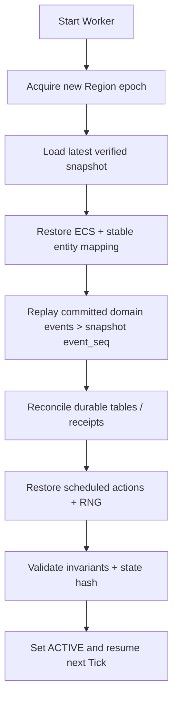

# 09. Persistence, Transactions, Snapshots, and Recovery (LLD)

[한국어](../09-persistence-recovery.md) | **English**

## 1. Explicit guarantees

| State | Guarantee | Basis |
|---|---|---|
| Assets/ownership/important quests/relationships | Target: **no loss after DB Commit** | Transaction + receipt + outbox |
| Position/movement paths/temporary combat | Restore to **latest valid snapshot** | Periodic checkpoint |
| Exact replay of every intermediate Tick | Not guaranteed in MVP | Not all inputs/state are durably logged |
| Outbox consumption | At-least-once + idempotent consumers | Relay may resend |

DB/disk-disaster guarantees depend on backup/PITR operations. “No loss after Commit” describes transaction atomicity within the single-DB failure scope, not an unconditional guarantee against destruction of an entire data center.

## 2. Durable Intent model

```rust
pub struct DurableIntent {
    pub command_id: uuid::Uuid,
    pub region_id: uuid::Uuid,
    pub ownership_epoch: i64,
    pub actor_id: uuid::Uuid,
    pub payload_hash: [u8; 32],
    pub expected_entity_versions: Vec<(uuid::Uuid, i64)>,
    pub operations: Vec<DurableOperation>,
    pub emitted_events: Vec<DurableDomainEvent>,
}
```

After validation, the Region reserves affected assets. The DB Writer executes the transaction below and ACKs `commit_result`. A pending map per actor/product prevents simultaneous double-use.

## 3. SQL transaction order

```text
BEGIN
 SELECT lease FOR UPDATE
 VERIFY owner/epoch/lease_not_expired
 INSERT command_receipts(command_id,payload_hash,status='PENDING') ON CONFLICT ...
    if exists: compare hash -> return previous result or reject
 SELECT wallet/inventory/market rows FOR UPDATE (stable order)
 VERIFY balances, stock, row versions
 UPDATE wallet/inventory/market
 ALLOCATE region_event_seq (under regions row lock)
 INSERT domain_events (...)
 INSERT outbox (...)
 UPDATE command_receipts SET status='SUCCEEDED', result_json=...
COMMIT
ACK(SUCCEEDED, committed_seq, updated_projections)
```

If a receipt is already `SUCCEEDED`, **return the existing result without re-executing the Command**. Complete PENDING and all related writes in one transaction to prevent partial records. ACK timeout is not failure: determine the outcome by receipt lookup.

## 4. SQLx transaction outline

```rust
async fn persist_intent(
    pool: &sqlx::PgPool,
    intent: DurableIntent,
) -> Result<PersistenceAck, PersistError> {
    let mut tx = pool.begin().await?;
    // 1. SELECT lease FOR UPDATE / verify epoch
    // 2. INSERT command receipt or select existing
    // 3. lock and update wallet, stock, inventory
    // 4. append event, outbox, receipt in same tx
    tx.commit().await?;
    // ACK can be lost; retry by command_id queries DB receipt.
    Ok(PersistenceAck::Committed { /* committed state */ })
}
```

This illustrates a contract/flow, not implemented domain SQL. Verify actual queries, DB versions, and exception-specific responses in integration tests.

## 5. Checkpoint and snapshot boundaries

**Problem:** including uncommitted DB state in a Snapshot can restore nonexistent items after restart.

Policy:

1. Temporarily **stop admission of new durable intents** when checkpointing starts.
2. Drain the separate priority ACK queue until all pending intents Commit/Reject. On timeout, fail the snapshot; continue Tick or safely Pause according to policy.
3. At a Tick boundary, serialize ECS state (Transient + latest committed Durable Projection), RNG state, timers, scheduled actions, and current Tick.
4. Include `last_committed_event_seq`, `ownership_epoch`, schema/engine/rules versions, and SHA-256 checksum.
5. Save to `region_snapshots`, then verify checksum/referential integrity.
6. Resume durable admission.

Long checkpoints affect players. After sufficient testing, consider copy-on-write snapshots or byte-copy strategies. **Full consistency takes priority** in the MVP; assume checkpoints every 5–10 minutes.

## 6. Recovery sequence



- Without a usable Snapshot, rebuild from initial Region configuration and the complete durable projection. Events alone do not guarantee reconstruction of all positions.
- Positions/paths/transient combat after the last checkpoint may be lost. Reconnecting clients receive a full snapshot including `world_revision`.
- **Final committed DB state wins** when latest durable data conflicts with the ECS projection.
- Missing upcasters for old durable events cause recovery failure/alerts; never silently ignore them.

## 7. Epoch/lease fencing

```sql
SELECT ownership_epoch, owner_id, lease_expires_at
  FROM region_leases
 WHERE region_id = $1
 FOR UPDATE;
-- Check expected_epoch/owner match and lease_expires_at > clock_timestamp()
```

- DB rejects every write attempted with a stale Worker Epoch.
- Evaluate leases using **DB time**, accounting for Coordinator failure and system-clock differences.
- Do not start new durable writes if lease renewal fails. Never trust the same Epoch indefinitely until DB connectivity returns.

## 8. Outbox delivery

1. Insert domain event + outbox within the DB transaction.
2. A separate Publisher claims unpublished rows with `FOR UPDATE SKIP LOCKED`.
3. Mark `published_at` after confirmed delivery to the external broker/service.
4. Consumers deduplicate by unique `event_id` because delivery may repeat.
5. Use retries/backoff/dead-letter handling for persistent failures. Preserve the rule that rolled-back domain transactions must not result in published events; publication starts from committed outbox rows.

## 9. Recovery/failure tests

| ID | Injection point | Expected result |
|---|---|---|
| TEST-PER-001 | Crash before BEGIN | No asset changes |
| TEST-PER-002 | Crash after asset UPDATE, before COMMIT | Complete rollback |
| TEST-PER-003 | Lose ACK after COMMIT | Receipt confirms one success |
| TEST-PER-004 | Crash while writing snapshot | Use latest valid snapshot |
| TEST-PER-005 | Crash during replay | Zero duplicate durable application after restart |
| TEST-PER-006 | DB UPDATE with stale epoch | Zero commits or explicit rejection |
| TEST-PER-007 | Outbox redelivery | Zero duplicate consumer effects |
