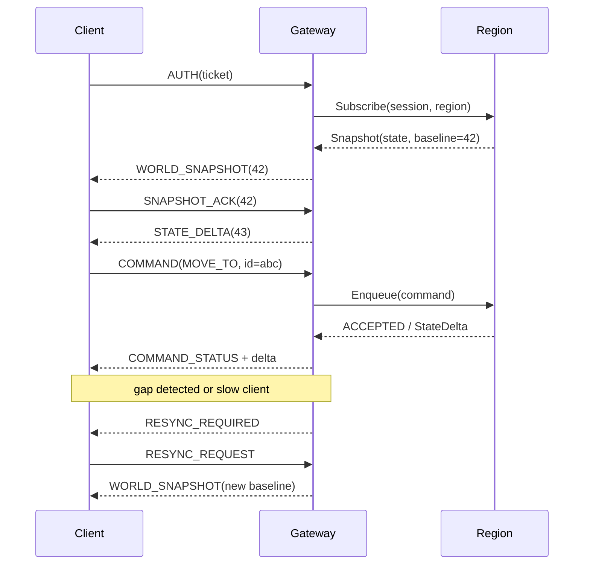

# 10. Multiplayer Synchronization and Network/AOI (LLD)

[한국어](../10-network-replication.md) | **English**

## 1. Transport principles

- Server authority: clients send intent Commands only; only the authoritative Region finalizes position/HP/items.
- Use `HTTPS + WSS`; Axum WebSocket Gateway manages connections on Tokio Runtime.
- Start with **versioned JSON**; consider Protobuf after bandwidth/CPU measurements.
- Do not propagate every movement Tick bit-for-bit; send Snapshot+Delta only to AOI subscribers.

## 2. Establishing a connection

1. Obtain an authenticated session through HTTPS login.
2. Request a single-use ticket from `POST /api/v1/ws-tickets`, with a short TTL (example: 30 seconds).
3. Connect to WSS `/ws` and send `AUTH {ticket}` **within 5 seconds**. Never process unauthenticated messages.
4. Gateway validates reuse/expiry and resolves actor_id, region_id, and session_id.
5. Receive an initial snapshot plus `baseline_id/world_revision` from the Region.
6. Client sends `SNAPSHOT_ACK`, then receives deltas.

By default, tickets must not appear in URL queries/logs. Obtain a new ticket on reconnect.

## 3. Area of Interest (AOI)

- Initial cells: 16×16 tiles. Subscribe to the surrounding 3×3 cells plus event/party/interaction targets.
- Worker produces `changed_entity_set`; Replicator selects interested entities per session.
- Cell transitions send `ENTITY_ENTER`/`ENTITY_LEAVE` and full attributes for newly visible entities.
- Do not propagate detailed changes for unobserved NPCs to uninterested subscribers.
- Regional public indicators such as security/food may reach outside AOI via news or separate subscriptions.

## 4. Snapshot/Delta contracts

| Message | When | Required data |
|---|---|---|
| `WORLD_SNAPSHOT` | Initial connect, reconnect, lost baseline | snapshot_id, world_revision, entities, region_tick |
| `STATE_DELTA` | State changes | baseline_id, delta_seq, region_tick, changed, removed |
| `COMMAND_STATUS` | Receipt/rejection/finalization | command_id, status, reason, committed_event_seq |
| `ENTITY_ENTER/LEAVE` | AOI changes | entity_id, state/remove |
| `RESYNC_REQUIRED` | Sequence gaps/slow clients | reason, current_revision |

`world_revision` is a per-Region state version, distinct from durable `region_event_seq`. Transient state_delta also advances revision.

## 5. Message sequence

## 6. Latency, loss, and ordering

- WebSocket ordering alone cannot recover reconnect-time message loss. Use `baseline_id`, `delta_seq`, and `region_tick`.
- On a Delta gap, retransmit from retained buffers when possible; otherwise send a full snapshot.
- Send `COMMAND_STATUS.SUCCEEDED` for durable changes only after DB ACK.
- If bandwidth is excessive, batch position Deltas at 5–10Hz independently of server Tick frequency. Use client interpolation.
- Predicted client movement is an optional P2 feature; initially interpolate authoritative coordinates smoothly.

## 7. Backpressure and security

- Bound per-session outgoing queues; coalesce position deltas to latest values and reset snapshots.
- Disconnect persistently slow connections with `SLOW_CONSUMER` and prompt reconnect.
- Apply Session/Actor/IP rate limits, accounting for shared NAT; finalize limits after load testing.
- Revalidate authority, visibility, and range even when a client sends another Actor ID or an unseen target ID.
- Limit JSON schema, payload size/depth, and reject malicious oversized messages.

## 8. Tests

- TEST-NET-001: two clients observe the same latest NPC coordinates.
- TEST-NET-002: resync after one missing Delta restores agreement.
- TEST-NET-003: no duplicate durable Command execution with 500ms delay/reconnect.
- TEST-NET-004: reject forged Actor IDs.
- TEST-NET-005: do not send out-of-AOI NPC changes to uninterested sessions.
- TEST-NET-006: slow clients do not delay Region ticks.
