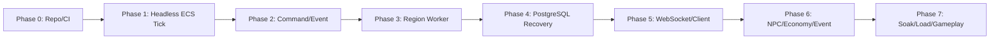

# 13. Implementation Backlog and Work Instructions

[한국어](../13-implementation-backlog.md) | **English**

> Each task includes goals, dependencies, concrete deliverables, and acceptance tests so different contributors can start independently. No duration estimates are provided; plan according to team capability/environment.

## 1. Phase gates



## 2. Tasks

### TASK-001 — Create Rust Workspace/CI

- **Dependencies:** none.
- **Work:** create `apps/game-server`, `apps/simulation-runner`, and `crates/{simulation-core,ecs-components,simulation-systems,game-domain,persistence,networking,shared-protocol}`. Pin Rust edition/version, Cargo.lock, lint/unit-test CI, and basic tracing.
- **Deliverables:** buildable Workspace; `cargo fmt`, `cargo clippy`, `cargo test` workflows.
- **DoD:** empty server/Runner start, CI blocks failures, README explains execution.

### TASK-002 — Entity/Region State and IDs

- **Dependencies:** TASK-001.
- **Work:** per-Region Bevy World; StableId(UUID) ↔ Bevy Entity index; Position/Velocity/Health/Needs; create/delete/query; typed Component registry.
- **DoD:** consistent indexes after creating/deleting 10,000 entities, reload persistent IDs, basic TEST-REGION coverage.

### TASK-003 — Fixed Tick Scheduler/Determinism

- **Dependencies:** TASK-002.
- **Work:** TickContext, SimulationPhase/ordered schedule, separate game/real time, seed/RNG, headless `--ticks --seed`, stable ordering.
- **DoD:** matching hashes over repeated 10,000-Tick replay; TEST-TICK-001~005.

### TASK-004 — Command and Event Contracts

- **Dependencies:** TASK-003.
- **Work:** Envelope/validator/assigned_tick/ingress_seq, Event type/correlation, deduplication, event budgets, error mapping.
- **DoD:** duplicate transient commands execute once in one Region; reproducible order; block Rule cycles.

### TASK-005 — Minimal Movement and Combat

- **Dependencies:** TASK-004.
- **Work:** integer millitile movement, A* budget, collision, health/damage/death/cooldown, no-path diagnostics.
- **DoD:** auto-move/walls/blocking/combat work; TEST-MOV/CMB.

### TASK-006 — Tokio Region Worker/Coordinator

- **Dependencies:** TASK-004.
- **Work:** dedicated threads, bounded channels, lifecycle, Router, Epoch validation hook, Tick lag detection, shutdown drain.
- **DoD:** two independent Regions, no unbounded memory growth under backpressure, tested shutdown/restart.

### TASK-007 — DB Migration and Durable Transactions

- **Dependencies:** TASK-004, TASK-006.
- **Work:** apply `schemas/0001_initial.sql`; SQLx writer; wallet/stock/receipt/event/outbox in one transaction; lease fencing; ACK receipt lookup.
- **DoD:** five DB failpoints; one charge for 100 purchase retries; TEST-PER-001~003/006.

### TASK-008 — Snapshot/Recovery

- **Dependencies:** TASK-007.
- **Work:** snapshot DTO/version/checksum, no-pending barrier, ECS restore, committed replay/reconcile, crash recovery, scheduled actions + RNG.
- **DoD:** recover from termination/corruption during snapshot; data integrity/checksum verified; TEST-PER-004/005.

### TASK-009 — Axum WebSocket and AOI

- **Dependencies:** TASK-006, TASK-007.
- **Work:** ticket AUTH, protocol v1, AOI, snapshot+delta+seq, client reconnect/resync, rate limiting.
- **DoD:** two-client sync, Delta-gap recovery, forged-actor rejection; all TEST-NET cases.

### TASK-010 — NPC Utility AI/GOAP

- **Dependencies:** TASK-002, TASK-003, TASK-005.
- **Work:** Perception, Needs, score curves, GOAP actions/planner, fallback, memory/relationships, budgets, next-Tick actions.
- **DoD:** 10 NPCs live independently and flee threats; staggered decisions for 1k NPCs; TEST-AI.

### TASK-011 — Economy/Factions/Event Rules

- **Dependencies:** TASK-007, TASK-010.
- **Work:** settlement food ledger, market supply/demand, reputation, dynamic rule DSL/AST, shortage→caravan→ambush chain.
- **DoD:** events occur without input; no negative food stock/duplicate rules; TEST-ECO/EVENT.

### TASK-012 — Client Vertical Slice/Prologue

- **Dependencies:** TASK-005, TASK-009, TASK-010.
- **Work:** Vue 3/Phaser tile rendering, WebSocket, NPC interaction, quest guidance, private prologue→shared migration, UI state mapping.
- **DoD:** complete a representative 15-minute experience; auto-move/buttons work; hide prologue button after shared-world entry.

### TASK-013 — Observability/Soak/Fault Injection

- **Dependencies:** TASK-007, TASK-009, TASK-011.
- **Work:** metrics/tracing/dashboard, golden replay, load generator, fault injection, profiling report.
- **DoD:** P0 PASS; share measured p95/p99; attach recovery/deduplication evidence.

### TASK-014 — Operations Safety/Deployment

- **Dependencies:** TASK-008, TASK-009, TASK-013.
- **Work:** TLS/WSS, secrets, backup/PITR restore drill, RBAC, health probes, graceful shutdown, version compatibility.
- **DoD:** reproducible operations Runbook and passing recovery drill; zero exposed service keys.

## 3. Pull request template

```markdown
## TASK ID / Requirements
TASK-___ / REQ-___
## Changes
- [ ] Scope and non-scope
- [ ] Design/ADR changes
- [ ] DB/API schema compatibility
## Test evidence
- [ ] cargo fmt --check
- [ ] cargo clippy -- -D warnings
- [ ] cargo test
- [ ] Applicable deterministic/integration/failpoint tests
## Operational impact
Rollback / Data migration / Metrics
## Open items
Owner / Next-task links
```

## 4. First-release checklist

- [ ] Identical headless replay results with fixed WorldSeed.
- [ ] Complete NPC/player/movement/combat and one dynamic event flow.
- [ ] Two clients synchronize positions/NPC state.
- [ ] Zero duplicate purchases after DB Commit/ACK loss.
- [ ] Assets/long-term memories survive restart; transient coordinates follow recovery policy.
- [ ] Rule trace/fallback work when events stall.
- [ ] Measure and document Region Tick/queue/DB/AI metrics.
